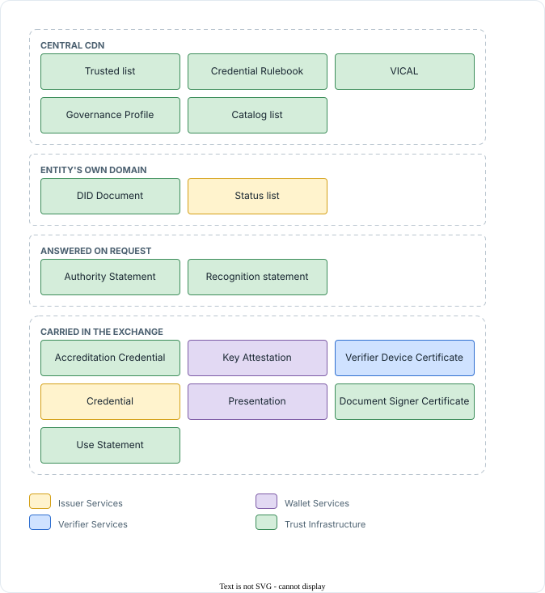

<!-- Sumber: Arsitektur Ekosistem Identitas Digital v0.2, §4.6, §5.7 (Kep. 9, 28, 30); Rincian Module dan Operasi, siklus scope verifier; tracks/0169 (fallback log DID ke DID Service, tidak ada di sumber) -->

# Artifacts exchanged {#artifacts-exchanged}

An artifact is something one party produces and another relies on: a signed
list, a certificate, a credential, an answer to a query. Thirteen of them exist
in the ecosystem and there are no others.

[The table of artifacts][tbl-artifacts] names each one and says what it is. The section it points to answers
it in full, opening with who publishes it, what reads it, where it lives and how
long a copy stays good. Where an artifact lives is what decides most about it,
because one published to a single national address fails differently from one
each entity serves itself, and differently again from one that is never
published anywhere.

{ #tbl-artifacts }

<figure markdown="1" class="ekdn-table">

| Artifact | Description | Details |
|---|---|---|
| Trusted list | The roll of accredited entities, naming each one along with the certificate authorities it issues from. A party absent from it is rejected however well everything else about it checks out. | [See Details][trusted-list] |
| Credential Rulebook | The rules for one credential type: its schema, its attributes, and the assurance each side has to meet. A version is frozen when it is published, so two parties holding the same version hold the same rules. | [See Details][credential-rulebook] |
| VICAL | The signed list of certificate roots allowed to sign an mdoc. It is what lets an offline verifier accept a credential from an issuer it has never met. | [See Details][vical] |
| DID Document | An entity's public keys and the methods for verifying against them. It proves a signature belongs to the entity that claims it, and answers nothing else. | [See Details][did-document] |
| Status list | Which of one issuer's credentials have been revoked. Each issuer publishes its own, so revocation data never accumulates in a single national service. | [See Details][status-list] |
| Authority Statement | One permission granted to one entity, an `action` on a `resource`. It is asked for over TRQP rather than published, and an entity holding several roles has several statements. | [See Details][authority-statement] |
| Use Statement | One registered use of one Relying Party: the purpose shown to the citizen, its legal basis, and the attributes that use may reach. The verifier carries it in its own request, so a wallet reads an approved purpose without asking anyone. | [See Details][use-statement] |
| Accreditation Credential | An entity's own proof that it was accredited, carried by that entity. It is evidence about itself, and everyone else checks the trusted list instead. | [See Details][accreditation-credential] |
| Key Attestation | Proof that a wallet installation's keys sit in storage the device platform vouches for. An issuer demands one before issuing any credential, and the Rulebook sets the storage it must report. | [See Details][key-attestation] |
| Verifier Device Certificate | The certificate standing behind one reading device, carrying the attributes that device may ask for. It is what lets a wallet trust a merchant that appears in no trusted list, and it vouches for a Relying Party's own counter device the same way. | [See Details][verifier-device-certificate] |
| Credential | The signed claims about a citizen that an issuer built from its own records. It lives on the citizen's device and in no register, so a verifier checks a signature rather than a lookup. | [See Details][credential] |
| Presentation | The attributes a citizen chose to disclose in one exchange, bound to the request that asked for them. It is good for a single use and kept by nobody. | [See Details][presentation] |
| Document Signer Certificate, Verifier Issuing CA, CRL | The X.509 certificates that chain an issuer's signature to the Issuer Root CA and a merchant's device to the Verifier Root CA, and the list that withdraws either one early. | [See Details][document-signer-certificate-verifier-issuing-ca-and-crl] |

</figure>

Trust SDK is named under Read by in two of the artifact sections, and it is not a
Module. It is a library embedded inside four of them, and what it holds is in
[Trust SDK][sa-trust-sdk].
Which identifier appears inside which artifact is in
[Identifier](identifier.md), and the message each protocol wraps them
in is in [Protocols per interaction][protocols-per-interaction].

The four groups that follow take the thirteen one at a time, grouped by where each
one lives. There are four places: fetched from Trust Infrastructure, fetched from the
entity, asked for and answered, or never fetched at all. Where an artifact
lives is what decides how it behaves when something is unreachable. Which of
them cross between the two planes,
and what each does for that crossing, is a different question, answered in
[what connects the two planes][what-connects-the-two-planes].

{ #fig-where-artifacts-live }

<figure markdown="1">
  { loading=lazy }
  <figcaption> The four places an artifact can live.</figcaption>
</figure>

## Published to the central CDN {#published-to-the-central-cdn}

Three artifacts are published once for everyone. Trust Registry publishes all
three and puts them behind a content delivery network (CDN), and every Module
that needs one keeps its own copy. None of the three carries citizen data, and
a static file behind a CDN fails more gracefully than an
interface does.

### Trusted list {#trusted-list}

- **Published by** Trust Registry, as a List of Trusted Entities (LoTE) JSON document signed with a [JSON
  Web Signature (JWS)][encoding-and-signing].
- **Read by** Issuer Core, Verifier Core, Mobile Wallet and Mobile Verifier,
  each from its own cached copy.
- **Where it lives** on the central CDN, as a static file anyone may fetch.
- **Lifetime** until the `NextUpdate` it carries, then discarded with no grace
  period, as ETSI TS 119 602 requires. How that date is chosen is in
  [Trusted list and cache][trusted-list-and-cache].

The trusted list is the roll of accredited entities, naming each one along with
the legal body behind it and the intermediary certificate authorities (CA) they
issue from, so an RP Intermediary's Verifier Issuing CA appears beside the
entity itself.

It answers one question: whether a party is accredited. Which key that party
signs with, and what it may do, are answered elsewhere, as
[three questions, three answers][three-questions-three-answers] sets out. The
key still comes from the DID Document or the certificate. The entry only names
any of the party's keys revoked early, with the time from which each is
revoked, so that a verifier can refuse a signature made with one.

The ecosystem publishes the LoTE JSON encoding only, and no XML trust-service
status list.

### Credential Rulebook {#credential-rulebook}

- **Published by** Trust Registry, from a Rulebook that a Credential Rulebook
  Provider proposed and the Root Authority approved.
- **Read by** Issuer Core to know what to build, Verifier Core to know what to
  expect and which attributes it may ask for at all, and Issuer Console to
  configure a credential type in the first place.
- **Where it lives** on the central CDN.
- **Lifetime** frozen the moment a version is published. A change becomes a new
  version rather than an edit.

A Credential Rulebook holds the rules for one credential type: its schema, its
attributes, the minimization class of each attribute, the display metadata, the
assurance demanded of the credential key, and the assurance demanded of the issuer's
signing key.

Freezing a version is what lets a cache be trusted. A participant holding version 2
never has to wonder whether version 2 changed underneath it. Where the Rulebook
sits among the three levels of rules is in
[The Credential Rulebook][the-credential-rulebook].

### VICAL {#vical}

- **Published by** Trust Registry, as a `COSE_Sign1` structure defined in
  [ISO/IEC 18013-5 Annex C][trust-lists-and-credential-status].
- **Read by** any mdoc verifier, including one operated in another country.
- **Where it lives** on the central CDN.
- **Lifetime** one registration period at a time.

Verified Issuer Certificate Authority List (VICAL) is the signed list of
certificate roots that sign mdoc credentials, and it exists for the verifier that
has no network. An offline verifier holding a cached VICAL can accept an mdoc from an
issuer it has never met, because the issuer's root is in the list and the list
is signed.

It is also the one artifact here written for verifiers outside the ecosystem as
well as inside it, which is how a verifier in another country can check an
Indonesian mdoc.

## Hosted by the entity that owns it {#hosted-by-the-entity-that-owns-it}

Two artifacts are never published centrally. Each is served by the entity it
describes, so neither depends on Trust Infrastructure being reachable.

### DID Document {#did-document}

- **Published by** the entity, which signs each `did.jsonl` entry with its own
  update key and serves the file. Decentralized Identifier (DID) Service adds a witness proof to every new
  entry, and a resolver rejects an entry without one.
- **Read by** Issuer Core, Verifier Core, Mobile Wallet and Mobile Verifier,
  through the Trust SDK embedded in each.
- **Where it lives** at the entity's own domain rather than the central CDN,
  because [`did:webvh`][identifiers-and-keys] derives the address from the
  DID itself. DID Service keeps the copy it witnessed as a fallback.
- **Lifetime** versioned, with a history a resolver can follow through a key
  rotation.

A DID Document holds an entity's public keys and verification methods, and it is
what proves a signature belongs to the entity that claims it.

DID Service witnesses and does not publish. `did:webvh:<scid>:kampus.ac.id`
resolves at that university's own domain. Only when
[the scheduled sync][trust-cache-sync] cannot reach that
domain does it read DID Service's copy of the log instead, and it checks that
copy's signatures exactly as it would the original. A merchant has none,
because it is never accredited and borrows its cryptographic identity from
the device certificate its intermediary issues. How the identifiers are formed
is in [Identifier](identifier.md), and the two routes a verifier can
take to an anchor are in
[Two trust anchor paths][two-trust-anchor-paths].

### Status list {#status-list}

- **Published by** Issuer Core, one list per issuer.
- **Read by** Verifier Core and Mobile Verifier.
- **Where it lives** at the issuer's own domain.
- **Lifetime** a time to live set by how much risk a stale answer carries.

A status list says which of an issuer's credentials have been revoked. The
encoding follows [IETF Token Status List][trust-lists-and-credential-status] for SD-JWT-based Verifiable Credentials (SD-JWT VC) and mdoc, and
[W3C Bitstring Status List][trust-lists-and-credential-status] for `ldp_vc`. Only issuers have one, since only they
issue credentials that can be revoked.

Publishing it per issuer rather than centrally buys three things at once.
Revocation data scales with the number of issuers instead of accumulating
nationally. It survives an outage of Trust Infrastructure, because it never lived there.
And it keeps a count off Trust Infrastructure, since a national revocation service would
know how many credentials are in circulation.

It is also the only thing an issuer ever gives a verifier. The two never speak,
and a static file is all that passes between them.

## Answered rather than published {#answered-rather-than-published}

One artifact is no file at all. It is not published like the five above it and
not carried like the seven below it. It is asked for, one question at a time, and
answered.

### Authority Statement {#authority-statement}

- **Published by** Trust Authority, which writes one each time the Root
  Authority grants a role.
- **Read by** any participant, through a [Trust Registry Query Protocol
  (TRQP)][exchange-protocols] query that Trust Registry
  answers.
- **Where it lives** as a row in the registry's own database. It is never a file
  and nobody hosts it.
- **Lifetime** until it is withdrawn. An answer is cached like everything else.

An Authority Statement records a single permission granted to a single entity:
an `action` on a `resource`. Because each statement covers one permission, an
entity holding several roles receives several statements rather than one
combined record.

Caching the answer is what lets a verifier still check a permission while the
registry is unreachable. What a statement covers, and how one is granted, is in
[Authorization][authorization].

## Carried in the exchange itself {#carried-in-the-exchange-itself}

The remaining seven reach the party that needs them inside the exchange, rather
than being fetched from an address beforehand. Nobody publishes them to a place
a participant goes looking, so there is nothing about them that can be unreachable.
The one thing published about any of them is the status list that revokes a Use
Statement, and a wallet reads that from cache like every other list.

Three of the seven have three parties rather than two, and that is the easy
thing to misread. A Key Attestation is carried by Mobile Wallet and read by
Issuer Core; a Verifier Device Certificate is carried by Mobile Verifier and
read by Mobile Wallet; a Use Statement is carried by whichever verifier the
request comes from and read by Mobile Wallet. In each case the artifact travels
to the party being vouched for and is read by the party on the other side of the
transaction, so for those three the Module that carries the artifact is
deliberately not the Module that reads it. The mechanism is in
[the operations group][the-operations-group].

### Use Statement {#use-statement}

- **Published by** Trust Authority, as a JSON Web Token (JWT) of type
  `use-statement+jwt`, when the Root Authority approves one use.
- **Read by** Mobile Wallet, before it shows the consent screen, and by Verifier
  Console, which validates each request template against the use it names.
- **Where it lives** with the verifier, which attaches it to its own request: in
  the OpenID for Verifiable Presentations (OpenID4VP) `verifier_info` parameter online, and in the `requestInfo` map of
  the ISO/IEC 18013-5 `ItemsRequest` offline, under the key `idUseStatement`, as
  the same JWT wrapped in a byte string. Only the status list that revokes it
  sits on the central CDN.
- **Lifetime** until its `exp`, or until the Root Authority withdraws it and
  the status list Trust Registry publishes flips its bit.

A Use Statement records one registered use of one Relying Party: a `use_id`, the
purpose the citizen is shown, the legal basis behind it, and the list of
attributes that use may reach. That list is always a subset of what the entity's
[Authority Statement][authority-statement] allows, so the two together give a
ceiling per entity and a narrower limit per use. How a use is granted is in
[Registered use][registered-use].

The wallet does five things with it, all from its own cache and without a call to
Trust Infrastructure: it checks the signature against Trust Authority's key, confirms the
`sub` names the same party as the `client_id` (for a merchant or offline verifier
presenting a certificate chain, the entity holding the Verifier Issuing CA in `x5c` or
`x5chain`, which for an accredited Relying Party is its own DID and for a
merchant is its intermediary), confirms it has not expired or been revoked,
confirms the attributes requested are a subset of the ones the statement lists,
and takes the purpose it displays from the statement rather than from the request.
Matching is attribute by attribute rather than by a hash over the whole query, so
a Relying Party can reword a request without invalidating its registration.

Carrying it rather than fetching it is what keeps Trust Infrastructure out of the
transaction. A wallet that had to resolve a registration at request time would
tell Trust Authority which citizen was dealing with which Relying Party every time
somebody presented a credential.

Proximity leaves no gap, because it carries the same statement: ReaderAuth
signs it along with the rest of the `ItemsRequest`, binding it to the session, and
the wallet runs the same checks against it that it runs online. Only a wallet
outside IDCTF that ignores `requestInfo` falls back to the `ReaderAuthRole` in the
certificate alone, which is why that limit is a second bound alongside the Use
Statement offline rather than a substitute for it: every device carries a
certificate there, where only a merchant carries one online. What stays
deliberate is the transition: a request that carries none at all is still served,
with the wallet warning the citizen that the request is not registered, until the
cut-off the Governance Profile sets.

### Accreditation Credential {#accreditation-credential}

- **Published by** Trust Authority, as an [SD-JWT VC][credential-formats-and-their-signatures], when an accreditation is
  granted.
- **Read by** the entity it was issued to, and by nobody else.
- **Where it lives** with that entity, carried rather than published.
- **Lifetime** the accreditation period.

An Accreditation Credential is evidence the entity holds about itself rather
than something others rely on, and that is why the only consumer recorded for it
is the entity it was issued to.

For everyone else the source of truth stays the trusted list, so a party absent
from that list is rejected however valid the Accreditation Credential it
presents.

### Key Attestation {#key-attestation}

- **Published by** Wallet Backend Service, as a JWT of type
  `keyattestation+jwt`, to each wallet installation.
- **Read by** Issuer Core, before it issues any credential.
- **Where it lives** with the Mobile Wallet installation it was issued to.
- **Lifetime** one day.

A Key Attestation states that the keys it covers sit in storage the device
platform vouches for, and it carries the resistance values the Governance
Profile maps assurance onto. A Rulebook that asks only for `low` lowers the
storage it accepts, not the need for the attestation.

The daily cadence is itself the revocation mechanism, and it reaches issuance
alone. An installation that stops being reissued can obtain no further
credential once its current attestation expires, with no revocation list to
distribute and no message that has to arrive. The credentials it already holds
go on being presented: no verifier reads a Key Attestation, so reaching those is
the issuer's job, through the status list its own revocation sets.

### Verifier Device Certificate {#verifier-device-certificate}

- **Published by** the Verifier Core that answers for the device, as an
  [X.509][certificates-and-revocation] certificate bound to
  one device and issued from that Verifier Core's own Verifier Issuing CA: an
  RP Intermediary's for a merchant's device, a Relying Party's own for its
  counter device.
- **Read by** Mobile Wallet, before it releases an attribute to that device.
- **Where it lives** on that device: with Mobile Verifier, or a
  Relying Party's own application built on the Reader SDK.
- **Lifetime** set by the Governance Profile, and withdrawn early through a
  certificate revocation list (CRL).

A Verifier Device Certificate carries the `ReaderAuthRole` that bounds which
attributes the party behind the device may ask for, which is how a limit
written into a certificate becomes provable rather than merely configured.

Before releasing an attribute, the wallet validates the chain up to the Verifier
Root CA, confirms the Verifier Issuing CA is on the trusted list, and rejects any
attribute outside the role in the certificate. Because the certificate lives
longer than a day it is withdrawn the ordinary X.509 way: the issuing entity publishes
a CRL and the wallet checks its cached copy. The arrangement is set out in
[RP Intermediary and merchant](../roles/rp-intermediary-and-merchant.md).

### Credential {#credential}

- **Published by** Issuer Core, signed as a JWS or as [CBOR Object Signing and
  Encryption (COSE)][encoding-and-signing] depending on the
  format.
- **Read by** Verifier Core and Mobile Verifier.
- **Where it lives** on the citizen's device, and in no register anywhere.
- **Lifetime** until its `exp` passes or its issuer revokes it.

A credential is the thing the whole ecosystem exists to move: a set of claims
about a citizen, signed by the issuer that holds the records behind them. The
three formats are in
[three credential formats][three-credential-formats].

There is no directory of holders and no record that a given person holds a given
credential, so what a verifier checks is a signature rather than a lookup, and
revocation is read from that issuer's status list rather than from Trust Infrastructure.

### Presentation {#presentation}

- **Published by** Mobile Wallet, built from a credential when somebody asks.
- **Read by** Verifier Core or Mobile Verifier, once.
- **Where it lives** nowhere. A verifier keeps a digest for its archive and not
  the attributes themselves.
- **Lifetime** one use, bound to one session.

A presentation carries the attributes the citizen agreed to disclose, bound to
the request through the credential key the wallet controls.

Binding it to one session is what stops a captured presentation being replayed
somewhere else.

### Document Signer Certificate, Verifier Issuing CA, and CRL {#document-signer-certificate-verifier-issuing-ca-and-crl}

- **Published by** Trust Authority, which issues all three.
- **Read by** Issuer Core, Verifier Core, Mobile Wallet and Mobile Verifier,
  through the Trust SDK.
- **Where it lives** with the entity's Key Manager and inside the `x5chain` of a
  message. The Verifier Issuing CA also appears in the trusted list.
- **Lifetime** 457 days for a signer certificate for a Mobile Driving License
  (mDL), 3650 days
  otherwise.

These three are the X.509 plumbing that holds the certificate chains together. A
Document Signer Certificate is what an issuer signs mdoc credentials with, and it
chains to the Issuer Root CA. A Verifier Issuing CA is the intermediate an RP
Intermediary signs merchant device certificates with, and it chains to the
Verifier Root CA. A CRL withdraws either one early.

That CRL is the Trust Authority's and covers only the certificates it issues. A
[Verifier Device Certificate][verifier-device-certificate] is withdrawn through
a separate CRL, published by the Verifier Core whose Verifier Issuing CA issued
it.

The Verifier Issuing CA appearing in the trusted list is how a wallet can tell a
genuine intermediary from an invented one. The two roots never sign each other,
and both chains are set out in
[Two trust anchor paths][two-trust-anchor-paths].
