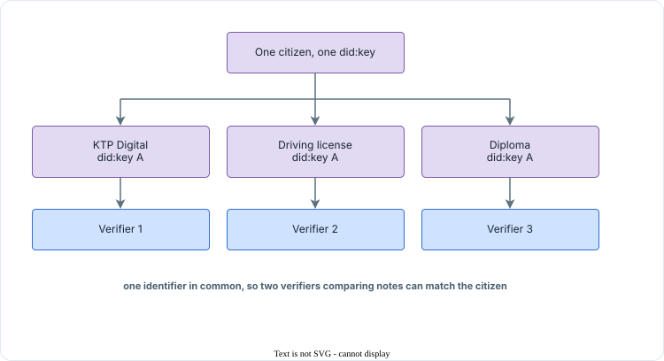

<!-- Sumber: Arsitektur Ekosistem Identitas Digital v0.2, §4.2, §4.3 (Kep. 4, 5, 14, 30), §9.2; Rincian Module dan Operasi, DID Service, siklus scope verifier; Bentuk Data Attestation, §3 -->

# Identifier {#identifier}

Six different things in the ecosystem carry an identifier: an entity, a
holder, a credential type, an attribute inside that type, a registered use, and
a device. Each gets a different shape, because each is asked to do a different
job. An entity's identifier has to resolve to a full history of keys. A holder's
identifier has to bind every credential to the phone that holds it. A
credential type's identifier has to stay fixed for one version and change only
by becoming a new one. A device's identifier has to name one wallet installation or one verifier device
without ever exposing the key that installation holds.

<figure markdown="1" class="ekdn-table">

| Object | Identifier | Why this shape |
|---|---|---|
| Entity (issuer, Relying Party, Wallet Provider) | [did:webvh][ref-did-webvh] | An append-only `did.jsonl` log with pre-rotation, so a resolver can walk a key through its full history |
| Holder | One [did:key][ref-did-key] per wallet installation, shared by every credential | The simplest binding to build and to recover from |
| Credential type | `id.idctf.<type>.<N>`, or `<reverse-domain>.<type>.<N>` for a private party | A name that stays fixed for one version, and changes only by becoming a new version |
| Attribute in scope | `<type>#<attribute>`, for example `id.idctf.ktp.1#usia_di_atas_17` | Names one attribute wherever a rule needs to point at it without pointing at the whole credential |
| Registered use of a Relying Party | `use_id`, set by Trust Authority when the use is approved, unique within one entity | Lets a request template and a verification record name the approved use they were run under |
| Wallet or Mobile Verifier installation | JWK thumbprint of the device key ([RFC 7638][ref-rfc7638]) | Identifies the device without transmitting the key it names |

</figure>

## Entities: did:webvh {#entities-didwebvh}

Every issuer, Relying Party, and Wallet Provider identifies itself with did:webvh v1.0.
Its address is not looked up in a directory: `did:webvh:<scid>:<domain>`
resolves at the entity's own domain, backed by a signed, append-only log
called `did.jsonl`. The self-certifying identifier inside the address is
derived from that log's own first entry, so the identifier and the log
backing it cannot be pulled apart. What the log holds and how a verifier
reads it is in
[Decentralized Identifier (DID) Document][did-document] and
[the update key][the-update-key].

The log being append-only, with pre-rotation, is what carries the identifier
through a key rotation. An entity that rotates its signing key still needs
every past signature to verify against whichever key was active when that
signature was made, so a resolver has to walk the entity's full key history
rather than trust only the current key. Pre-rotation lets the entity commit to
its next key before that key is ever used, so a thief who steals the current
key cannot also claim the one coming after it.

The identifier proves only that a signature belongs to the entity claiming
it. Whether that entity is allowed to issue or verify at all is a separate
question, answered by the trusted list and by the Authority Statement it can
be asked for, not by did:webvh itself.

## Holder: one did:key per wallet installation {#holder-one-didkey-per-wallet-installation}

did:key v0.9 needs nothing did:webvh needs. It is derived entirely from a public
key, so there is no log to sign, no domain to host it on, and no resolver
call beyond decoding the identifier itself. The wallet generates one key pair
in the secure element at the citizen's first login to the wallet, and the
identifier falls out of it for free.

That one key serves every credential on the installation, and it is not created
again per issuance. It has a known cost, which IDCTF accepts. A holder who
presents the same identifier to a grocery store and to a bank can be matched by
the two of them comparing notes, even without either one reading a single
disclosed attribute.

{ #fig-holder-identifier }

<figure markdown="1">
  { loading=lazy }
  <figcaption> One citizen, three credentials, one holder identifier.</figcaption>
</figure>

- **Every credential** is bound to the same credential key, so the wallet holds
  one holder identifier however many credentials it holds.
- **Each verifier** sees that identifier.
- **Comparing notes** lets two verifiers match the holder, which is the exposure
  IDCTF accepts.

The rest of the ecosystem calls this key the credential key, and
[the credential key][the-credential-key] says what it signs and how it is
protected. Each credential format asserts the same holder binding differently.

- [SD-JWT-based Verifiable Credentials (SD-JWT VC)][ref-i-d-ietf-oauth-sd-jwt-vc]
  draft -13 carries the key as a JSON Web Key (JWK) in the `cnf` claim, under
  `jwk`.
- [ISO mdoc][ref-iso-18013-5] (ISO/IEC 18013-5:2021) carries the same key as the
  `DeviceKey` field inside the Mobile Security Object (MSO), a name that belongs
  to the mdoc specification's own vocabulary rather than to the physical device.
- [W3C Verifiable Credentials Data Model (VCDM) 2.0][ref-vc-data-2-0] (`ldp_vc`)
  names the holder by the did:key itself, in `credentialSubject.id`, and proves
  possession with a [Data Integrity][ref-vc-data-integrity] 1.0 proof at the
  presentation level, signed over a `challenge` and a `domain` the verifier
  supplies.

Because the credential key is shared across formats as well, a
credential type that ships as both SD-JWT VC and ISO mdoc, per
[one credential, two representations][one-credential-two-representations],
binds both representations to the same credential key. The wallet does not mint a
second identifier just because a Credential Rulebook demands a second format.

## Credential types and attributes {#credential-types-and-attributes}

A credential type is named `id.idctf.<type>.<N>`. The type is lowercase and
the version is a bare integer, so the national ID digital credential is
`id.idctf.ktp.1` and never `id.idctf.KTPDigital.v1`. For a type the ecosystem
names, one identifier serves all three places a type is named: the `vct` of an SD-JWT VC, the `docType` of an
mdoc, and the mdoc namespace its attributes sit in. The two representations of
one credential therefore carry the same name, which keeps them identifiable
as the same type; what makes them one credential is the claim
values and the status entry they share, per
[one credential, two representations][one-credential-two-representations].

`id.idctf` is the ecosystem's own root and Trust Authority holds it, so a
credential type name cannot come from whoever happens to write a
Credential Rulebook. It says nothing about who issues: an Attribute Issuer may
be a university, a hospital, or a bank, and which institution issued a given
credential is carried in the issuer's DID, never in the type.

A type another body already owns is the exception. The credential keeps that
body's names, so software built to its standard reads it unchanged: a mobile
driving license carries the `docType` `org.iso.18013.5.1.mDL` and the
namespace `org.iso.18013.5.1`. Its Rulebook still takes an identifier with a
version, `org.iso.18013.5.1.mDL.1`, and that is the name a permission, a
registered use, and an accreditation scope point at, so a second version of
the Rulebook can be told apart even though the `docType` stays the same. A
wallet or a verifier reads a `docType` as the `id` of the Rulebook whose mdoc
format names it, and the `ReaderAuthRole` extension, which follows the
standard, keeps the `docType`.

A private party names its type under a domain it declares it owns, written in
reverse as `<reverse-domain>.<type>.<N>`, so a bank holding `example.co.id`
names its account credential `id.co.example.rekening.1`. The `id.idctf` root
stays reserved for the types Trust Authority publishes, whoever holds the
domain it reads as. Ownership of the domain is declared and not verified, and
the name has to be unique across the ecosystem. Every private type has to be
registered in the Credential Rulebook Catalog.

This identifier anchors the Credential Rulebook that governs the type: it is
the value of the Rulebook's own `id` field, for example `"id.idctf.ktp.1"`.
One type is named this way and has no Rulebook:
`id.idctf.accreditation.1`, the Accreditation Credential an entity carries
about itself, which no citizen holds and no verifier asks for. Its claims are
fixed by
[Issuing and carrying an Accreditation Credential](../../technical-specifications/issuing-and-carrying-an-accreditation-credential.md)
instead. A
version is frozen once its Rulebook is published, so `.1` never changes meaning
underneath a party that already checked it. A schema change, a new attribute,
or a different assurance requirement is published as `.2` instead. What else a
Rulebook freezes under that same version is in
[The Credential Rulebook][the-credential-rulebook].

An attribute inside a credential type gets its own identifier, built by
appending `#<attribute>` to the type's own:
`id.idctf.ktp.1#usia_di_atas_17` names one derived attribute rather than the
whole credential. An Authority Statement
can grant a role permission over one attribute, a Use Statement can narrow that
down to the attribute a registered use is approved for, and the `ReaderAuthRole`
extension can bind a Verifier Device Certificate to that same attribute, which
it writes as the bare `docType` and element name the standard uses. None of the
three has to enumerate the whole credential type.

## Registered use of a Relying Party {#registered-use-of-a-relying-party}

A Relying Party's registered use carries a `use_id`, set by Trust Authority when the
use is approved. It is a string set per entity rather than per ecosystem, so
two Relying Parties may both call a use `kyc-pembukaan-rekening` without colliding.

It is the only identifier here that names a decision rather than a thing. What
it is for is pointing back at that decision from the places where the use shows
up later: a request template in Verifier Console names the `use_id` it was
built under, and a verification record keeps it so a transaction can be traced
to the purpose it was run for years afterward. What the approval grants, and
what the verifier then carries in its request, is the
[Use Statement][use-statement].

## Devices {#devices}

The wallet installation on a citizen's phone, and a verifier device, whether a
merchant's or a Relying Party's own counter device, are each identified the
same way: the JWK thumbprint of their device key, computed the
way RFC 7638 defines it. A thumbprint is a hash
over the public key's own JSON fields, so anyone holding the public key can
compute the identical identifier without asking a registry for it.

This device key is not the credential key from
[the holder identifier][holder-one-didkey-per-wallet-installation], and
[the device key][the-device-key] says what it signs and how the two differ.

Naming the device by the thumbprint, and never by the key, keeps the
identifier safe to carry inside a request or write to a log, because it
gives an attacker nothing to impersonate the device with, while the private
key stays wherever it was generated. The public half travels once, to the
party that vouches for the installation, which computes the identifier from
it when the installation enrolls; [what vouches for a key on a
device][what-vouches-for-a-key-on-a-device] says who that party is. The
identifier surfaces in two places: in enrolling a wallet installation, and in
the messages that ask for a Key Attestation. Both follow the same protocol paths as everything else a wallet
exchanges with Wallet Backend Service, covered in
[Protocols per interaction][protocols-per-interaction].
