<!-- Sumber: Arsitektur Ekosistem Identitas Digital v0.2, Section 7, Kep. 5, 9, 28, 30; Peta Alur Penerbitan dan Presentasi §5.1; Rincian Module dan Operasi §2.5, §6.2, §7.3, §8; tracks/0094, tracks/0096, tracks/0133, tracks/0155 (pembaruan kredensial dari OpenID4VCI 1.0 §14.5 dan EUDI ARF ISSU_42, ISSU_50, ISSU_65; tidak ada di sumber). Saluran laporan kehilangan ke issuer tidak disebut sumber mana pun (debt/0072); tracks/0169 (fallback log DID ke DID Service, tidak ada di sumber) -->

# Flows per use case {#flows-per-use-case}

*This section is informative.*

Each flow below is the minimum path, not a complete protocol trace. The steps
name who acts and what they send, and stop where the
[Technical Specifications](../../technical-specifications/index.md) take over
with the wire format.

Every flow holds to [the two paths never cross][the-two-paths-never-cross]:
nothing in Trust Infrastructure is called while a transaction runs.

## Trust ecosystem and infrastructure {#trust-ecosystem-and-infrastructure}

### Entity onboarding {#entity-onboarding}

Onboarding brings a new entity into the control plane, the step that has to
happen before the entity can sign anything on the transaction path. The entity
generates its own keys, and Trust Authority, Decentralized Identifier (DID)
Service, and Trust Registry each play a distinct part in accepting them.

{ #fig-entity-onboarding }

<figure markdown="1">

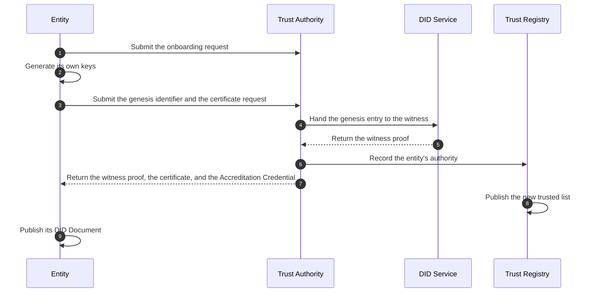

<figcaption> Entity onboarding, from the request to Trust Authority through to the DID Document the entity publishes.</figcaption>
</figure>

1. The entity sends `POST /entities` to Trust Authority, supplying the
   documents that establish it as a legal body and a conformance test.

2. The entity generates `issuance-jose`, `issuance-cose`, `status-list`, and
   an Ed25519 update key using its Key Manager Component, in whichever driver
   the entity uses: an encrypted
   software keystore, a cloud key management service (KMS), or a hardware
   security module (HSM). The keys shown are an issuer's; a Relying Party or a
   Wallet Provider generates the keys of its own registered role.

3. The entity submits its keys to Trust Authority in one request, through
   `POST /entities/me/keys`: the genesis `did.jsonl` entry, a proof of
   possession for each key, the `keyStorage` value, and a certificate signing
   request (CSR) from the `issuance-cose` key, for the mdoc path. Trust
   Authority checks the `keyStorage` value against the `issuer_assurance` its
   requested credential types demand, and the CSR against the certificate profile.

4. Trust Authority hands the genesis entry to DID Service, which checks the
   chain and each proof of possession.

5. DID Service returns a witness proof signed with `eddsa-jcs-2022` to Trust
   Authority.

6. Trust Authority records an Authority Statement in Trust Registry, naming
   the action and the resource, together with the public keys and the
   `keyStorage` value, and records the new keys in its Public Key Registry
   Component.

7. Trust Authority returns the witness proof, a Document Signer Certificate
   (DSC), and the entity's Accreditation Credential in the same exchange.

8. Trust Registry publishes the new trusted list, which now carries the
   entity's entry.

9. The entity publishes its DID Document on its own domain.

Rotation follows the same path, through the same door: a new log entry, signed
with the current update key and matching the pre-rotation hash, is submitted
to Trust Authority and witnessed before it counts. The entity never submits an
entry to DID Service itself. After onboarding, the entity signs using its own
Key Manager Component, and Trust Infrastructure is not called once
transactions start.

### Multi-tenant merchant onboarding {#multi-tenant-merchant-onboarding}

This flow lets an RP Intermediary, which runs a Verifier Core, onboard a new
merchant in the three stages [provisioning a merchant][provisioning-a-merchant]
describes in role terms: registration, device activation, and periodic
renewal. It establishes the trust binding between the merchant's device
certificate and the RP Intermediary's Verifier Issuing CA, its intermediate
certificate authority (CA), without requiring the merchant to run
infrastructure of its own. The protocol between Mobile Verifier and
Verifier Core is internal to the RP Intermediary; only the certificate it
produces has a fixed form.

{ #fig-multi-tenant-merchant-onboarding }

<figure markdown="1">

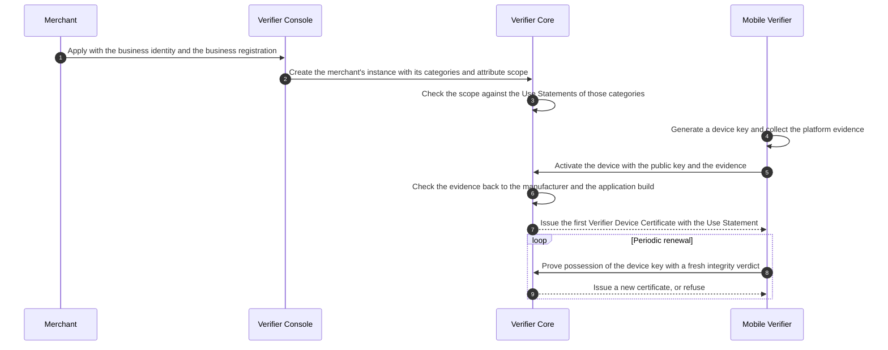

<figcaption> Multi-tenant merchant onboarding, from the merchant's application through the first Verifier Device Certificate to the renewals that keep it active.</figcaption>
</figure>

1. The merchant applies to the RP Intermediary through Verifier Console,
   handing over its business identity and its Nomor Induk Berusaha (NIB),
   the business registration number. The RP Intermediary checks that the
   business is real and that a named person answers for it. No device and no
   key is involved yet.

2. Verifier Console asks Verifier Core to create the merchant's
   `verifier_instance`, recording the Use Statement categories the merchant
   is bound to in `use_ids` and the attribute scope it is granted in
   `allowed_attrs`. The entry is the merchant's place in the RP
   Intermediary's tenant inventory, which Trust Authority may ask for at any
   time.

3. Verifier Core checks that `allowed_attrs` is a subset of the union of the
   Use Statements behind `use_ids`, with no `restricted` attribute among
   them. A scope that fails the check creates no instance, and the merchant
   never starts.

4. Mobile Verifier, using its Attestation Client Component, generates a key
   pair in the device's secure hardware and collects the platform's evidence:
   the attestation that the key is held in hardware and the verdict that the
   application is the official build.

5. Mobile Verifier activates the device with Verifier Core, sending the
   device key's public half and the platform evidence.

6. Verifier Core follows the evidence back to the manufacturer's root,
   confirms the official build, and confirms the device has not been rooted.
   A device that fails obtains no first certificate; the registration
   survives, so the merchant may try again with a device that passes.

7. Verifier Core issues the merchant's first Verifier Device Certificate,
   cut from the RP Intermediary's Verifier Issuing CA, and hands it over
   together with the Use Statement of the merchant's category. Its `Subject`
   names the merchant, and its `ReaderAuthRole` extension carries the
   attribute scope set at registration. The instance is now active.

8. For as long as the merchant operates, Mobile Verifier returns before the
   certificate expires with a Proof of Possession (PoP) of the same device
   key and a fresh integrity verdict.

9. Verifier Core issues a new short-lived certificate while the instance
   still stands and the device still passes, or refuses. A merchant that is
   simply not renewed ends on its own when the certificate expires; one
   withdrawn before that is published on the RP Intermediary's certificate
   revocation list (CRL), the path
   [merchant certificate withdrawal][merchant-certificate-withdrawal] shows.

### Merchant certificate withdrawal {#merchant-certificate-withdrawal}

This flow lets an RP Intermediary stop a merchant it registered. It is the
counterpart of the onboarding above, and it runs on the one part of a relayed
transaction the intermediary can read: the request. What the intermediary
observes, and what it may keep, is in
[RP Intermediary and merchant](../roles/rp-intermediary-and-merchant.md).

{ #fig-merchant-certificate-withdrawal }

<figure markdown="1">

```mermaid
sequenceDiagram
    autonumber
    participant MV as Mobile Verifier
    participant VC as Verifier Core
    participant MW as Mobile Wallet
    MV->>VC: Leave the signed request, one customer after another
    VC->>VC: Compare what the merchant asks for with the category its device was bound to
    VC->>VC: Withdraw the merchant's device certificate
    VC-->>MW: Publish the revoked certificate to the list wallets read
    MW->>MW: Refuse the next request from that device
```

<figcaption> Withdrawal of a merchant's certificate, from the requests the relay holds through to the wallet that refuses the device.</figcaption>
</figure>

1. Mobile Verifier leaves a signed request with Verifier Core for each
   customer it serves, as [verification by a merchant][verification-by-a-merchant]
   sets out. The request is signed and not encrypted, so it is readable to the
   RP Intermediary; the response never is.

2. Verifier Core compares the attributes a merchant asks for against the
   Use Statement of the business category its device was bound to. A merchant
   that asks beyond its category is refused by every wallet it approaches, and
   without this comparison nobody would learn that it kept trying.

3. Verifier Core withdraws that merchant's Verifier Device Certificate, within
   the deadline the Governance Framework sets, and the merchant's other
   permissions are untouched because it has none beyond that certificate.

4. Verifier Core publishes the withdrawn certificate to the CRL it
   maintains for the certificates it issues. Nothing
   is published centrally, and no other merchant is affected.

5. Mobile Wallet checks the certificate against its cached copy of that list
   and refuses the next request from the device. The refusal happens on the
   citizen's phone, so no part of it waits on Trust Infrastructure.

### Wallet enrollment and attestation {#wallet-enrollment-and-attestation}

This flow enrolls a wallet installation with Wallet Backend Service and
keeps it supplied with a Key Attestation, drawing on the device's own
operating system or chip and on the wallet's identity provider.

{ #fig-wallet-enrollment-and-attestation }

<figure markdown="1">

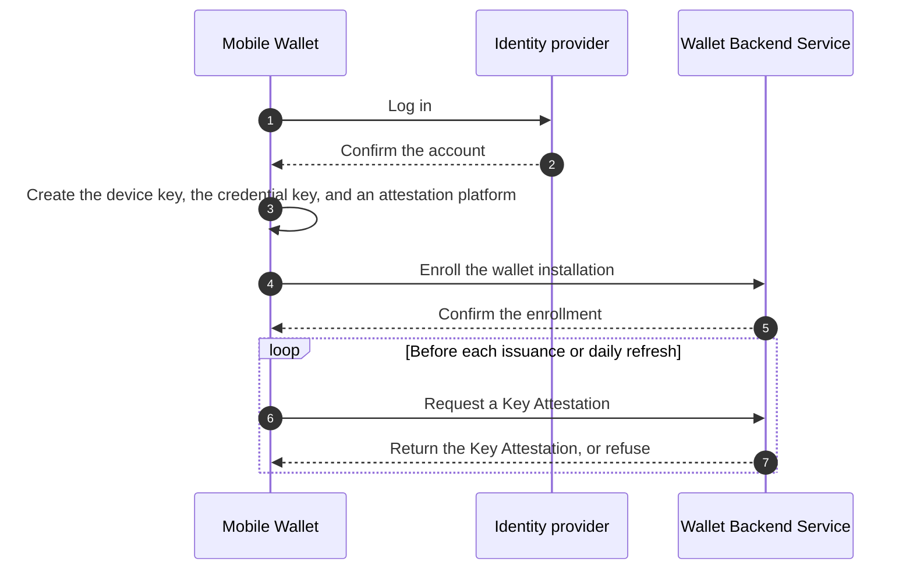

<figcaption> Wallet enrollment and attestation, from the login at the identity provider through to the Key Attestation Wallet Backend Service issues.</figcaption>
</figure>

1. Mobile Wallet logs in to the wallet's identity provider over OpenID Connect.

2. The identity provider returns an `id_token` for the citizen's account.

3. On this first login, Mobile Wallet creates the device key, the credential
   key, and an attestation platform in the device's operating system or
   secure element, producing an integrity verdict.

4. Mobile Wallet enrolls the wallet installation with Wallet Backend Service,
   sending the device key's public key, the attestation platform, and the
   `id_token`.

5. Wallet Backend Service confirms the enrollment, marking the installation
   active.

6. Before each issuance, at any assurance level, and on a daily refresh,
   Mobile Wallet requests a new Key Attestation from
   Wallet Backend Service, sending PoP of the device key, the
   credential key to be attested, an integrity token, and the issuer's nonce.

7. Wallet Backend Service returns the Key Attestation, attesting the
   credential key in `attested_keys`, or refuses if the device is marked
   revoked.

Wallet Backend Service knows the account and the device. It knows neither the
credential, the issuer, nor the verifier. Replacing the phone means
reissuance, because a hardware key cannot be backed up.

### Entity key revocation {#entity-key-revocation}

This flow runs when an entity's signing key is compromised, moving through
five phases from the revocation of the key to the post-mortem.

{ #fig-entity-key-revocation }

<figure markdown="1">

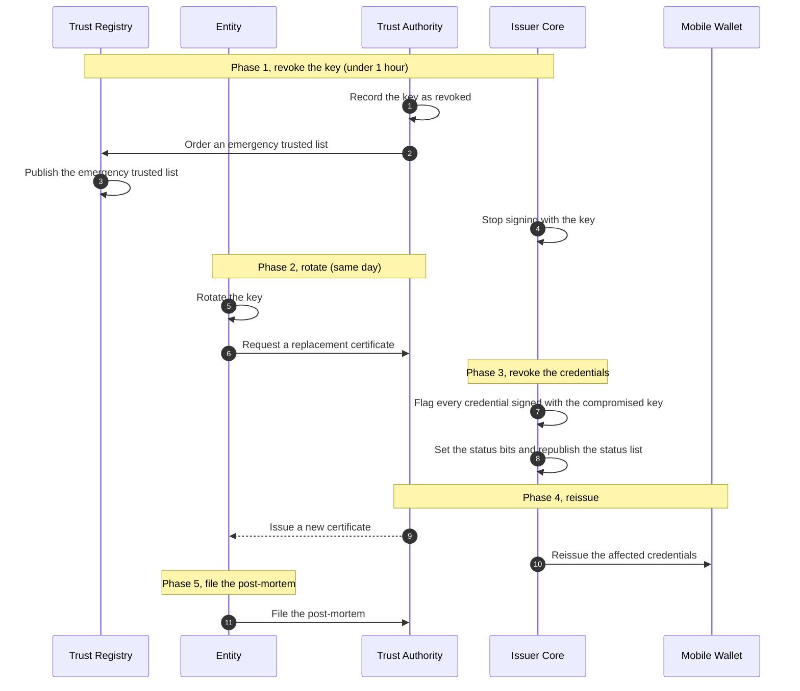

<figcaption> Entity key revocation, the five phases as the messages exchanged among Trust Registry, the entity, Trust Authority, Issuer Core, and Mobile Wallet.</figcaption>
</figure>

1. The Root Authority revokes the compromised key, and Trust Authority
   records it as `REVOKED` in its Public Key Registry and, for an X.509 key
   such as the DSC, adds the certificate to the CRL, within an hour of the
   compromise being confirmed. The entity stays accredited and its status
   stays granted.

2. Trust Authority orders Trust Registry to publish an emergency trusted
   list naming the revoked key, and the Root Authority notifies Relying
   Parties directly, the notice sent by Trust Authority using its Incident
   Service Component. The notice reaches each Relying Party as an
   organization, out of band, and never as a call to its Verifier Core: no
   Module in Trust Infrastructure calls a Module outside it.

3. Trust Registry publishes the emergency trusted list.

4. Issuer Core stops signing with that key and issues again once the
   replacement key is registered. The Root Authority tells the entity, out of
   band with the Relying Parties, and that notice is what meets the hour.
   Issuer Core refuses on its own as well: before each issuance it checks
   that its cached trusted list entry does not name the key as revoked, and
   Mobile Wallet refuses the offer on the same read of its own cache, so
   whoever was not told is cut off when the emergency list reaches its
   cache, on its own schedule.

5. The entity rotates its key at once using its Key Manager Component, with
   pre-rotation in `did:webvh` witnessed by DID Service before it counts. The
   old key leaves `assertionMethod` without the entry being deleted, and the
   witness refuses any new entry signed by the revoked key.

6. The entity submits a new CSR from the rotated key to Trust Authority, the
   same day.

7. Issuer Core flags the `issuance_record` of every credential signed with
   the compromised key, each record pointing at that credential's index in
   the status list.

8. Issuer Core, using its Status Manager Component, sets the status bit for
   each flagged index and republishes the Status List Token, signed with the
   separate `status-list` key so that it still works.

9. Trust Authority issues the entity a new DSC.

10. Issuer Core reissues the affected credentials; Mobile Wallet can receive a
    push notice to update.

11. The entity files a post-mortem to Trust Authority's transparency log, and
    the driver of its Key Manager Component is reviewed.

<figure markdown="1" class="ekdn-table">

| Phase | Target | Action |
|---|---|---|
| **1. Revoke the key** | Under 1 hour | The Root Authority revokes the key through Trust Authority, which records it `REVOKED` and, for an X.509 key, adds the certificate to the CRL; Trust Registry publishes an emergency trusted list naming the key; the Root Authority notifies Relying Parties directly, through Trust Authority's Incident Service Component; Issuer Core stops signing with the key. |
| **2. Rotate** | Same day | The entity rotates the key at once using its Key Manager Component, with pre-rotation in `did:webvh` and DID Service's witness; the entity submits a new certificate request; the old key leaves `assertionMethod` without the entry being deleted; the witness refuses any new entry signed by the revoked key. |
| **3. Revoke credentials** | No fixed target | Every credential signed with the compromised key is revoked: `issuance_record` points to that credential's index in the status list, and Issuer Core, using its Status Manager Component, sets the bit and republishes the Status List Token. Periodic key rotation limits how many credentials this reaches. |
| **4. Reissue** | No fixed target | Trust Authority issues a new DSC, and Issuer Core reissues the affected credentials; the wallet can receive a push notice to update its credential. |
| **5. File post-mortem** | No fixed target | A post-mortem is filed to the transparency log; the driver of the issuer's Key Manager Component is reviewed. |

</figure>

Two things have to exist from phase 1 for this flow to run at all: an
`issuance_record` that records a `signing_key_ref` per credential, and a DID
Service that keeps history and holds two active keys at once. Scheduled key
rotation, with a DSC valid at most 457 days for a Mobile Driving License
(mDL), decides how many credentials get caught up when one key leaks: the
more often a key rotates, the fewer credentials need reissuing. Phase 1
stops every credential the key signed, in both formats: an offline mdoc
presentation fails the CRL check once the DSC is on it, and an online
SD-JWT-based Verifiable Credential (SD-JWT VC) fails once the verifier's
cached trusted list names the key. Phase 3 then marks each of those
credentials in the status list.

Revoking a key leaves the entity accredited, and its other keys keep working.
Suspending the whole entity is a separate act, for misconduct: the Root
Authority decides it through Trust Authority and uses the same emergency
trusted list and notice. A suspension reaches that one registration only. In a
severe incident the Root Authority may suspend every registration of the same
legal body at once, found on the trusted list by the legal identifier they
share, and the Governance Framework sets what counts as severe.

### Trust cache sync {#trust-cache-sync}

Nothing on the transaction path asks Trust Infrastructure anything while a
transaction runs, so every verifying party works from a local cache this sync
fills. Mobile Wallet and Mobile Verifier need it because they present and
verify with no network. Verifier Core holds the same copies and refreshes
them well before the `NextUpdate` each list carries, on the short Time to
Live (TTL) a reachable Module is given, as [the three rules for reading the
copy][three-rules-for-reading-the-copy] set out: being reachable shortens how
stale its copy may get and does not let it query Trust Infrastructure
mid-transaction. Mobile Wallet runs the sync shown here. A verifier's run
adds one fetch the wallet's skips: the credential status list of every issuer
the trusted list names, downloaded whole from the address where that issuer
publishes it, so no fetch is tied to a presentation.

The same sync fetches the `did:webvh` log of every entity the trusted list
names. The entity's own domain is the source, and DID Service's copy of the
log is the fallback when that domain cannot be reached. The fallback belongs
to the sync alone. A log missing from the cache mid-transaction, which
happens only for an entity added since the last sync, is fetched from the
entity's domain and nowhere else, and the transaction is refused if that
fails.

{ #fig-trust-cache-sync }

<figure markdown="1">

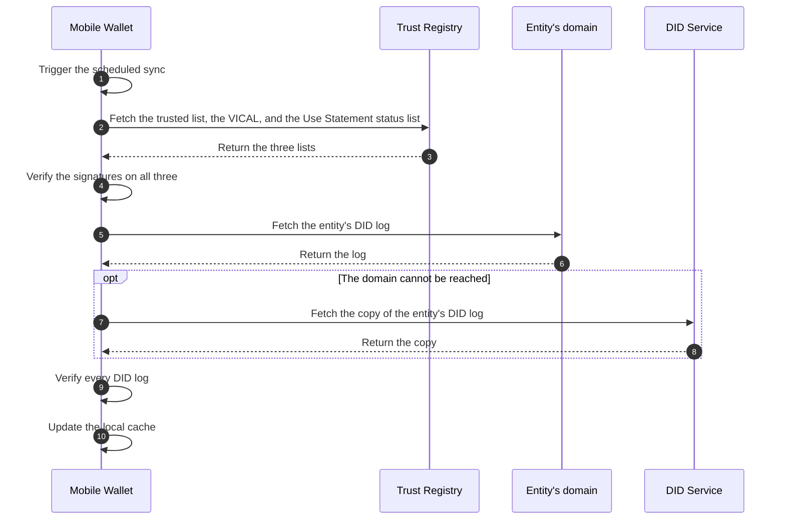

<figcaption> Trust cache sync, from the scheduled trigger through to the refreshed local cache.</figcaption>
</figure>

1. Mobile Wallet triggers a scheduled background sync, on a jittered timer
   the Governance Profile sets and bounded by the `NextUpdate` the list
   carries, or when it detects an unmetered network connection.

2. Mobile Wallet requests Trust Registry for the latest trusted list, the
   Verified Issuer Certificate Authority List (VICAL), and the Use Statement
   status list. The credential status lists are not among them: those are
   read by verifiers, and a wallet learns of its own revoked credential by
   push from the issuer.

3. Trust Registry returns the trusted list of accredited entities; the VICAL,
   the signed list of mdoc issuer root
   certificates from ISO/IEC 18013-5 Annex C; and the Use Statement status
   list, the Token Status List in which Trust Registry publishes each Use
   Statement that the Root Authority has withdrawn.

4. Mobile Wallet verifies the signatures on the trusted list, the VICAL, and
   the Use Statement status list, confirming each comes from its legitimate
   authority and has not been tampered with.

5. Mobile Wallet fetches the `did.jsonl` log of each entity the trusted list
   names from that entity's own domain, the address `did:webvh` derives from
   the identifier itself.

6. The entity's domain returns its log.

7. When a domain is unreachable or answers with an error, Mobile Wallet asks
   DID Service's Resolver endpoint for the copy of that entity's log it kept
   while witnessing each entry. This is the only place the fallback runs.

8. DID Service returns the copy.

9. Mobile Wallet, using its Trust SDK, replays each log and verifies the hash
   chain, pre-rotation, the entity's signatures, and the witness proof on
   every entry, whichever source the log came from, so the fallback adds no
   trust in DID Service. A log neither source returned keeps its
   last-known-good copy until the tolerance limit.

10. Mobile Wallet overwrites its local cache with the fresh data, ready for
   the next offline presentation.

## Credential issuance {#credential-issuance}

### Authorization Code flow {#authorization-code-flow}

This flow issues a credential to a citizen's wallet over
[OpenID for Verifiable Credential Issuance (OpenID4VCI)][exchange-protocols], online, using the Authorization Code flow.
The wallet redirects the citizen to the issuer's portal to log in and prove
their identity before requesting a token. Mobile Wallet, Wallet Backend
Service, Issuer Core, and the source system take part, and the trusted list
is read from cache throughout.

{ #fig-authorization-code-flow }

<figure markdown="1">

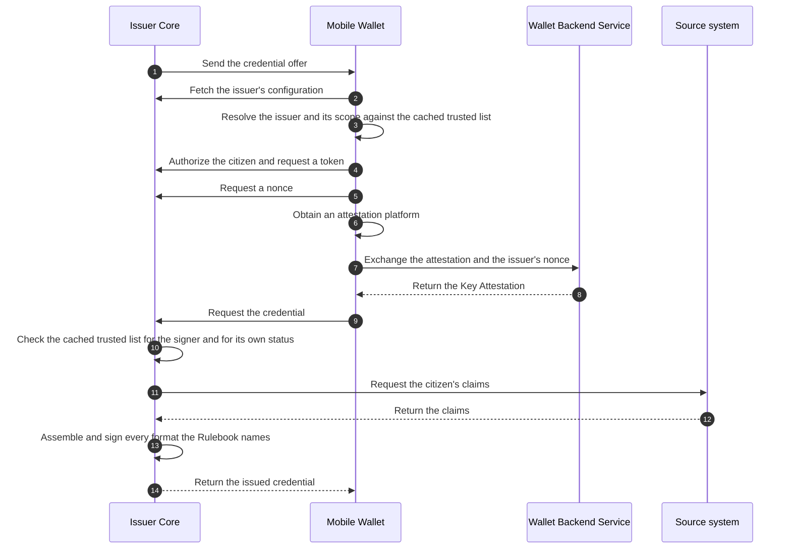

<figcaption> Credential issuance over OpenID4VCI with the Authorization Code flow, from the credential offer to Mobile Wallet receiving the issued credential.</figcaption>
</figure>

1. Issuer Core sends a credential offer to Mobile Wallet, using a QR code or
   a deeplink.

2. Mobile Wallet sends `GET /.well-known/openid-credential-issuer` to Issuer
   Core, reading `proof_types_supported` and `key_attestations_required`
   from the response.

3. Mobile Wallet resolves the issuer's identity and authority against its
   local cache of the trusted list, and refuses the offer when the entry is
   not granted or the offered type is outside the issuer's scope.

4. Mobile Wallet authorizes and requests a token through the Authorization
   Code flow, sending a pushed authorization request (PAR) and a Proof Key
   for Code Exchange (PKCE) to Issuer Core, bound with Demonstrating Proof
   of Possession (DPoP).

5. Mobile Wallet requests a nonce, sending `POST /nonce` to Issuer Core.

6. Mobile Wallet obtains an attestation platform for its credential key,
   created inside the secure element at the citizen's first login to the
   wallet and reused afterward.

7. Mobile Wallet exchanges the attestation platform and the issuer's nonce
   with Wallet Backend Service.

8. Wallet Backend Service returns a Key Attestation, carrying
   `attested_keys` and `key_storage`.

9. Mobile Wallet requests the credential, sending `POST /credential` to
   Issuer Core with `proofs.attestation` attached.

10. Issuer Core checks its local cache of the trusted list to confirm the
    Key Attestation's signer is present and that its own entry still reads
    granted; a suspended issuer stops here.

11. Issuer Core requests the citizen's claims from the source system,
    calling `getClaims(subjectRef, credentialType)` on its Claims Provider
    Component.

12. The source system returns the claims, which Issuer Core receives through
    its Claims Provider Component with a `data_as_of` value.

13. Issuer Core assembles and signs the credential locally, in every format
    the [Credential Rulebook][the-credential-rulebook] names for that
    credential type. There are three to choose from: an SD-JWT VC carrying `cnf`, an mdoc carrying a Mobile Security Object
    (MSO) and a DeviceKey, and a W3C Verifiable Credentials Data Model (VCDM)
    credential in `ldp_vc` form carrying a Data Integrity proof. The common
    case is the first two together, because a type that has to be checked
    where there is no signal needs the mdoc and a type with a restricted
    attribute cannot take `ldp_vc` at all. Which formats a given type takes,
    and which role may issue each, is in
    [Credential formats](../data-model-and-protocols/credential-formats.md).

14. Issuer Core returns the issued credential to Mobile Wallet, in each
    format it signed.

{ #subjectref-origin }

`subjectRef` never arrives from the wallet. It comes from how the citizen
was authenticated: the citizen logs into an agency's own system, an officer
selects a record and creates the offer on the citizen's behalf, or the
offer chains from a credential the citizen already holds, with Issuer Core
verifying that credential (a KTP Digital) first. When the source system
answers slowly, issuance is deferred and Issuer Core returns a
`transaction_id` instead of the credential.

### Pre-Authorized Code flow {#pre-authorized-code-flow}

This flow issues a credential over OpenID4VCI using the Pre-Authorized Code
flow, for when Issuer Core already knows the citizen's identity and pushes
a credential offer on its own. Instead of redirecting the citizen to a
login page, Mobile Wallet exchanges the offer's `pre-authorized_code` and
an out-of-band factor, such as an SMS PIN or a One-Time Password (OTP),
directly for the credential.

{ #fig-pre-authorized-code-flow }

<figure markdown="1">

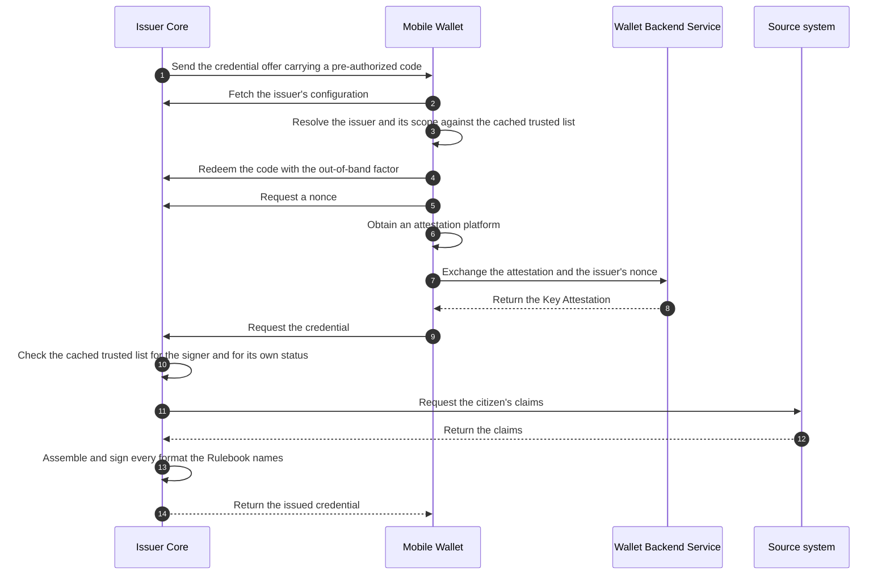

<figcaption> Credential issuance over OpenID4VCI with the Pre-Authorized Code flow, from the credential offer to Mobile Wallet receiving the issued credential.</figcaption>
</figure>

1. Issuer Core sends a credential offer carrying a `pre-authorized_code` to
   Mobile Wallet, using a QR code or a deeplink.

2. Mobile Wallet sends `GET /.well-known/openid-credential-issuer` to Issuer
   Core, reading `proof_types_supported` and `key_attestations_required`
   from the response.

3. Mobile Wallet resolves the issuer's identity and authority against its
   local cache of the trusted list, and refuses the offer when the entry is
   not granted or the offered type is outside the issuer's scope.

4. Mobile Wallet bypasses the authorization endpoint and requests a token
   directly, sending `POST /token` to Issuer Core with the
   `pre-authorized_code` and an out-of-band factor, such as a PIN or an
   OTP, serving as the `tx_code`, bound with DPoP.

5. Mobile Wallet requests a nonce, sending `POST /nonce` to Issuer Core.

6. Mobile Wallet obtains an attestation platform for its credential key,
   created inside the secure element at the citizen's first login to the
   wallet and reused afterward.

7. Mobile Wallet exchanges the attestation platform and the issuer's nonce
   with Wallet Backend Service.

8. Wallet Backend Service returns a Key Attestation, carrying
   `attested_keys` and `key_storage`.

9. Mobile Wallet requests the credential, sending `POST /credential` to
   Issuer Core with `proofs.attestation` attached.

10. Issuer Core checks its local cache of the trusted list to confirm the
    Key Attestation's signer is present and that its own entry still reads
    granted; a suspended issuer stops here.

11. Issuer Core requests the citizen's claims from the source system,
    calling `getClaims(subjectRef, credentialType)` on its Claims Provider
    Component.

12. The source system returns the claims, which Issuer Core receives through
    its Claims Provider Component with a `data_as_of` value.

13. Issuer Core assembles and signs the credential locally, in every format
    the Credential Rulebook names for that credential type, exactly as on the
    interactive path.

14. Issuer Core returns the issued credential to Mobile Wallet, in each
    format it signed.

Issuer Core already knows the citizen before it creates the offer; [how
`subjectRef` reaches Issuer Core][subjectref-origin] applies the same way
here.

## Presentation and verification {#presentation-and-verification}

### Online verification {#online-verification}

This flow lets a Relying Party's business system verify a credential over
[OpenID for Verifiable Presentations (OpenID4VP)][exchange-protocols], with Verifier Core mediating between it and
Mobile Wallet. The trusted list and the status list are both read from cache.

{ #fig-online-verification }

<figure markdown="1">

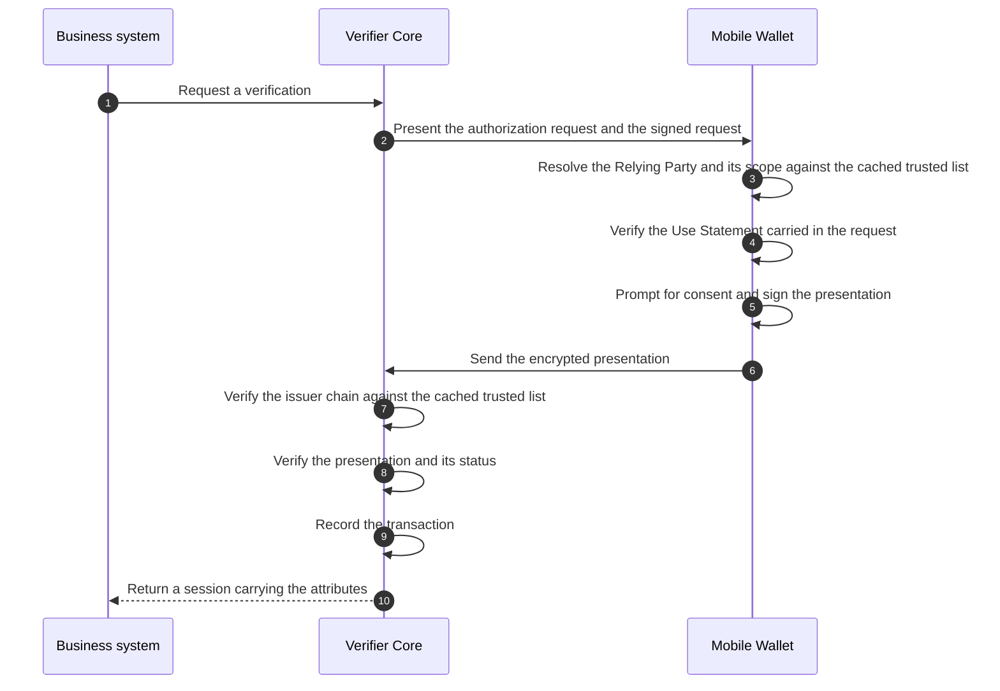

<figcaption> Online verification, from the business system's request to Verifier Core through to the session it returns.</figcaption>
</figure>

1. The Relying Party's business system asks Verifier Core to run a check using a template.

2. Verifier Core sends Mobile Wallet an authorization request (a QR code or a
   deeplink) carrying `request_uri` and `client_id`, prefixed with
   `decentralized_identifier:`. Mobile Wallet retrieves the signed Request
   Object via `GET request_uri`, which carries the Digital Credentials Query
   Language (DCQL) query, the nonce, the verifier's encryption key, and the
   Use Statement in `verifier_info`.

3. Mobile Wallet resolves `client_id` against the trusted list and checks the
   requested scope through Trust Registry Query Protocol (TRQP), reading both
   from the local cache.

4. Mobile Wallet reads the Use Statement out of `verifier_info` in the signed
   Request Object it fetched at step 2, verifies Trust Authority's signature
   on it, checks its revocation against the cached status list, and confirms
   the requested attributes are a subset of the ones it lists.

5. Mobile Wallet shows the citizen the consent request (for example, that Bank
   XYZ asks to confirm age over 17, per the purpose in the Use Statement) and
   signs a Key Binding JWT (KB-JWT) over the nonce and the
   audience.

6. Mobile Wallet delivers the `vp_token` to Verifier Core's `response_uri` via
   `direct_post.jwt`, encrypted as JSON Web Encryption (JWE) using the verifier's key from
   `client_metadata.jwks`.

7. Verifier Core verifies the issuer chain by running the entity chain against
   the cached trusted list, checking E1 through E3.

8. Verifier Core verifies the presentation and status by running the
   transaction chain against the trusted list: T1 (the signature), T2 (the status list), T3
   (the KB-JWT against `cnf`), T4 (the nonce and audience), and T5 (the
   scope).

9. Verifier Core records the transaction internally, keeping the transaction
   ID, the `use_id` the request ran under, and the consent receipt as T6,
   storing only the `vp_digest`.

10. Verifier Core returns a session (OpenID Connect or a Security Assertion
    Markup Language (SAML) session) carrying the attributes to the business
    system.

Verifier Core does not store the resulting attributes. Keeping them is the
business system's responsibility.

### Offline verification {#offline-verification}

This flow verifies a credential over [ISO/IEC 18013-5][exchange-protocols], in
proximity, between Mobile Verifier and Mobile Wallet. The verifying
application is always on a device: Mobile Verifier on a merchant's phone or a
Relying Party's counter device, or a Relying Party's own application built on the
Reader SDK. It is never Verifier Core. No network is reachable during it at
all.

{ #fig-offline-verification }

<figure markdown="1">

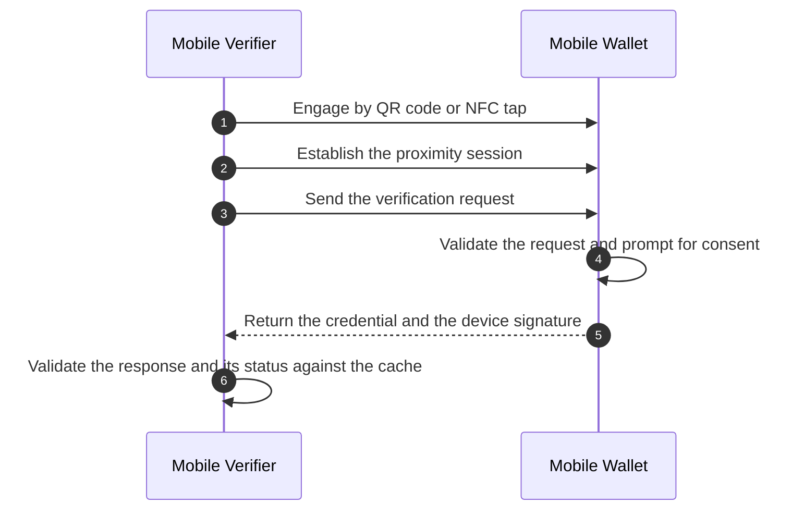

<figcaption> Offline verification, from the proximity engagement through to Mobile Verifier's check of the response.</figcaption>
</figure>

1. Mobile Verifier engages Mobile Wallet with a QR code or a Near Field
   Communication (NFC) tap.

2. Mobile Verifier and Mobile Wallet establish a session over Bluetooth Low
   Energy (BLE), using ephemeral Elliptic Curve Diffie-Hellman (ECDH).

3. Mobile Verifier sends Mobile Wallet a DeviceRequest containing
   `ItemsRequest` (carrying the Use Statement in
   `requestInfo.idUseStatement`) and ReaderAuth (a COSE_Sign1 structure
   holding the Verifier Device Certificate in `x5chain` and signing the
   request and the SessionTranscript).

4. Mobile Wallet validates the certificate chain up to the Verifier Root CA
   embedded at build time, confirms from the cached trusted list that the
   Verifier Issuing CA is granted, and verifies that the Use Statement holds:
   its `sub` names the entity holding that Verifier Issuing CA.
   It then checks that the requested attributes are a subset of both
   `ReaderAuthRole` and the Use Statement, and asks the citizen to select which
   attributes to release.

5. Mobile Wallet returns the mdoc and DeviceAuth encapsulated in a
   DeviceResponse.

6. Mobile Verifier chains `x5chain` to the Issuer Root CA from its cache to
   validate IssuerAuth, recomputes the digest, checks DeviceAuth against the
   SessionTranscript, and checks the status list from its cache.

Zero network calls happen during this flow. The status list can be stale by
the time it runs, up to the tolerance limit the Governance Framework sets;
the trusted list is good until the `NextUpdate` Trust
Registry wrote into it and is discarded after. DeviceAuth is a
`deviceSignature`; `deviceMac` is out of scope. The consequence is that a
presentation cannot be denied afterward: a Relying Party can prove to a third
party that the citizen presented. That is accepted as the price of easier
audit and dispute settlement.

### Verification by a merchant {#verification-by-a-merchant}

This flow lets a merchant verify a credential through Mobile Verifier,
standing in for the Verifier Core it does not run itself. Three parties take
part: Mobile Verifier on the merchant's own device, Verifier Core run by the
RP Intermediary that registered the merchant, and Mobile Wallet.

{ #fig-verification-by-a-merchant }

<figure markdown="1">

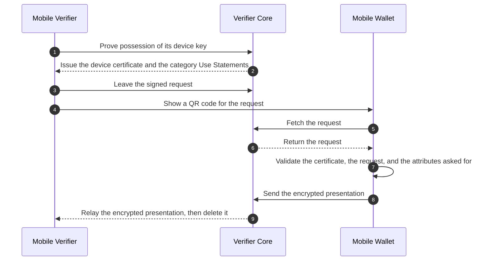

<figcaption> Verification by a merchant, from the device certificate request through to the relayed presentation.</figcaption>
</figure>

1. Mobile Verifier sends Verifier Core a PoP of its device key and an
   integrity token, to set up or renew its certificate.

2. Verifier Core returns a Verifier Device Certificate, with the device key
   as the Subject Public Key Info (SPKI) and carrying the `ReaderAuthRole`
   extension, along with the Use Statements for the business categories its
   device is bound to. The
   [multi-tenant merchant onboarding flow][multi-tenant-merchant-onboarding]
   covers this certificate issuance in full.

3. When a customer arrives, Mobile Verifier leaves a Request Object with
   Verifier Core, signed with the device key and carrying the certificate.

4. Mobile Verifier shows Mobile Wallet a QR code for the request.

5. Mobile Wallet fetches the Request Object from Verifier Core, at the
   `request_uri` the QR code carries.

6. Verifier Core returns the Request Object to Mobile Wallet.

7. Mobile Wallet validates the certificate chain against the embedded
   Verifier Root CA with the Verifier Issuing CA granted in the cached trusted
   list,
   checks that the certificate is valid and not on the CRL, matches the
   Request Object signature and the SHA-256 hash of the Verifier Device
   Certificate against the `client_id`, confirms the requested attributes
   are a subset of `ReaderAuthRole` and never include restricted
   attributes, and checks that the requested attributes align with the
   category Use Statement.

8. Mobile Wallet sends the encrypted presentation to Verifier Core via
   `direct_post.jwt`, keeping the data encrypted to the merchant's device
   key.

9. Verifier Core relays the ciphertext back to Mobile Verifier and deletes
   it, so Mobile Verifier decrypts and verifies the data locally on the
   merchant's device.

The key is born on the merchant's own device and signs there too. The RP
Intermediary's Verifier Core holds only the Request Object and the encrypted
response, for a short time. It may record the request side, which it can
already read, and never logs the response; it vouches for the merchant but
never sees the citizen's data. OpenID4VP 1.0 permits the
relay: for a `client_id` with the `x509_hash` prefix, the wallet checks the
certificate hash, the request signature, and the chain, and the specification
binds `response_uri` to a host name only for the `x509_san_dns` prefix, so the
response may be addressed to the RP Intermediary's domain. A merchant is
registered, not accredited. The consent screen shows the citizen the merchant's name, taken
from the `Subject` of its Verifier Device Certificate, and the purpose of the
category Use Statement in use, for example age verification for buying
tobacco products; the RP Intermediary's name appears only in the transaction
history.

## Wallet and holder lifecycle {#wallet-and-holder-lifecycle}

### Device migration and recovery {#device-migration}

Hardware keys cannot be exported from the secure element. When a citizen
moves to a new device or recovers from a lost phone, the wallet installation is
enrolled again and the credentials are reissued. Wallet Backend Service
revokes the old installation, so it obtains no further Key Attestation.

{ #fig-device-migration }

<figure markdown="1">

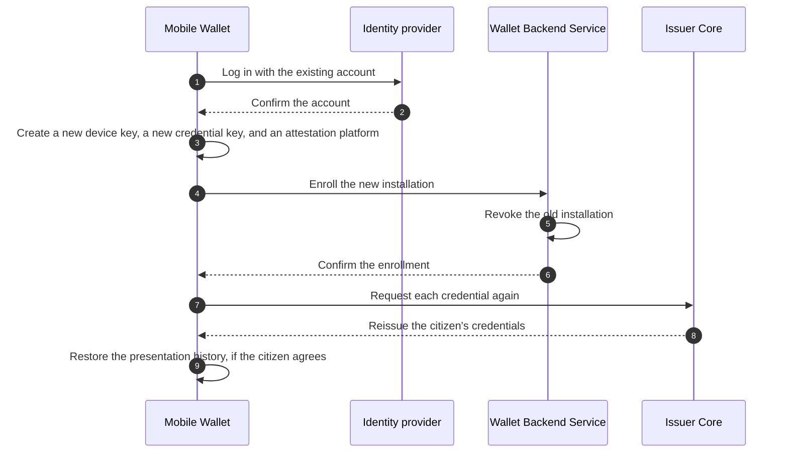

<figcaption> Device migration, from the login on the new device through to the reissued credentials.</figcaption>
</figure>

1. Mobile Wallet logs in to the identity provider with the citizen's existing
   account on the new device.

2. The identity provider returns an `id_token` for that account.

3. Mobile Wallet creates a new device key, a new credential key, and an
   attestation platform in the secure element of the new device, as at
   [wallet enrollment][wallet-enrollment-and-attestation].

4. Mobile Wallet enrolls the new installation with Wallet Backend Service,
   sending the device key's public key, the attestation platform, and the
   `id_token`.

5. Wallet Backend Service finds the citizen's account through the
   `id_token` and revokes the old installation, which obtains no further
   Key Attestation and so can obtain no further credential.

6. Wallet Backend Service confirms the enrollment, marking the new
   installation active.

7. Mobile Wallet requests each credential again from its Issuer Core through
   the [Authorization Code flow][authorization-code-flow], using the new
   credential key and a Key Attestation for it.

8. Issuer Core reissues the credential in each format its Rulebook names,
   bound to the new credential key.

9. Mobile Wallet offers to restore the presentation history from the
   encrypted client-side backup and restores it if the citizen agrees.
   The history holds no key and no attribute value, so it needs no
   reissuing.

### Credential renewal {#credential-renewal}

A credential is valid until its `exp`, and a KTP Digital carries one like
any other. Renewal is what keeps presentations working past that date
without sending the citizen through a new authorization: Mobile Wallet
exchanges the refresh token Issuer Core gave it at issuance for a fresh
access token and asks for the credential again, the credential refresh
OpenID4VCI 1.0 describes, run with no action from the citizen. The refresh
token is bound with DPoP to the installation that received it, so renewal
serves the same phone only; a new phone goes through
[device migration][device-migration], which is a fresh issuance with the
citizen's authentication.

{ #fig-credential-renewal }

<figure markdown="1">

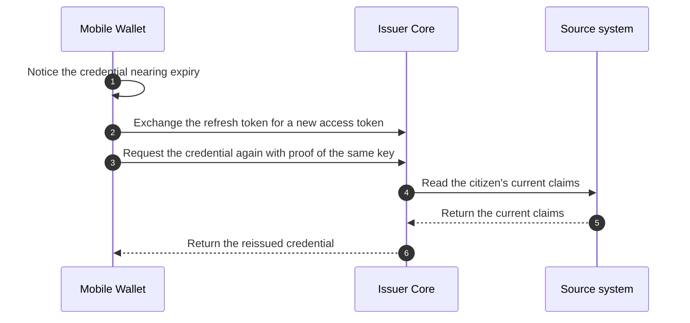

<figcaption> Credential renewal, from the wallet noticing the approaching expiry through to the reissued credential on the same phone.</figcaption>
</figure>

1. Mobile Wallet notices that a stored credential is approaching its `exp`,
   with the lead time the Governance Profile sets, and starts renewal on its
   own. The citizen is not asked to act, though the wallet also lets them
   start it by hand.

2. Mobile Wallet presents the refresh token to Issuer Core's token endpoint
   and receives a fresh access token, with no login and no new
   authorization. A refresh token that has expired or been revoked ends the
   shortcut, and the wallet falls back to the
   [Authorization Code flow][authorization-code-flow].

3. Mobile Wallet sends a credential request to Issuer Core with a proof of
   the same credential key and a current Key Attestation for it.

4. Issuer Core reads the citizen's current claims from the source system,
   using its Claims Provider Component, as it does at first issuance.

5. The source system returns the current claims, which Issuer Core receives
   through its Claims Provider Component with the current `data_as_of`
   value. A claim that has changed since the first issuance is carried as
   it now stands; it is the credential that is renewed, not the record.

6. Issuer Core signs the credential again in each format its Rulebook names,
   with a new technical validity period that it chooses within the
   Governance Profile's ceiling and never past the administrative period,
   and returns it to Mobile Wallet. The credential it replaces needs no revocation: it expires on its
   own.

### Citizen-initiated revocation {#citizen-initiated-revocation}

A citizen can have their credentials revoked before replacing a lost or
compromised device, by reporting the loss to the issuer. The phone is gone,
so the report runs outside Mobile Wallet, on a channel the issuer provides;
which channels count, and how the citizen proves who they are on one, is
for the Governance Framework to set. The same loss is reported to the Wallet
Provider, which revokes the installation so that it obtains no further Key
Attestation, the path [device migration][device-migration] shows. The two
reports reach different parties: the issuer's revocation is what reaches
credentials already held, and the Wallet Provider's stops new issuance.

{ #fig-citizen-initiated-revocation }

<figure markdown="1">

<figcaption> Citizen-initiated revocation, from the citizen's report to the issuer through to the published Status List Token.</figcaption>
</figure>

1. The citizen reports the lost device to the issuer and asks for
   revocation, on the channel the issuer runs for it outside the wallet.

2. Issuer Core retrieves the `issuance_record` for the citizen's active
   credentials, identifying their index positions in the status list.

3. Issuer Core flips the status bit for those indices to revoked, using
   its Status Manager Component.

4. Issuer Core publishes a new Status List Token reflecting the revoked
   status.

Verifiers do not see the change right away. They pick up the new
Status List Token at their next
[Trust cache sync][trust-cache-sync]
and reject presentations from the lost device from that point on. Mobile
Wallet fetches no credential status list; it learns that its own credential
is revoked by push from the issuer.
