<!-- Sumber: Arsitektur Ekosistem Identitas Digital v0.2, Section 7, Kep. 5, 9, 28, 30; Peta Alur Penerbitan dan Presentasi §5.1; Rincian Module dan Operasi §2.5, §6.2, §7.3, §8; tracks/0094, tracks/0096, tracks/0133, tracks/0155 (pembaruan kredensial dari OpenID4VCI 1.0 §14.5 dan EUDI ARF ISSU_42, ISSU_50, ISSU_65; tidak ada di sumber). Saluran laporan kehilangan ke issuer tidak disebut sumber mana pun (debt/0072); tracks/0169 (fallback log DID ke DID Service, tidak ada di sumber), tracks/0213, tracks/0220, tracks/0355 -->

# Flows per use case {#flows-per-use-case}

Each flow below is the minimum path, not a complete protocol trace. The steps
name who acts and what they send, and stop where the
[Technical Specifications](../../technical-specifications/index.md) take over
with the wire format.

Every flow holds to [the two paths never cross][the-two-paths-never-cross]:
nothing in Trust Infrastructure is called while a transaction runs.

## Trust ecosystem and infrastructure {#trust-ecosystem-and-infrastructure}

### Entity onboarding {#entity-onboarding}

Onboarding brings a new entity into the control plane, the step that has to
happen before the entity can sign anything on the transaction path. The entity
generates its own keys, and Trust Authority, Decentralized Identifier (DID)
Service, and Trust Registry each take a part in accepting them.

{ #fig-entity-onboarding }

<figure markdown="1">

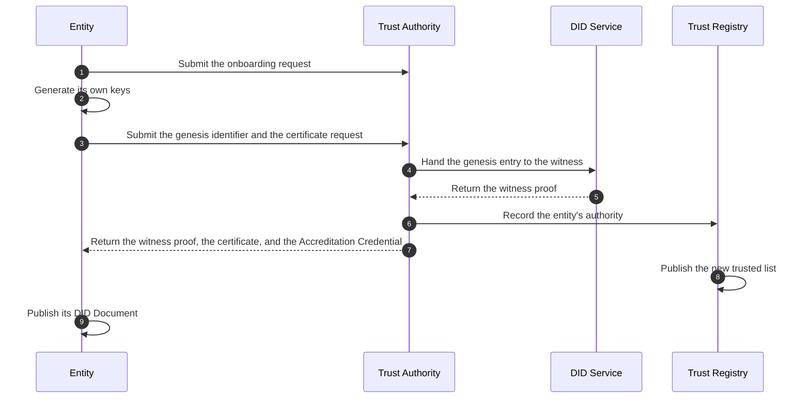

<figcaption> Entity onboarding, from the request to Trust Authority through to the DID Document the entity publishes.</figcaption>
</figure>

1. The entity's staff register it in Trust Authority's portal, supplying
   the documents that establish it as a legal body and a conformance test.

2. The entity generates `issuance-jose`, `issuance-cose`, `status-list`, and
   an Ed25519 update key using its Key Manager Component, in whichever driver
   the entity uses: an encrypted
   software keystore, a cloud key management service (KMS), or a hardware
   security module (HSM). The keys shown are an issuer's; a Relying Party or a
   Wallet Provider generates the keys of its own registered role.

3. The entity submits its keys to Trust Authority in one request, through
   `POST /entities/me/keys`:

    - the genesis `did.jsonl` entry;
    - a proof of possession for each key the entry publishes;
    - the `keyStorage` value;
    - for the mdoc path, a certificate signing request (CSR) from the
      `issuance-cose` key. The CSR from the `status-list` key comes with it, or
      later, when the issuer first publishes the form of its status list an
      mdoc reader checks.

    Trust Authority checks the `keyStorage` value against the
    `issuer_assurance` its requested credential types demand, and the CSR
    against the certificate profile.

4. Trust Authority hands the genesis entry to DID Service, which checks the
   chain and each proof of possession.

5. DID Service returns a witness proof signed with `eddsa-jcs-2022` to
   Trust Authority.

6. Trust Authority records an Authority Statement in Trust Registry, naming
   the action and the resource, together with the public keys and the
   `keyStorage` value, and records the new keys in its Public Key Registry
   Component.

7. Trust Authority returns the witness proof, a Document Signer Certificate
   (DSC), and the entity's Accreditation Credential in the same exchange.

8. Trust Registry publishes the new trusted list, which now carries the
   entity's entry.

9. The entity publishes its DID Document on its own domain.

Rotation follows the same path, through the same door. A new log entry is
signed with the update key it carries, and that key matches the hash the
previous entry announced. The entry is submitted to Trust Authority and
witnessed before it counts. The entity never submits an entry to DID Service
itself.

### Multi-tenant merchant onboarding {#multi-tenant-merchant-onboarding}

This flow lets an RP Intermediary, which runs a Verifier Core, onboard a new
merchant in the three stages [provisioning a merchant][provisioning-a-merchant]
describes in role terms: registration, device activation, and periodic
renewal. It establishes the trust binding between the merchant's device
certificate and the RP Intermediary's Verifier Issuing CA, its intermediate
certificate authority (CA), without requiring the merchant to run
infrastructure of its own. The protocol between Mobile Verifier and
Verifier Core is internal to the RP Intermediary; only the certificate it
produces has a fixed form.

{ #fig-multi-tenant-merchant-onboarding }

<figure markdown="1">

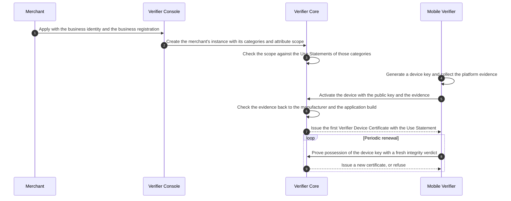

<figcaption> Multi-tenant merchant onboarding, from the merchant's application through the first Verifier Device Certificate to the renewals that keep it active.</figcaption>
</figure>

1. The merchant applies to the RP Intermediary through Verifier Console,
   handing over its business identity and its Nomor Induk Berusaha (NIB),
   the business registration number. The RP Intermediary checks that the
   business is real and that a named person answers for it. No device and no
   key is involved yet.

2. Verifier Console asks Verifier Core to create the merchant's
   `verifier_instance`, recording the Use Statement categories the merchant is
   bound to in `use_ids` and the attribute scope it is granted in
   `allowed_attrs`. The entry is the merchant's place in the RP Intermediary's
   merchant inventory, which Trust Authority may ask for at any time.

3. Verifier Core checks that `allowed_attrs` is a subset of the union of the
   Use Statements behind `use_ids`, with no `restricted` attribute among
   them. A scope that fails the check creates no instance, and the merchant
   never starts.

4. Mobile Verifier, using its Attestation Client Component, generates a key
   pair in the device's secure hardware and collects the platform's evidence:
   the attestation that the key is held in hardware and the verdict that the
   application is the official build.

5. Mobile Verifier activates the device with Verifier Core, sending the
   device key's public half and the platform evidence.

6. Verifier Core follows the evidence back to the manufacturer's root,
   confirms the official build, and confirms the device has not been rooted.
   A device that fails obtains no first certificate; the registration
   survives, so the merchant may try again with a device that passes.

7. Verifier Core issues the merchant's first Verifier Device Certificate,
   cut from the RP Intermediary's Verifier Issuing CA, and hands it over
   together with the Use Statements of the merchant's categories. Its `Subject`
   names the merchant, and its `ReaderAuthRole` extension carries the
   attribute scope set at registration. The instance is now active.

8. For as long as the merchant operates, Mobile Verifier returns before the
   certificate expires with a Proof of Possession (PoP) of the same device key
   and a fresh integrity verdict.

9. Verifier Core issues a new certificate while the instance
   still stands and the device still passes, or refuses. A merchant that is
   not renewed ends on its own when the certificate expires; one
   withdrawn before that is published on the RP Intermediary's certificate
   revocation list (CRL), the path
   [merchant certificate withdrawal][merchant-certificate-withdrawal] shows.

### Merchant certificate withdrawal {#merchant-certificate-withdrawal}

This flow lets an RP Intermediary stop a merchant it registered. It is the
counterpart of [multi-tenant merchant onboarding][multi-tenant-merchant-onboarding],
and it runs on the one part of a relayed
transaction the RP Intermediary can read: the request. What the RP Intermediary
observes, and what it may keep, is in
[RP Intermediary and merchant](../roles/rp-intermediary-and-merchant.md).

{ #fig-merchant-certificate-withdrawal }

<figure markdown="1">

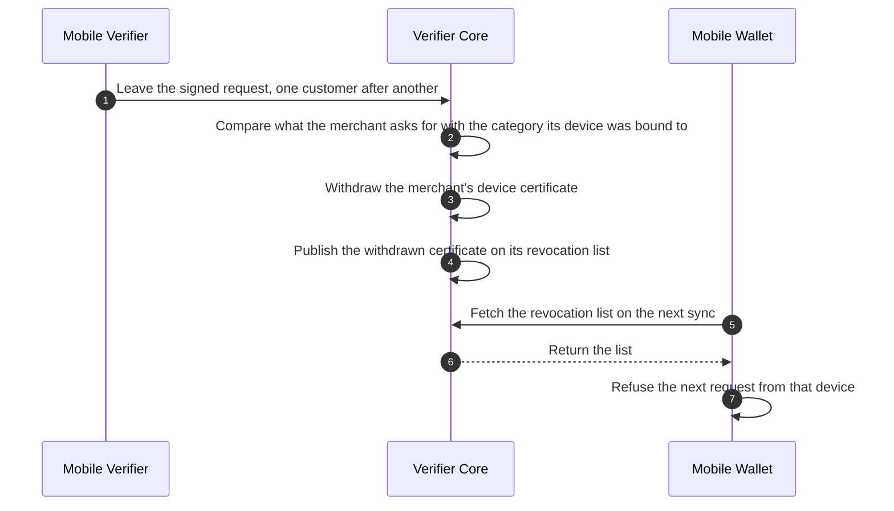

<figcaption> Withdrawal of a merchant's certificate, from the requests the relay holds through to the wallet that refuses the device.</figcaption>
</figure>

1. Mobile Verifier leaves a signed request with Verifier Core for each
   customer it serves, as [verification by a merchant][verification-by-a-merchant]
   sets out. The request is signed and not encrypted, so it is readable to the
   RP Intermediary; the response never is.

2. Verifier Core compares the attributes a merchant asks for against the
   Use Statement of the business category its device was bound to. A merchant
   that asks beyond its category is refused by every wallet it approaches, and
   without this comparison nobody would learn that it kept trying.

3. Verifier Core withdraws that merchant's Verifier Device Certificate,
   [within the deadline the Governance Framework sets][gf-withdrawing-a-merchant],
   and the merchant's other permissions are untouched because it has none beyond
   that certificate.

4. Verifier Core publishes the withdrawn certificate to the CRL it
   maintains for the certificates it issues. Nothing
   is published centrally, and no other merchant is affected.

5. Mobile Wallet fetches that CRL on its next
   [trust cache sync][trust-cache-sync], from the address the merchant's
   device certificate names.

6. Verifier Core returns the list, a static file served without
   authentication and without any identifier of the reader.

7. Mobile Wallet checks the certificate against its cached copy of that list
   and refuses the next request from the device. The refusal happens on the
   citizen's phone, so no part of it waits on Trust Infrastructure.

### Wallet enrollment and attestation {#wallet-enrollment-and-attestation}

This flow enrolls a wallet installation with Wallet Backend Service and
keeps it supplied with a Key Attestation, drawing on the device's own
operating system or chip and on the wallet's identity provider.

{ #fig-wallet-enrollment-and-attestation }

<figure markdown="1">

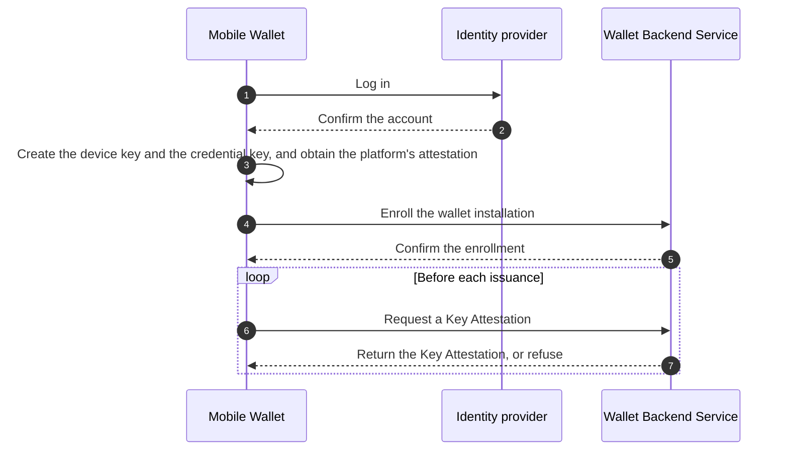

<figcaption> Wallet enrollment and attestation, from the login at the identity provider through to the Key Attestation Wallet Backend Service issues.</figcaption>
</figure>

1. Mobile Wallet logs in to the wallet's identity provider over OpenID Connect Core 1.0.

2. The identity provider returns an `id_token` for the citizen's account.

3. On this first login, Mobile Wallet creates the device key and the
   credential key in the device's secure element and obtains the platform's
   attestation over them: on Android a certificate chain for each key, on
   iOS an App Attest attestation of the device key that commits to the
   credential key. Android adds an integrity verdict of the operating
   system; iOS has none.

4. Mobile Wallet enrolls the wallet installation with Wallet Backend Service,
   sending the public credential key, the attestation platform of each key it
   covers, the integrity verdict where the platform produces one, and the
   `id_token`.

5. Wallet Backend Service confirms the enrollment, marking the installation
   active.

6. Before each issuance, at any assurance level, Mobile Wallet requests a new
   Key Attestation from Wallet Backend Service, sending:

    - the installation;
    - the thumbprint of the credential key to be attested;
    - the issuer's nonce;
    - fresh evidence over the two, a device key signature with an integrity
      verdict on Android and an App Attest assertion on iOS.

    The attestation platform of the enrollment is not sent again. An
    attestation carries the nonce of the issuance it was made for, so nothing
    mints one on a timer, and the day it lives is a ceiling on how long one may
    be used rather than a schedule.

7. Wallet Backend Service returns the Key Attestation, attesting the
   credential key in `attested_keys`, or refuses if the device is marked
   revoked.

Wallet Backend Service holds the account and the device. It holds nothing about
the credential, the issuer, or the verifier.

### Entity key revocation {#entity-key-revocation}

This flow runs when an entity's signing key is compromised, moving through
five phases from the revocation of the key to the post-mortem.

{ #fig-entity-key-revocation }

<figure markdown="1">

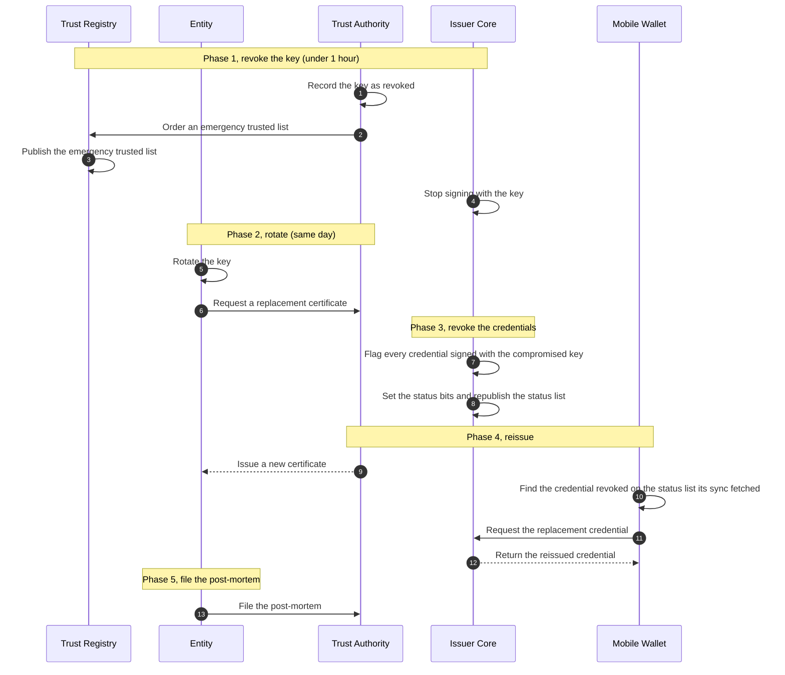

<figcaption> Entity key revocation, the five phases as the messages exchanged among Trust Registry, the entity, Trust Authority, Issuer Core, and Mobile Wallet.</figcaption>
</figure>

1. The Root Authority revokes the compromised key, and Trust Authority records
   it as `REVOKED` in its Public Key Registry, within an hour of the compromise
   being confirmed. For an X.509 key such as the DSC, Trust Authority also adds
   the certificate to the CRL within 24 hours of the revocation, the limit
   [ETSI EN 319 411-1 V1.4.1][ref-etsi-en-319411-1] sets for revocation status,
   in phase 2.

2. Trust Authority orders Trust Registry to publish an emergency trusted list
   naming the revoked key, and the Root Authority notifies Relying Parties
   directly, the notice sent by Trust Authority using its Incident Service
   Component. The notice reaches each Relying Party as an organization, out of
   band, and never as a call to its Verifier Core: no Module in Trust
   Infrastructure calls a Module outside it.

3. Trust Registry publishes the emergency trusted list.

4. Issuer Core stops signing with that key and issues again once the
   replacement key is registered. The Root Authority tells the entity within the
   hour, out of band with the Relying Parties.
   Issuer Core refuses on its own as well, checking before each issuance
   that its cached trusted list entry does not name the key as revoked.
   Mobile Wallet refuses the offer on the same read of its own cache, so
   whoever was not told is cut off when the emergency list reaches its
   cache, on its own schedule.

5. The entity rotates its key at once using its Key Manager Component, with
   pre-rotation in `did:webvh` witnessed by DID Service before it counts. The
   old key leaves `assertionMethod` without the entry being deleted, and the
   witness refuses any new entry signed by the revoked key.

6. The entity submits a new CSR from the rotated key to Trust Authority, the
   same day.

7. Issuer Core flags the `issuance_record` of every credential signed with
   the compromised key, each record pointing at that credential's index in
   the status list.

8. Issuer Core, using its Status Manager Component, sets the status bit for
   each flagged index and republishes the Status List Token and the
   Bitstring Status List v1.0, both signed with the separate `status-list` key so
   that they still work.

9. Trust Authority issues the entity a new DSC.

10. Mobile Wallet finds the credential marked revoked on the status list its
    [trust cache sync][trust-cache-sync] fetched.

11. Mobile Wallet asks Issuer Core for a replacement with the refresh token
    it holds, as [credential renewal][credential-renewal] runs.

12. Issuer Core reissues the credential, signed with the new key.

13. The entity files the post-mortem in Trust Authority's portal, Trust
    Authority writes it into its transparency log, and the driver of the
    entity's Key Manager Component is reviewed.

<figure markdown="1" class="ekdn-table">

| Phase | Target | Action |
|---|---|---|
| **1. Revoke the key** | Under 1 hour | The Root Authority revokes the key through Trust Authority, which records it `REVOKED`; Trust Registry publishes an emergency trusted list naming the key; the Root Authority notifies Relying Parties directly, through Trust Authority's Incident Service Component; Issuer Core stops signing with the key. |
| **2. Rotate** | Same day | Trust Authority adds an X.509 key's certificate to the CRL within 24 hours of the revocation; the entity rotates the key at once using its Key Manager Component, with pre-rotation in `did:webvh` and DID Service's witness; the entity submits a new certificate request; the old key leaves `assertionMethod` without the entry being deleted; the witness refuses any new entry signed by the revoked key. |
| **3. Revoke credentials** | No fixed target | Every credential signed with the compromised key is revoked: `issuance_record` points to that credential's index in the status list, and Issuer Core, using its Status Manager Component, sets the bit and republishes the Status List Token and the Bitstring Status List. Periodic key rotation limits how many credentials this reaches. |
| **4. Reissue** | No fixed target | Trust Authority issues a new DSC; each wallet finds its credential revoked on the status list its sync fetches and asks Issuer Core for a replacement, which Issuer Core issues under the new key. |
| **5. File post-mortem** | No fixed target | A post-mortem is filed to the transparency log; the driver of the issuer's Key Manager Component is reviewed. |

</figure>

Two things have to exist from phase 1 for this flow to run at all: an
`issuance_record` that records a `signing_key_ref` per credential, and a DID
Service that keeps history and holds two active keys at once.

Scheduled key rotation, with a DSC valid at most 457 days for a mobile driving
license (mDL), decides how many credentials get caught up when one key leaks:
the more often a key rotates, the fewer credentials need reissuing.

Phases 1 and 2 stop every credential the key signed, in every format: an offline
mdoc presentation fails the CRL check once the DSC is on it, and an online
SD-JWT-based Verifiable Credential (SD-JWT VC) draft -13 or `ldp_vc` fails once
the verifier's cached trusted list names the key. Phase 3 then marks each of
those credentials in the status list.

Revoking a key leaves the entity accredited, and its other keys keep working.
Suspending the whole entity is a separate act, for misconduct: the
Root Authority decides it through Trust Authority and uses the same emergency
trusted list and notice. A suspension reaches that one registration only. In a
severe incident the Root Authority may suspend every registration of the same
legal body at once, found on the trusted list by the legal identifier they
share, and the Governance Framework sets
[what counts as severe][gf-body-wide-suspension].

### Trust cache sync {#trust-cache-sync}

Nothing on the transaction path asks Trust Infrastructure anything while a
transaction runs, so every verifying party works from a local cache this sync
fills. Mobile Wallet and Mobile Verifier need it because they present and verify
with no network.

Verifier Core holds the same copies and refreshes them well
before the trusted list's `NextUpdate`, and on the sync schedule it replaces
each other copy long before that copy's Time to Live (TTL) runs out, as
[the three rules for reading the copy][three-rules-for-reading-the-copy] set
out. Being reachable shortens how stale its copies get. It does not let it
query Trust Infrastructure mid-transaction, and it buys no tolerance different
from an offline reader's.

Mobile Wallet runs the sync shown here.
A verifier's run differs in three places. It also fetches the Verified Issuer
Certificate Authority List (VICAL), which only an mdoc verifier reads. It asks
only for the issuers' Authority Statements, for each type it accepts. And it
downloads the credential status list of every issuer the trusted list names,
where the wallet downloads only the lists its own credentials point to. Both
download a list whole, from the address where the issuer publishes it, so no
fetch is tied to a presentation.

DID Service's copy of a log is the fallback for the sync alone. A log missing
from the cache mid-transaction, which happens only for an entity added since
the last sync, is not fetched: that entity is absent from the cached
trusted list as well, so the transaction is refused until the next sync brings
both.

{ #fig-trust-cache-sync }

<figure markdown="1">

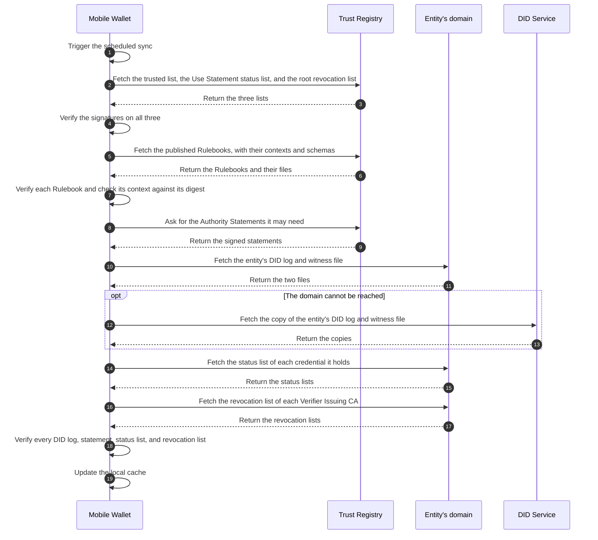

<figcaption> Trust cache sync, from the scheduled trigger through to the refreshed local cache.</figcaption>
</figure>

1. Mobile Wallet triggers a scheduled background sync, on a jittered timer
   the Governance Profile sets and bounded by the trusted list's
   `NextUpdate`, or when it detects an unmetered network connection.

2. Mobile Wallet requests Trust Registry for the latest trusted list, the
   Use Statement status list, and the CRL of the Verifier Root CA. The
   credential status lists come from each issuer, at step 14.

3. Trust Registry returns the trusted list of accredited entities; the
   Use Statement status list, the Token Status List draft -14 in which Trust
   Registry publishes each Use Statement that the Root Authority has withdrawn;
   and the Verifier Root CA's CRL, which names every Verifier Issuing CA
   certificate withdrawn early.

4. Mobile Wallet verifies the signatures on all three lists, confirming each
   comes from its legitimate authority and has not been tampered with.

5. Mobile Wallet requests Trust Registry for every published
   Credential Rulebook, with the JSON-LD context and the credential schema of
   each one that lists `ldp_vc`. Both are needed before any `ldp_vc` credential
   is verified or presented, because neither is fetched mid-transaction.

6. Trust Registry returns the Rulebooks and their files.

7. Mobile Wallet verifies the signature on each Rulebook and checks each
   context against the `context_digest` the Rulebook carries. A context that
   fails the check is discarded and the last-known-good copy kept.

8. Mobile Wallet asks Trust Registry over Trust Registry Query Protocol
   (TRQP) v2.0 for each Authority Statement
   it may need and holds no current copy of: whether each issuer on the
   trusted list may `issue` each credential type in the catalog, and whether
   each Relying Party on the list may `request` each type the wallet holds
   and each attribute of it. One query names one entity, one action, and one
   resource, and none names a citizen or a transaction.

9. Trust Registry returns each answer with its Authority Statement, signed by
   Trust Authority.

10. Mobile Wallet fetches the `did.jsonl` log and the `did-witness.json`
   witness file of each entity the trusted list names from that entity's own
   domain, the address `did:webvh` derives from the identifier itself.

11. The entity's domain returns its log and its witness file.

12. When a domain is unreachable or answers with an error, Mobile Wallet asks
   DID Service's Resolver endpoint for the copy of that entity's log and
   witness file it kept while witnessing each entry.

13. DID Service returns the copy.

14. Mobile Wallet fetches, from each issuer's own domain, the whole status list
   that each credential it holds points to. This is how a wallet learns that one
   of its own credentials was revoked.

15. Each issuer's domain returns its status list.

16. Mobile Wallet fetches the CRL of each Verifier Issuing CA the trusted list
   names, from the address its device certificates name, so that it can check a
   reader in proximity with no network.

17. Each holder of a Verifier Issuing CA returns its CRL.

18. Mobile Wallet, using its Trust SDK, replays each log and verifies it,
    whichever source the log came from, so the fallback adds no trust in
    DID Service:

    - the hash chain, pre-rotation, the entity's signatures, and the witness
      proof the witness file holds for every entry;
    - each status list against the issuer's DID Document;
    - each CRL against the certificate of the authority that signed it;
    - each Authority Statement against Trust Authority's DID Document.

    A log neither source returned, and a statement that does not verify, keep
    their last-known-good copies until the tolerance limit.

19. Mobile Wallet overwrites its local cache with the fresh data, ready for
   the next offline presentation.

## Credential issuance {#credential-issuance}

### Authorization Code flow {#authorization-code-flow}

This flow issues a credential to a citizen's wallet over
[OpenID for Verifiable Credential Issuance (OpenID4VCI) 1.0][ref-openid4vci],
online, using the Authorization Code flow. The wallet redirects the citizen to
the issuer's portal to log in and prove their identity before requesting a
token. Mobile Wallet, Wallet Backend Service, Issuer Core, and the source system
take part, and the trusted list is read from cache throughout.

{ #fig-authorization-code-flow }

<figure markdown="1">

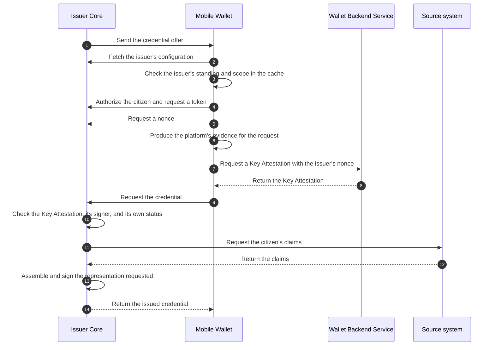

<figcaption> Credential issuance over OpenID4VCI with the Authorization Code flow, from the credential offer to Mobile Wallet receiving the issued credential.</figcaption>
</figure>

1. Issuer Core sends a credential offer to Mobile Wallet, using a QR code or
   a deeplink.

2. Mobile Wallet sends `GET /.well-known/openid-credential-issuer` to Issuer
   Core, asking for the metadata signed with the issuer's `issuance-jose`
   key, and reads from it the issuer's DID, `proof_types_supported`, and
   `key_attestations_required`.

3. Mobile Wallet resolves the DID the signed metadata names against its
   local cache of the trusted list, and reads from the same cache the Authority Statement
   its sync obtained on whether the issuer may `issue` the offered type. It
   refuses the offer when the entry is not granted, or when the statement is
   missing, past its tolerance limit, or answers `false`.

4. Mobile Wallet authorizes and requests a token through the Authorization
   Code flow, sending a pushed authorization request (PAR) and a Proof Key
   for Code Exchange (PKCE) to Issuer Core, bound with Demonstrating Proof
   of Possession (DPoP).

5. Mobile Wallet requests a nonce, sending `POST /nonce` to Issuer Core.

6. Mobile Wallet produces the evidence its platform requires over the
   issuer's nonce and the thumbprint of its credential key: a device key
   signature with an integrity verdict on Android, an App Attest assertion
   on iOS.

7. Mobile Wallet sends that evidence and the issuer's nonce to Wallet Backend
   Service, which checks both against the installation record it made at
   enrollment.

8. Wallet Backend Service returns a Key Attestation, carrying
   `attested_keys` and `key_storage`.

9. Mobile Wallet requests the credential, sending `POST /credential` to
   Issuer Core for one representation, with the proof the issuer announced:
   the Key Attestation itself, or a `jwt` proof carrying it.

10. Issuer Core checks its local cache of the trusted list to confirm that the
    Key Attestation's signer is a Wallet Provider whose entry reads granted,
    since a withdrawn Wallet Provider stays on the list, and that its own entry
    still reads granted; a suspended issuer stops here. Using its
    Key Attestation Validator Component, it also checks that the attestation
    carries the nonce it issued at step 5, which it accepts in one credential
    request only, and a `user_authentication` value it announced for the
    credential type.

11. Issuer Core requests the citizen's claims from the source system,
    calling `getClaims(subjectRef, credentialType)` on its Claims Provider
    Component.

12. The source system returns the claims, which Issuer Core receives through
    its Claims Provider Component with a `data_as_of` value.

13. Issuer Core assembles and signs the credential locally, in the
    representation the request names, one of the three the
    [Credential Rulebook][the-credential-rulebook] names for that credential
    type:

    - an SD-JWT VC carrying `cnf`;
    - an mdoc carrying a Mobile Security Object (MSO) and a DeviceKey;
    - a W3C Verifiable Credentials Data Model (VCDM) 2.0 credential in
      `ldp_vc` form carrying a Data Integrity proof.

    The common case is the first two together, because a type that has to be
    checked where there is no signal needs the mdoc, and a type with a
    restricted attribute cannot take `ldp_vc` at all. Which formats a given
    type takes, and which role may issue each, is in
    [Credential formats](../data-model-and-protocols/credential-formats.md).

14. Issuer Core returns the issued credential to Mobile Wallet, in that
    representation. Steps 5 to 10, 13 and 14 run again for each other
    representation the Credential Rulebook names, each with a new nonce and a
    new Key Attestation, and Issuer Core builds every representation from the
    claims it read once, with the same credential key and status entry.

{ #subjectref-origin }

`subjectRef` never arrives from the wallet. It comes from how the citizen
was authenticated: the citizen logs into an agency's own system, an officer
selects a record and creates the offer on the citizen's behalf, or the
offer chains from a credential the citizen already holds, which the entity asks
for in its Relying Party role, as [online verification][online-verification]
runs it, before Issuer Core creates the offer. A type issued as mdoc alone, as a
KTP Digital is, cannot serve that chain: an mdoc is read in proximity and never
online. When the source system
answers slowly, issuance is deferred and Issuer Core returns a
`transaction_id` instead of the credential.

### Pre-Authorized Code flow {#pre-authorized-code-flow}

This flow issues a credential over OpenID4VCI using the Pre-Authorized Code
flow, for when Issuer Core already knows the citizen's identity and sends
a credential offer on its own. Instead of redirecting the citizen to a
login page, Mobile Wallet exchanges the offer's `pre-authorized_code` and
an out-of-band factor, such as a Personal Identification Number (PIN) sent by
Short Message Service (SMS) or a One-Time Password (OTP), directly for the
credential.

{ #fig-pre-authorized-code-flow }

<figure markdown="1">

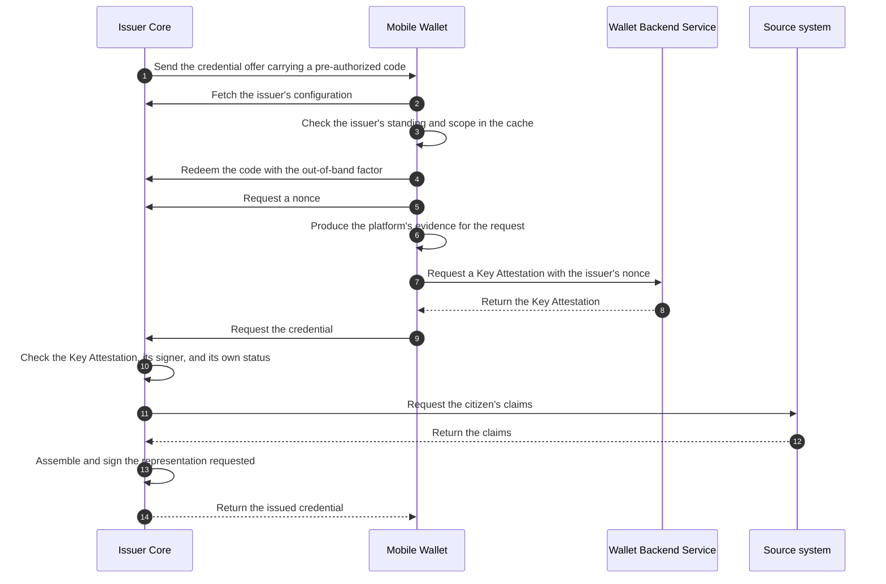

<figcaption> Credential issuance over OpenID4VCI with the Pre-Authorized Code flow, from the credential offer to Mobile Wallet receiving the issued credential.</figcaption>
</figure>

1. Issuer Core sends a credential offer carrying a `pre-authorized_code` to
   Mobile Wallet, using a QR code or a deeplink.

2. Mobile Wallet fetches the signed issuer metadata and reads the issuer's
   DID, as in [the Authorization Code flow][authorization-code-flow].

3. Mobile Wallet resolves the DID in its cache and reads the Authority Statement
   for the offered type, as in
   [the Authorization Code flow][authorization-code-flow].

4. Mobile Wallet bypasses the authorization endpoint and requests a token
   directly, sending `POST /token` to Issuer Core with the
   `pre-authorized_code` and an out-of-band factor, such as a PIN or an
   OTP, serving as the `tx_code`, bound with DPoP.

5. Mobile Wallet requests a nonce, as in
   [the Authorization Code flow][authorization-code-flow].

6. Mobile Wallet produces the platform's evidence over the nonce and its
   credential key, as in
   [the Authorization Code flow][authorization-code-flow].

7. Mobile Wallet sends the evidence and the nonce to Wallet Backend Service,
   as in [the Authorization Code flow][authorization-code-flow].

8. Wallet Backend Service returns a Key Attestation, as in
   [the Authorization Code flow][authorization-code-flow].

9. Mobile Wallet requests the credential, as in
   [the Authorization Code flow][authorization-code-flow].

10. Issuer Core checks the Key Attestation, its signer, and its own standing,
    as in [the Authorization Code flow][authorization-code-flow].

11. Issuer Core requests the citizen's claims from the source system, as in
    [the Authorization Code flow][authorization-code-flow].

12. The source system returns the claims, as in
    [the Authorization Code flow][authorization-code-flow].

13. Issuer Core assembles and signs the credential locally, in the
    representation the request names, exactly as on the interactive path.

14. Issuer Core returns the issued credential and repeats the exchange for each
    other representation, as in
    [the Authorization Code flow][authorization-code-flow].

Issuer Core already knows the citizen before it creates the offer; [how
`subjectRef` reaches Issuer Core][subjectref-origin] applies the same way
here.

## Presentation and verification {#presentation-and-verification}

### Online verification {#online-verification}

This flow lets a Relying Party's business system verify a credential over
[OpenID for Verifiable Presentations (OpenID4VP) 1.0][ref-openid4vp], with
Verifier Core mediating between it and Mobile Wallet. The trusted list and the
status list are both read from cache.

{ #fig-online-verification }

<figure markdown="1">

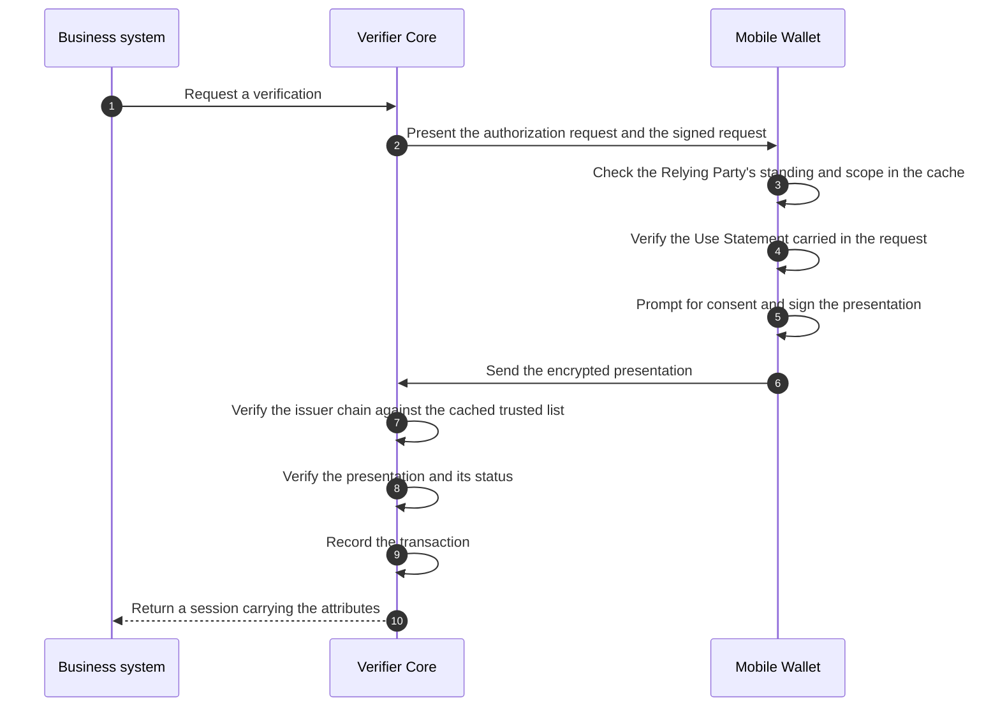

<figcaption> Online verification, from the business system's request to Verifier Core through to the session it returns.</figcaption>
</figure>

1. The Relying Party's business system asks Verifier Core to run a check using a template.

2. Verifier Core sends Mobile Wallet an authorization request (a QR code or a
   deeplink) carrying `request_uri` and `client_id`, prefixed with
   `decentralized_identifier:`. Mobile Wallet retrieves the signed Request
   Object via `GET request_uri`, which carries the Digital Credentials Query
   Language (DCQL) query, the nonce, the encryption key Verifier Core drew
   for this request, and the
   Use Statement in `verifier_info`.

3. Mobile Wallet resolves `client_id` against the cached trusted list, and
   reads from the same cache the Authority Statements its sync obtained on
   whether that Relying Party may `request` what the query names. It refuses
   the request when the entry is not granted, or when a statement is
   missing, past its tolerance limit, or answers `false`.

4. Mobile Wallet reads the Use Statement out of `verifier_info` in the signed
   Request Object it fetched at step 2 and checks it:

    - Trust Authority's signature on it verifies;
    - its `sub` is the DID in `client_id`, so that one verifier cannot borrow
      another's registration;
    - its `exp` has not passed;
    - the cached status list does not mark it revoked;
    - the requested attributes are a subset of the ones it lists.

    This is T5, the scope, checked by the wallet before the citizen is asked.

5. Mobile Wallet shows the citizen the consent request (for example, that Bank
   XYZ asks to confirm age over 17, per the purpose in the Use Statement) and
   signs a Key Binding JWT (KB-JWT) over the nonce and the
   audience, or, for an `ldp_vc`, a presentation proof over the same values as
   `challenge` and `domain`.

6. Mobile Wallet delivers the `vp_token` to Verifier Core's `response_uri` via
   `direct_post.jwt`, encrypted as JSON Web Encryption (JWE) using the verifier's key from
   `client_metadata.jwks`.

7. Verifier Core verifies the issuer chain by running the
   [entity chain][entity-chain-and-transaction-chain] against the cached
   trusted list, checking E1 through E3.

8. Verifier Core verifies the presentation and status by running the
   transaction chain against the trusted list: T1 (the signature), T2 (the
   status list), T3 (the KB-JWT against `cnf`, or the presentation proof
   against the holder's `did:key`), and T4 (the nonce and audience).

9. Verifier Core records the transaction internally, keeping the transaction
   ID, the `use_id` the request ran under, and the consent receipt as T6,
   storing only the `vp_digest`.

10. Verifier Core returns a session (OpenID Connect or a Security Assertion
    Markup Language (SAML) session) carrying the attributes to the business
    system.

Verifier Core does not store the resulting attributes. Keeping them is the
business system's responsibility.

### Offline verification {#offline-verification}

This flow verifies a credential over [ISO/IEC 18013-5:2021][ref-iso-18013-5], in
proximity, between Mobile Verifier and Mobile Wallet. The verifying
application is always on a device: Mobile Verifier on a merchant's phone or a
Relying Party's counter device, or a Relying Party's own application built on the
Reader SDK. It is never Verifier Core. No network is reachable during it at
all.

{ #fig-offline-verification }

<figure markdown="1">

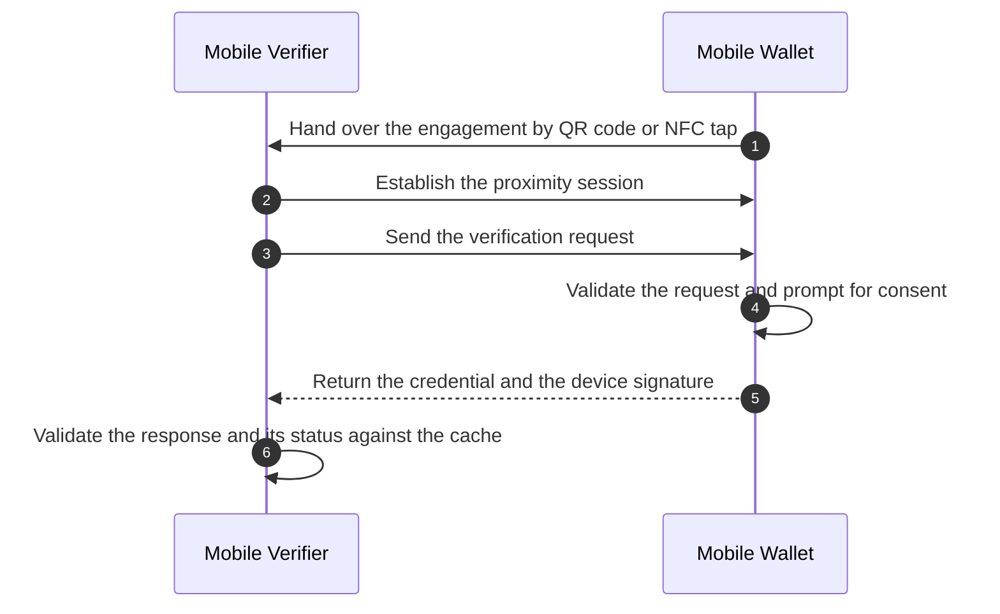

<figcaption> Offline verification, from the proximity engagement through to Mobile Verifier's check of the response.</figcaption>
</figure>

1. Mobile Wallet hands Mobile Verifier the device engagement, shown as a QR
   code or read off a Near Field Communication (NFC) tap.

2. Mobile Verifier and Mobile Wallet establish a session over Bluetooth Low
   Energy (BLE), using ephemeral Elliptic Curve Diffie-Hellman (ECDH).

3. Mobile Verifier sends Mobile Wallet a DeviceRequest containing
   `ItemsRequest` (carrying the Use Statement in
   `requestInfo.idUseStatement`) and ReaderAuth (a COSE_Sign1 structure
   holding the Verifier Device Certificate in `x5chain` and signing the
   request and the SessionTranscript).

4. Mobile Wallet validates the request against its own caches:

    - the certificate chain reaches the Verifier Root CA embedded at build
      time, and the cached revocation list does not name the certificate;
    - the cached trusted list carries the Verifier Issuing CA as granted;
    - the Use Statement holds, its `sub` naming the entity that holds that
      Verifier Issuing CA, its `exp` unpassed, and the cached Use Statement
      status list not marking it revoked;
    - the requested attributes are a subset of both `ReaderAuthRole` and the
      Use Statement.

    It then asks the citizen to approve the attributes requested, or to
    refuse.

5. Mobile Wallet returns the mdoc and DeviceAuth encapsulated in a
   DeviceResponse.

6. Mobile Verifier chains `x5chain` to an Issuer Root CA that its cached VICAL
   carries, once that VICAL has verified, to validate IssuerAuth, recomputes the
   digest, checks DeviceAuth against the SessionTranscript, and checks the
   status list from its cache.

The status list can be stale by
the time it runs, up to the tolerance limit the Governance Profile sets;
the trusted list is good until the `NextUpdate` Trust
Registry wrote into it and is discarded after. DeviceAuth is a
`deviceSignature`; `deviceMac` is out of scope. The consequence is that a
presentation cannot be denied afterward: a Relying Party can prove to a third
party that the citizen presented. That is accepted as the price of easier
audit and dispute settlement.

### Verification by a merchant {#verification-by-a-merchant}

This flow lets a merchant verify a credential through Mobile Verifier,
standing in for the Verifier Core it does not run itself. Three parties take
part: Mobile Verifier on the merchant's own device, Verifier Core run by the
RP Intermediary that registered the merchant, and Mobile Wallet.

{ #fig-verification-by-a-merchant }

<figure markdown="1">

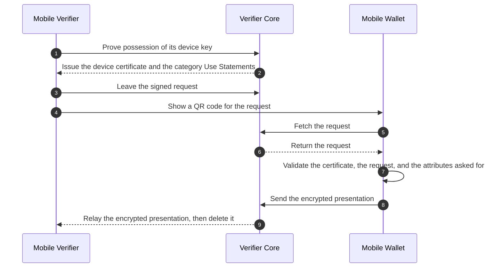

<figcaption> Verification by a merchant, from the device certificate request through to the relayed presentation.</figcaption>
</figure>

1. Mobile Verifier sends Verifier Core a PoP of its device key and an
   integrity token, to set up or renew its certificate.

2. Verifier Core returns a Verifier Device Certificate, with the device key
   as the Subject Public Key Info (SPKI) and carrying the `ReaderAuthRole`
   extension, along with the Use Statements for the business categories its
   device is bound to. The
   [multi-tenant merchant onboarding flow][multi-tenant-merchant-onboarding]
   covers this certificate issuance in full.

3. When a customer arrives, Mobile Verifier leaves a Request Object with
   Verifier Core, signed with the device key and carrying the certificate.

4. Mobile Verifier shows Mobile Wallet a QR code for the request.

5. Mobile Wallet fetches the Request Object from Verifier Core, at the
   `request_uri` the QR code carries.

6. Verifier Core returns the Request Object to Mobile Wallet.

7. Mobile Wallet validates the request:

    - the certificate chain reaches the embedded Verifier Root CA, with the
      Verifier Issuing CA granted in the cached trusted list;
    - the certificate is valid and absent from the CRL;
    - the Request Object signature and the SHA-256 hash of the
      Verifier Device Certificate match the `client_id`;
    - the requested attributes are a subset of `ReaderAuthRole` and carry no
      restricted attribute;
    - the requested attributes align with the category Use Statement.

8. Mobile Wallet sends the encrypted presentation to Verifier Core via
   `direct_post.jwt`, keeping the data encrypted to the key the merchant's
   device drew for this request.

9. Verifier Core relays the ciphertext back to Mobile Verifier and deletes
   it, so Mobile Verifier decrypts and verifies the data locally on the
   merchant's device.

The key is born on the merchant's own device and signs there too. The
RP Intermediary's Verifier Core holds only the Request Object and the encrypted
response, for a short time. It may record the request side, which it can already
read, and never logs the response; it vouches for the merchant but never sees
the citizen's data.

OpenID4VP permits the relay: for a `client_id` with the `x509_hash` prefix, the
wallet checks the certificate hash, the request signature, and the chain, and
the specification binds `response_uri` to a host name only for the
`x509_san_dns` prefix, so the response may be addressed to the
RP Intermediary's domain.

The consent screen shows the citizen the merchant's name, taken from the
`Subject` of its Verifier Device Certificate, and the purpose of the category
Use Statement in use, for example age verification for buying tobacco products;
the RP Intermediary's name appears only in the transaction history.

## Wallet and holder lifecycle {#wallet-and-holder-lifecycle}

### Device migration and recovery {#device-migration}

Hardware keys cannot be exported from the secure element. When a citizen
moves to a new device or recovers from a lost phone, the wallet installation is
enrolled again and the credentials are reissued. Wallet Backend Service
revokes the old installation, so it obtains no further Key Attestation.

{ #fig-device-migration }

<figure markdown="1">

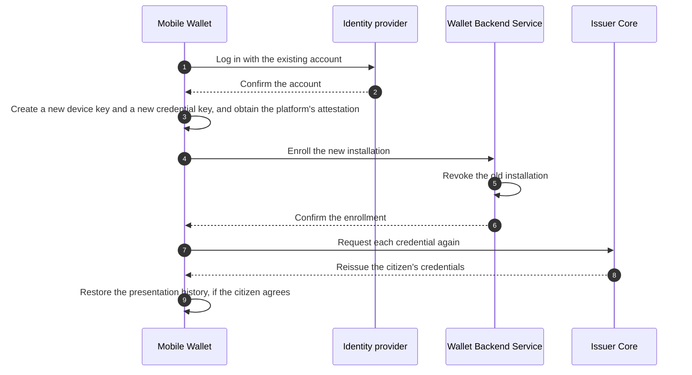

<figcaption> Device migration, from the login on the new device through to the reissued credentials.</figcaption>
</figure>

1. Mobile Wallet logs in to the identity provider with the citizen's existing
   account on the new device.

2. The identity provider returns an `id_token` for that account.

3. Mobile Wallet creates a new device key and a new credential key in the
   secure element of the new device and obtains the platform's attestation
   over them, as at
   [wallet enrollment][wallet-enrollment-and-attestation].

4. Mobile Wallet enrolls the new installation with Wallet Backend Service, as
   at [wallet enrollment][wallet-enrollment-and-attestation], sending the
   `id_token` with it.

5. Wallet Backend Service finds the citizen's account through the
   `id_token` and revokes the old installation, which obtains no further
   Key Attestation and so can obtain no further credential.

6. Wallet Backend Service confirms the enrollment, marking the new
   installation active.

7. Mobile Wallet requests each credential again from its Issuer Core through
   the [Authorization Code flow][authorization-code-flow], using the new
   credential key and a Key Attestation for it.

8. Issuer Core reissues the credential in each format its Rulebook names,
   bound to the new credential key.

9. Mobile Wallet offers to restore the presentation history from the
   encrypted client-side backup and restores it if the citizen agrees.
   The history holds no key and no attribute value, so it needs no
   reissuing.

### Credential renewal {#credential-renewal}

A credential is technically valid until its `exp`, and a KTP Digital carries one like
any other. Renewal keeps presentations working past that date
without sending the citizen through a new authorization. Mobile Wallet
exchanges the refresh token Issuer Core gave it at issuance for a fresh
access token and asks for the credential again, the credential refresh
OpenID4VCI describes. The refresh
token is bound with DPoP to the installation that received it, so renewal
serves the same phone only; a new phone goes through
[device migration][device-migration], which is a fresh issuance with the
citizen's authentication.

{ #fig-credential-renewal }

<figure markdown="1">

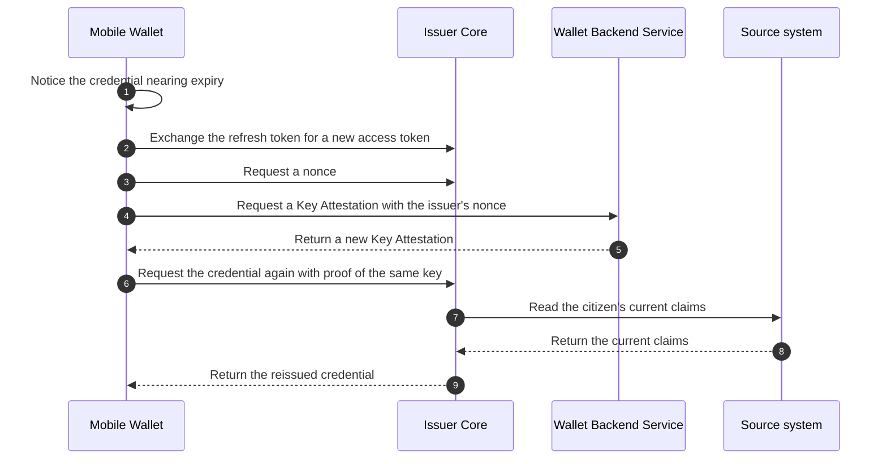

<figcaption> Credential renewal, from the wallet noticing the approaching expiry through to the reissued credential on the same phone.</figcaption>
</figure>

1. Mobile Wallet notices that a stored credential is approaching its `exp`,
   with the lead time the Governance Profile sets, and starts renewal on its
   own. The citizen is not asked to act, though the wallet also lets them
   start it by hand.

2. Mobile Wallet presents the refresh token to Issuer Core's token endpoint
   and receives a fresh access token. A refresh token that has expired or been revoked ends the
   shortcut, and the wallet falls back to the
   [Authorization Code flow][authorization-code-flow].

3. Mobile Wallet requests a nonce, sending `POST /nonce` to Issuer Core.

4. Mobile Wallet sends Wallet Backend Service the issuer's nonce with the
   evidence its platform requires, as before each issuance.

5. Wallet Backend Service returns a new Key Attestation for the same
   credential key. An attestation serves one credential request, so renewal
   never reuses the one from the first issuance.

6. Mobile Wallet sends a credential request to Issuer Core with the new
   Key Attestation as the proof itself, for the same credential key, which
   Issuer Core checks as at first issuance. No signature by the credential key
   is asked for, because only the citizen's authentication releases that key.

7. Issuer Core reads the citizen's current claims from the source system,
   using its Claims Provider Component, as it does at first issuance.

8. The source system returns the current claims, which Issuer Core receives
   through its Claims Provider Component with the current `data_as_of`
   value. A claim that has changed since the first issuance is carried as
   it now stands; it is the credential that is renewed, not the record.

9. Issuer Core signs the credential again in each format its Rulebook names,
   with a new technical validity period that it chooses within the
   Governance Profile's ceiling and never past the administrative period,
   and returns it to Mobile Wallet. The credential it replaces needs no revocation: it expires on its
   own.

### Citizen-initiated revocation {#citizen-initiated-revocation}

A citizen can have their credentials revoked before replacing a lost or
compromised device, by reporting the loss to the issuer. The phone is gone, so
the report runs outside Mobile Wallet, on a channel the issuer provides; which
channels count, and how the citizen proves who they are on one, is set out in
the Governance Framework under [loss reports][gf-loss-reports].

The same loss is reported to the Wallet Provider, which revokes the installation
so that it obtains no further Key Attestation, the path
[device migration][device-migration] shows. The two reports reach different
parties: the issuer's status change reaches credentials already held, and the
Wallet Provider's stops new issuance.

The issuer suspends first, because a loss report is a doubt being checked rather
than a finding, as [credential lifecycle][credential-lifecycle] explains. The
entry becomes invalid once the citizen holds the credential on another
installation, or when the suspension period the Governance Profile sets runs
out.

{ #fig-citizen-initiated-revocation }

<figure markdown="1">

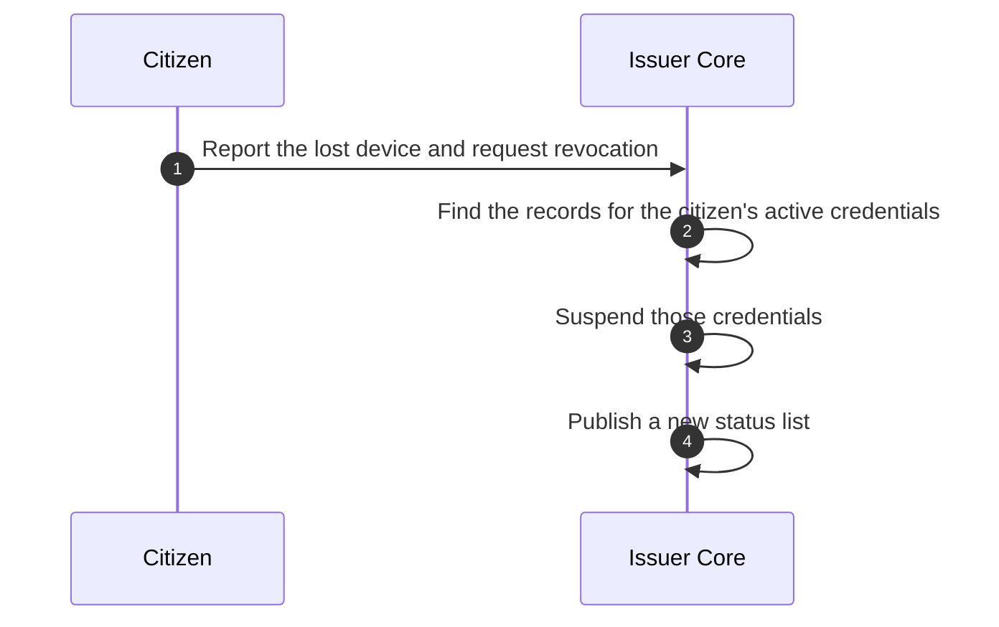

<figcaption> Citizen-initiated revocation, from the citizen's report to the issuer through to the published Status List Token.</figcaption>
</figure>

1. The citizen reports the lost device to the issuer and asks for
   revocation, on the channel the issuer runs for it outside the wallet.

2. Issuer Core retrieves the `issuance_record` for the citizen's active
   credentials, identifying their index positions in the status list.

3. Issuer Core sets the entries at those indices to suspended, using its
   Status Manager Component, within the time [loss reports][gf-loss-reports]
   allows it.

4. Issuer Core publishes a new Status List Token, and for an `ldp_vc` a new
   Bitstring Status List, reflecting the suspended status.

Verifiers do not see the change right away. They pick up the new
Status List Token at their next [trust cache sync][trust-cache-sync] and reject
presentations from the lost device from that point on. Mobile Wallet learns of
it on the same sync.
