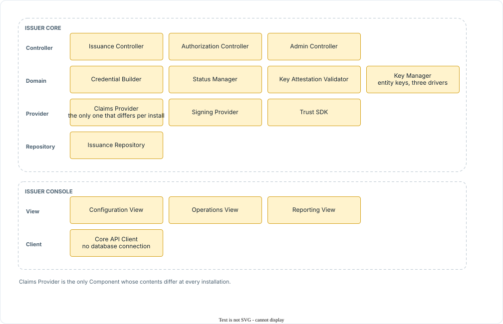
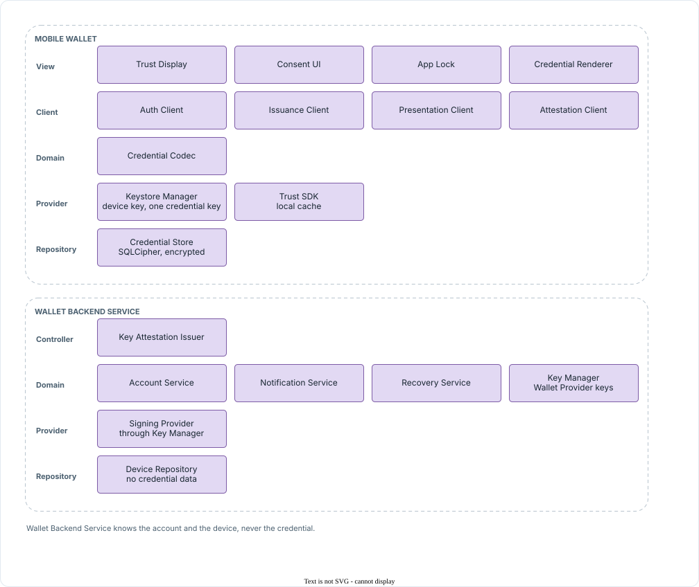
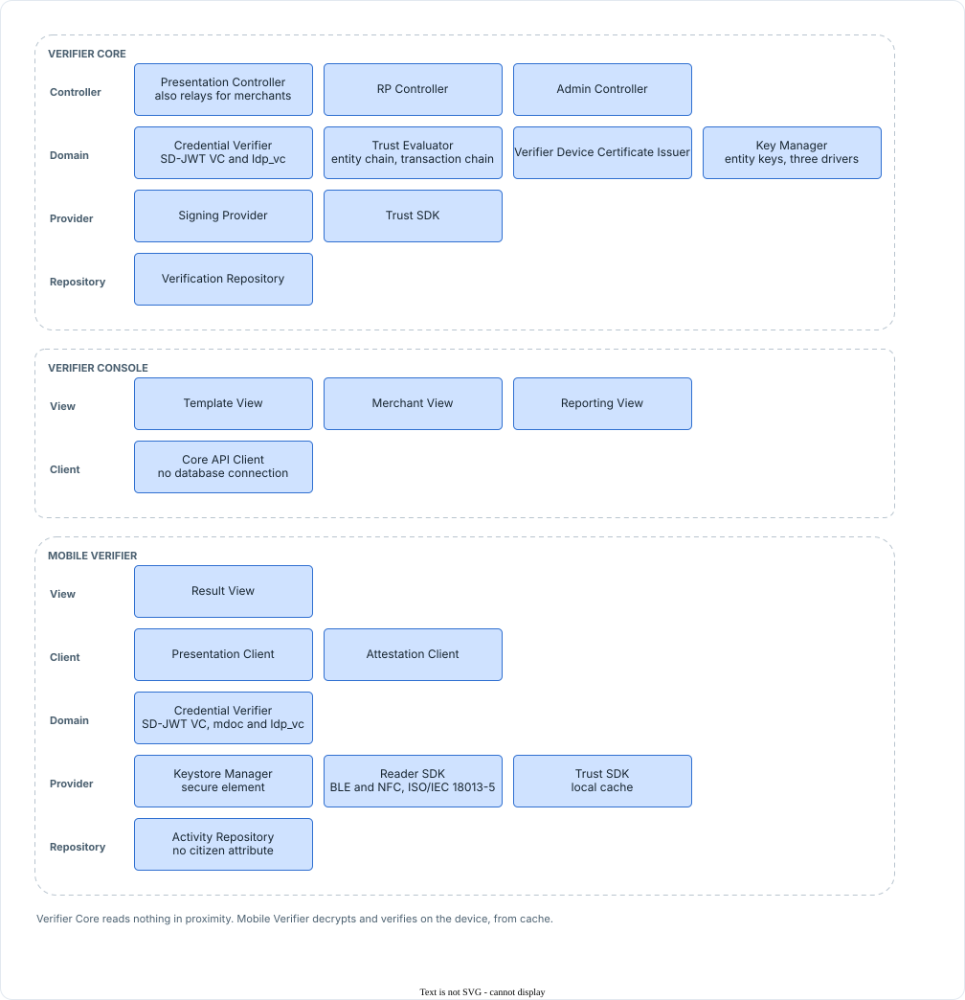
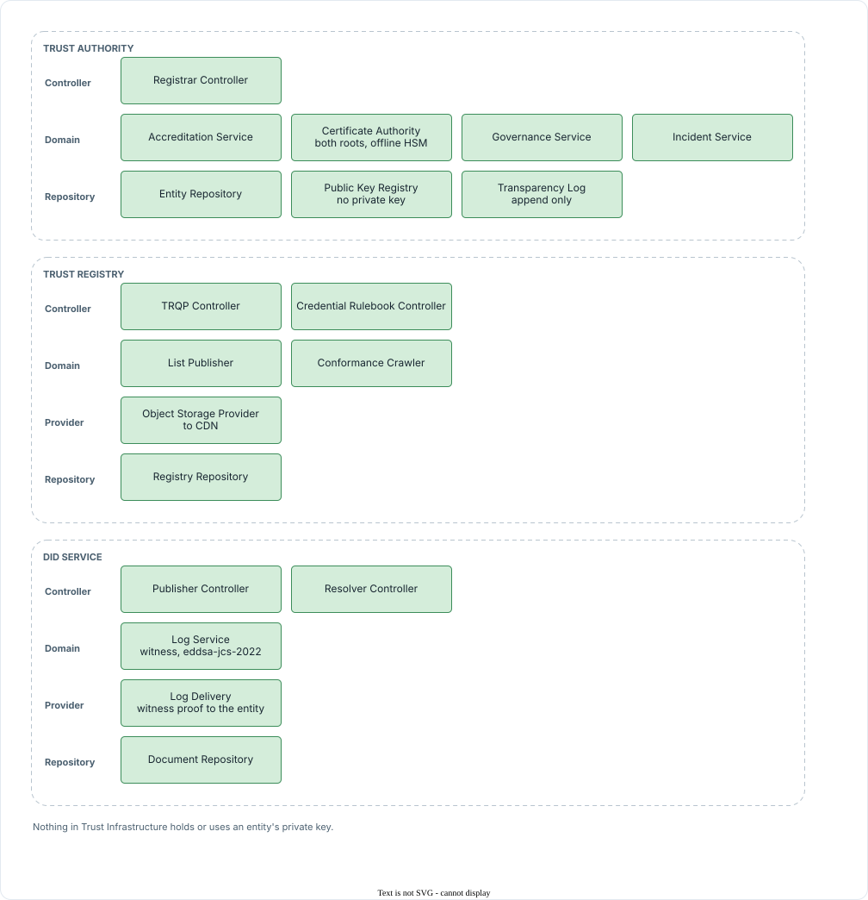
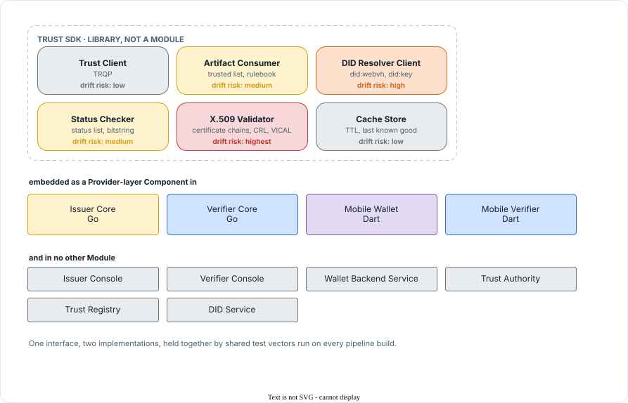

<!-- Sumber: Arsitektur Ekosistem Identitas Digital v0.2, §9, Kep. 5, 9, 28, 29, 30; tracks/0169 (fallback log DID ke DID Service, tidak ada di sumber); tracks/0211; tracks/0213, tracks/0220 -->

# Components inside a Module {#components-inside-a-module}

A Component is a part of a Module that is not deployed on its own, where
[Module Map](../high-level-architecture/module-map.md) names the ten units
that ship.

Every Component sits in one of the layers
[Layers inside a Module](layers-inside-a-module.md) defines, and the
layer is given for each, because what a Component may call depends on which
layer it is in rather than on what it does.

## Issuer Services {#sa-issuer-services}

[Layers inside a Module](layers-inside-a-module.md) sets out the four layers of
a server Module, and what a console or application Module has in place of a
Controller. In either case a Component is drawn where it is because of what it does, not because
of the layer it happens to sit in: it holds one responsibility, removing it
leaves a functional hole, and the full set of Components together covers
everything the Module does. Claims Provider is the clearest case: it faces the
source system outside the Module, and the Provider layer is where everything
facing outward goes.

{ #fig-issuer-services-components }

<figure markdown="1">
  { loading=lazy }
  <figcaption> Issuer Core and Issuer Console by layer.</figcaption>
</figure>

### Issuer Core {#sa-issuer-core}

Issuer Core is where credentials come from, as [Issuer Core][hla-issuer-core]
describes it.

<figure markdown="1" class="ekdn-table">

| Component | Layer | What it does | Standards |
|---|---|---|---|
| Issuance Controller | Controller | Credential offer, `/credential`, nonce, deferred issuance, notification, and the `.well-known` metadata, signed with the `issuance-jose` key | OpenID4VCI 1.0, [RFC 8414][ref-rfc8414] |
| Authorization Controller | Controller | Pre-authorized code with `tx_code`, under an attempt limit; authorization code with PKCE | OAuth 2.0, RFC 7636, [RFC 9396][ref-rfc9396] |
| Admin Controller | Controller | The internal endpoint for Issuer Console; the only path by which configuration is changed | None |
| Credential Builder | Domain | Assembles SD-JWT VC (salt, disclosure, `cnf`), mdoc (MSO, `valueDigests`, `deviceKey`, `x5chain` in the unprotected header), and VCDM 2.0 `ldp_vc` (JSON-LD, a Data Integrity `proof` in `ecdsa-rdfc-2019`, RDFC-1.0 canonicalization over contexts read from cache); computes derived attributes as the Credential Rulebook specifies | IETF SD-JWT VC, ISO/IEC 18013-5, W3C VCDM 2.0, VC Data Integrity, ECDSA Cryptosuites v1.0, JSON-LD 1.1, RDFC-1.0 |
| Status Manager | Domain | Random index allocation inside a partition, revocation, reissuing the Status List Token and a Bitstring Status List per purpose, hosted on the issuer's own domain | IETF Token Status List, W3C Bitstring Status List |
| Key Attestation Validator | Domain | Before every issuance: validates the Key Attestation (the signer is a Wallet Provider whose trusted list entry reads `granted`, the nonce matches and is accepted in one credential request only, it has not expired, the proof key is present in `attested_keys`, `key_storage` and `user_authentication` meet the `min_assurance` mapping in the Governance Profile, which sets a lower bar at `low`) | OpenID4VCI 1.0 App. D.1, F.1, F.3 |
| Claims Provider | Provider | The extension point into the source system, `getClaims(subjectRef, credentialType)`; read-only; returns only the fields listed in the Credential Rulebook; has no notion of credential format; stores no PII. Built from a Source Connector (REST, SOAP, JDBC, CDC), a Mapping Service (normalizes to the Credential Rulebook schema, `data_as_of`), and a Staging Repository (periodic replication only) | JSON Schema |
| Key Manager | Domain | Generates, stores, and rotates `issuance-jose`, `issuance-cose`, `status-list`, and the Ed25519 `did:webvh` update key through a driver: an encrypted software keystore by default, a cloud KMS (`cloudkms`), or an HSM over PKCS#11 (`hsm`); registers each public key with Trust Authority (a `did.jsonl` entry, proof of possession, `keyStorage`, and a CSR); scheduled rotation; publishes `did.jsonl` | did:webvh v1.0, [`eddsa-jcs-2022`][ref-vc-di-eddsa], [RFC 2986][ref-rfc2986], PKCS#11 |
| Signing Provider | Provider | JWS with the `issuance-jose` key (also the Data Integrity proof of `ldp_vc`); `COSE_Sign1` with the `issuance-cose` key and the DSC in `x5chain`; the Status List Token and the Bitstring Status List with the `status-list` key; through Key Manager | PKCS#11, RFC 7515, RFC 9052 |
| Trust SDK | Provider | Trusted list, Credential Rulebook, DID resolution, TRQP; the library's own contents are in [Trust SDK][sa-trust-sdk] | ETSI TS 119 602, ToIP TRQP v2.0 |
| Issuance Repository | Repository | `issuance_record` (`credential_type`, the subject pseudonym as a keyed hash (HMAC) of the subject, credential key thumbprint, status index, `signing_key_ref`, digest, `holder_key_storage`, `data_as_of`, `issued_at`), the status list, deferred requests, a local copy of the Credential Rulebook | None |

</figure>

Nothing Claims Provider does can write back into an institution's own records,
and it holds no personally identifiable information (PII) of its own. The
mapping to SD-JWT-based Verifiable Credentials (SD-JWT VC) draft -13, mdoc, or
`ldp_vc` happens one layer up, in Credential Builder, so Claims Provider has
no notion of the format the claims it returns will take.

### Issuer Console {#sa-issuer-console}

Issuer Console is the operator's side of Issuer Core, as
[Issuer Console][hla-issuer-console] describes it. It holds no database
connection of its own, so an operator's session cannot reach around the
Admin API to the data underneath.

<figure markdown="1" class="ekdn-table">

| Component | Layer | What it does | Standards |
|---|---|---|---|
| Configuration View | View | Selecting a credential type from the Credential Rulebook, display templates, credential configuration | OpenID4VCI credential configuration |
| Operations View | View | Batch issuance, single and bulk revocation, the deferred queue | None |
| Reporting View | View | Issuance reports, status list monitoring, the audit trail | None |
| Core API Client | Client | Calls the Admin Controller. Opens no database connection of its own | None |

</figure>

## Wallet Services {#sa-wallet-services}

Wallet Services is two Modules: the application on the citizen's phone,
and Wallet Backend Service, which vouches for it.

{ #fig-wallet-services-components }

<figure markdown="1">
  { loading=lazy }
  <figcaption> The wallet's five layers, and Wallet Backend Service, which vouches for it.</figcaption>
</figure>

### Mobile Wallet {#sa-mobile-wallet}

Mobile Wallet is the citizen's application, as
[Mobile Wallet][hla-mobile-wallet] describes it. It is an application Module,
so it has no Controller: Views and Clients sit on top instead.

<figure markdown="1" class="ekdn-table">

| Component | Layer | What it does | Standards |
|---|---|---|---|
| Trust Display | View | Through the Trust SDK, for an accredited Relying Party: resolves the `client_id` did:webvh from cache and checks scope against the cached TRQP answer. For a merchant: validates the `x5c` or `x5chain` chain up to the Verifier Root CA, confirms the Issuing CA is on the trusted list and not named there as revoked, matches the certificate hash against `client_id`, and rejects any attribute outside `ReaderAuthRole`. For both: checks the Use Statement, in `verifier_info` online or `requestInfo` offline, matches the requested attributes against it, and takes the displayed purpose from it, warning the citizen where none is present during the transition; shows the requester's official name, or for a merchant the name from its certificate, and that purpose before consent | OpenID4VP 1.0 (`decentralized_identifier`, `x509_hash`, `verifier_info`), did:webvh, ISO/IEC 18013-5, RFC 5280 |
| Consent UI | View | Per-request consent: shows the attributes a request asks for, which the citizen approves whole or refuses | IETF SD-JWT, ISO/IEC 18013-5 |
| App Lock | View | Authenticates the citizen by biometrics, enforces a session timeout, and locks the app in the background; kept separate from the identity provider login | BiometricPrompt, LocalAuthentication |
| Credential Renderer | View | Displays a credential according to the Credential Rulebook's display metadata, with localization | SD-JWT VC Type Metadata |
| Auth Client | Client | Logs the citizen in at the identity provider, as its OpenID Connect client; session and token handling; links the account to the device | OpenID Connect Core, PKCE |
| Issuance Client | Client | Receives the credential offer and runs PAR with PKCE and DPoP; selects the proof type according to `proof_types_supported` and `key_attestations_required` in the issuer's metadata | OpenID4VCI 1.0 |
| Presentation Client | Client | Receives the authorization request, parses DCQL, matches credentials, produces the Key Binding JWT, handles QR or NFC engagement, the BLE session, and the SessionTranscript of each engagement | OpenID4VP 1.0, ISO/IEC 18013-5 |
| Attestation Client | Client | Enrolls the installation; exchanges the attestation platform and integrity verdict for a Key Attestation bound to the issuer's nonce. Called before each issuance; the issuer's `key_attestations_required` sets what the attestation must report | OpenID4VCI 1.0 App. D.1, Play Integrity, App Attest |
| Credential Codec | Domain | Parses and reassembles SD-JWT VC, mdoc, and `ldp_vc`: disclosures, IssuerSigned, DeviceAuth, the Data Integrity proof | IETF SD-JWT VC, ISO/IEC 18013-5, W3C VCDM 2.0, VC Data Integrity, JSON-LD 1.1, RDFC-1.0 |
| Keystore Manager | Provider | The device key, one per installation, and the credential key, one per installation and shared by every credential, in the secure element; attestation platform; the credential key doubles as `DeviceKey` in the MSO | Android Keystore, iOS Secure Enclave |
| Trust SDK | Provider | Trusted list, the Use Statement status list, and the JSON-LD contexts of `ldp_vc` Rulebooks from local cache; the Use Statement status list falls back to the last-known-good copy, the trusted list never does | ETSI TS 119 602, IETF Token Status List |
| Credential Store | Repository | Encrypted storage for all three formats, an encrypted client-side backup, a local presentation history holding each signed request, its Use Statement, the outcome, and the time | SQLCipher, Android Keystore |

</figure>

### Wallet Backend Service {#sa-wallet-backend-service}

Wallet Backend Service proves an installation is genuine, as
[Wallet Backend Service][hla-wallet-backend-service] describes it. It stores
no credentials at all, which lets it disown a wallet without ever being able
to read what that wallet holds.

<figure markdown="1" class="ekdn-table">

| Component | Layer | What it does | Standards |
|---|---|---|---|
| Key Attestation Issuer | Controller | Verifies the attestation platform up to the Google or Apple root at enrollment, and at each request the device key signature or App Attest assertion against the record, with the integrity verdict where the platform produces one; issues a Key Attestation carrying `attested_keys`, `key_storage`, `user_authentication`, and `nonce`; rejects a revoked installation | OpenID4VCI 1.0 App. D.1, [Android Key Attestation][ref-android-key-attestation], App Attest, Play Integrity |
| Account Service | Domain | Validates the identity provider's token, links the citizen's account to the device, and forms the basis for recovery | OpenID Connect Core |
| Notification Service | Domain | Pushes the Wallet Provider's own notices to its installations. No issuer is party to them: a credential offer reaches the wallet by QR code or deeplink, and a revoked credential is read from the issuer's status list | None |
| Recovery Service | Domain | Encrypted client-side backup, orchestrating reissuance on a new device, revoking a lost device | None |
| Key Manager | Domain | Generates, stores, and rotates the Wallet Provider's Key Attestation key (P-256) and its Ed25519 `did:webvh` update key through a driver, and registers them with Trust Authority | did:webvh v1.0, `eddsa-jcs-2022`, PKCS#11 |
| Signing Provider | Provider | Signs the Key Attestation with the Wallet Provider's key, through Key Manager | PKCS#11, RFC 7515 |
| Device Repository | Repository | The registry of active and revoked devices, device key thumbprints, links to the account at the identity provider. Holds no credential data | None |

</figure>

Device Repository is where the no-credentials rule shows in the schema: there
is no column a credential could go in.

## Verifier Services {#sa-verifier-services}

Verifier Services is three Modules: the Core an accredited Relying Party runs,
the Console its staff work in, and the application that reads on a device,
carried by a merchant with no server or set on a Relying Party's counter.

{ #fig-verifier-services-components }

<figure markdown="1">
  { loading=lazy }
  <figcaption> All three verifying Modules.</figcaption>
</figure>

### Verifier Core {#sa-verifier-core}

Verifier Core is the Relying Party's verifying backend, as
[Verifier Core][hla-verifier-core] describes it. Whatever front end sits
before it belongs to the Relying Party, and it reads nothing in proximity:
that happens on the device, in [Mobile Verifier][sa-mobile-verifier] or in a
Relying Party's own application built on the Reader SDK. The Trust Evaluator
row below names the two chains a verification walks.

<figure markdown="1" class="ekdn-table">

| Component | Layer | What it does | Standards |
|---|---|---|---|
| Presentation Controller | Controller | Authorization request, DCQL, `request_uri`, accepts `vp_token` through `direct_post.jwt`; attaches the Use Statement of the template's registered use in `verifier_info`; also serves as the relayed `request_uri` and `response_uri` for a merchant's Mobile Verifier (ciphertext only, short lifetime, never opened) | OpenID4VP 1.0, RFC 9101 |
| RP Controller | Controller | Bridges OpenID Connect and SAML to the Relying Party's business system; forwards attributes without storing them | OpenID Connect Core, SAML 2.0 |
| Admin Controller | Controller | Internal endpoint for Verifier Console | None |
| Credential Verifier | Domain | Verifies SD-JWT VC (signature, KB-JWT, disclosures) and `ldp_vc` (the Data Integrity proof on the credential, canonicalized under RDFC-1.0 with every `@context` read from cache, and the proof on the VP, checked against `challenge` and `domain`). An mdoc is read in proximity, so the reader on the device verifies it, through the Reader SDK | RFC 9901, W3C VCDM 2.0, VC Data Integrity, JSON-LD 1.1, RDFC-1.0 |
| Trust Evaluator | Domain | Walks the entity chain E1 to E5 and the transaction chain T1 to T6; enforces accreditation scope and minimization; policy written as Rego | ToIP TRQP, ETSI TS 119 602, IETF Token Status List, OPA/Rego |
| Verifier Device Certificate Issuer | Domain | Onboards each reader device it answers for: used by a Relying Party for its own devices, for offline reading, and by an RP Intermediary for its merchants, after verifying the business's identity. Binds the device, checks application integrity; issues the Verifier Device Certificate with its `ReaderAuthRole`, a subset of the union of the Use Statements handed over with it, from this Verifier Core's own Verifier Issuing CA, for a lifetime the Governance Profile sets; issues the CRL; rejects revoked devices. Online, an accredited Relying Party still introduces itself through its DID | OpenID4VP client identifier, ISO/IEC 18013-5 |
| Key Manager | Domain | Generates, stores, and rotates the Request Object key, the Verifier Issuing CA key, and the Ed25519 `did:webvh` update key through a driver: an encrypted software keystore by default, a cloud KMS (`cloudkms`), or an HSM over PKCS#11 (`hsm`); registers each public key with Trust Authority (a `did.jsonl` entry, proof of possession, `keyStorage`, and a CSR) | did:webvh v1.0, `eddsa-jcs-2022`, RFC 2986, PKCS#11 |
| Signing Provider | Provider | Signs the Request Object and, through the Verifier Issuing CA, the Verifier Device Certificate, through Key Manager; decrypts each response with the key drawn for its request | PKCS#11, RFC 7515, [RFC 7516][ref-rfc7516] |
| Trust SDK | Provider | Trusted list, DID resolution, status list, CRL, and the JSON-LD contexts and credential schemas of `ldp_vc` Rulebooks | ETSI TS 119 602, ToIP TRQP |
| Verification Repository | Repository | `verification_record` (txId, requested attributes, outcome, `use_id`, `trust_list_version`, `vp_digest`, consent receipt), `request_template` with the `use_id` it names, `use_statement`, `client_app`, and each merchant's `verifier_instance` | [ISO/IEC TS 27560][ref-iso-27560], [ISO/IEC 29184][ref-iso-29184] |

</figure>

### Verifier Console {#sa-verifier-console}

Verifier Console is the operator's side of Verifier Core, as
[Verifier Console][hla-verifier-console] describes it. Like Issuer Console it
reaches its Core only through the Admin API, and nothing in it touches
Verifier Core's database directly.

<figure markdown="1" class="ekdn-table">

| Component | Layer | What it does | Standards |
|---|---|---|---|
| Template View | View | Defines request templates with their attributes and purpose; each names one registered use and is validated against that Use Statement | OpenID4VP DCQL |
| Merchant View | View | Merchant onboarding, setting each merchant's `allowed_attrs`, device revocation, device inventory | None |
| Reporting View | View | Consent receipt archive, verification reports | None |
| Core API Client | Client | Calls the Admin Controller. Opens no database connection of its own | None |

</figure>

### Mobile Verifier {#sa-mobile-verifier}

Mobile Verifier is the verifier application for merchants and for a
Relying Party's counter, as [Mobile Verifier][hla-mobile-verifier] describes
it. There is no web version, because a browser cannot hold the keys this
design requires.

Its proximity reading lives in the Reader SDK, a Dart library. Reading over Bluetooth Low
Energy (BLE) and Near Field Communication (NFC) has to happen on a physical
device, so the library is embedded here, and a Relying Party may embed the same
library in its own application instead of running Mobile Verifier.

For `ldp_vc`, its Credential Verifier carries a JSON for Linked Data
(JSON-LD) 1.1 processor and a Resource Description Framework (RDF) Dataset
Canonicalization (RDFC-1.0) canonicalizer, the same pair Verifier Core's
Credential Verifier holds in Go.

The Activity Repository keeps the record of that work on the device, and the
record is the verification itself rather than the citizen: it holds no
attribute belonging to the person whose credential was checked.

<figure markdown="1" class="ekdn-table">

| Component | Layer | What it does | Standards |
|---|---|---|---|
| Result View | View | Shows the verification result to the merchant on screen | None |
| Presentation Client | Client | Assembles the request, QR or deeplink; online, hands the Request Object, carrying the Use Statement in `verifier_info`, to the RP Intermediary's Verifier Core and collects the response from it; offline, engages by QR or NFC and reads an mdoc over BLE through the Reader SDK, with ReaderAuth from the Verifier Device Certificate and the Use Statement in `requestInfo` | OpenID4VP 1.0, ISO/IEC 18013-5 |
| Attestation Client | Client | Enrolls the device with the Verifier Core that answers for it (the RP Intermediary's for a merchant, the Relying Party's own for a counter device), retrieves and renews the Verifier Device Certificate together with the Use Statements of the uses bound to the device; hands over the platform evidence of the device key at activation and renewal | OpenID4VP client identifier, [Android Key Attestation][ref-android-key-attestation], Play Integrity, App Attest |
| Credential Verifier | Domain | Verifies SD-JWT VC, mdoc, and `ldp_vc`; both trust chains, from cache | RFC 9901, ISO/IEC 18013-5 |
| Keystore Manager | Provider | Device key in the secure element, which signs the Request Object; the key drawn for each request, which decrypts its response on the device | Android Keystore, iOS Secure Enclave |
| Reader SDK | Provider | The proximity reading library a Relying Party's own application may also embed: QR or NFC engagement, the BLE session, DeviceRequest with ReaderAuth, verification of the DeviceResponse | ISO/IEC 18013-5 |
| Trust SDK | Provider | Trusted list, status list, VICAL, and the JSON-LD contexts and credential schemas of `ldp_vc` Rulebooks from the local cache | ETSI TS 119 602 |
| Activity Repository | Repository | Verification history on the device; holds no citizen attribute | None |

</figure>

## Trust Infrastructure {#sa-trust-infrastructure}

Trust Infrastructure is three Modules. Only the first has a human at the
controls; the other two carry out what the Root Authority decides through it
and publish the result. No
entity key is created in any of the three. Entities generate their own, and
Trust Infrastructure certifies, witnesses, and records the public halves.

{ #fig-trust-infrastructure-components }

<figure markdown="1">
  { loading=lazy }
  <figcaption> The control plane in full.</figcaption>
</figure>

### Trust Authority {#sa-trust-authority}

Trust Authority is where registration, accreditation, and authorization
happen, as [Trust Authority][hla-trust-authority] describes it. Its two roots
sit in offline hardware security modules (HSMs), one each, and its other keys,
the trusted list key among them, in its own HSM, as
[Trust Authority's own keys][trust-authoritys-own-keys] sets out.

<figure markdown="1" class="ekdn-table">

| Component | Layer | What it does | Standards |
|---|---|---|---|
| Registrar Controller | Controller | Self-service entity portal with MFA, for registration, uses, further permissions, incidents, and the record; the entity endpoint, `POST /entities/me/keys`, for a log entry, proof of possession, storage evidence, and a CSR; operator back office with MFA | None |
| Accreditation Service | Domain | Registration, verification that the applicant is a legal body, intake of assessment-body reports, recording of status decisions, issuance of the Authority Statement, the Use Statement, and the Accreditation Credential, and withdrawal of a single use; Approval Tiers A, B, and C | ToIP TRQP, IETF SD-JWT VC |
| Certificate Authority | Domain | Issuer Root CA and Verifier Root CA, each self-signed in its own offline HSM; issues the Document Signer Certificate (EKU 1.0.18013.5.1.2) and the Verifier Issuing CA, for an RP Intermediary and for a Relying Party that reads offline, from a CSR; issues the CRL of each root, which Trust Registry serves; signs each published version of the trusted list and of the VICAL with the trusted list key and the VICAL key | ISO/IEC 18013-5 Annex B and Annex C, ETSI TS 119 602, RFC 7515, RFC 5280, RFC 2986 |
| Governance Service | Domain | List of `action` and `resource`, mapping of `min_assurance` to ISO/IEC 18045 values and of `issuer_assurance` to Key Manager drivers, cache TTL, tolerance limits, the `NextUpdate` horizon of the trusted list, the cut-off date for requests carrying no Use Statement, list of Assessment Bodies | None |
| Incident Service | Domain | Revokes a compromised key, suspends or withdraws an entity on the Root Authority's decision, orders the emergency trusted list, notifies Relying Parties directly | None |
| Entity Repository | Repository | Entity data, status, accreditation, and authorization history | None |
| Public Key Registry | Repository | `keyRef`, thumbprint, `purpose`, evidence of `keyStorage`, validity, status; no private key | None |
| Transparency Log | Repository | Append-only record of every entity event, no citizen transaction; read outside Trust Authority only by each entity, for its own events, through the portal | [RFC 6962][ref-rfc6962] / [RFC 9162][ref-rfc9162] |

</figure>

### Trust Registry {#sa-trust-registry}

Trust Registry answers queries and publishes the lists, as
[Trust Registry][hla-trust-registry] describes it. Everything it publishes
goes out through a content delivery network (CDN) as a static file, which is
how it stays off the transaction path.

<figure markdown="1" class="ekdn-table">

| Component | Layer | What it does | Standards |
|---|---|---|---|
| TRQP Controller | Controller | `POST /authorization`, `POST /recognition`; errors as Problem Details | ToIP TRQP v2.0, RFC 9457 |
| Credential Rulebook Controller | Controller | `GET /rulebooks`, `GET /rulebooks/{id}`; schema, display, minimization, `min_assurance`; each version frozen once published | JSON Schema, SD-JWT VC Type Metadata |
| List Publisher | Domain | LoTE JSON, VICAL, JSON-LD Context, the Use Statement status list, the accreditation status list; status with history (`StatusStartingTime`, `NextUpdate`); the keys an entry names as revoked early | ETSI TS 119 602, ISO/IEC 18013-5 Annex C |
| Conformance Crawler | Domain | Compares the `.well-known` metadata an issuer publishes against its approved scope, and looks for `did:webvh` log entries without a witness in every entity's log; findings go to Incident Service | None |
| Object Storage Provider | Provider | Publishes static artifacts to the CDN with refresh jitter | None |
| Registry Repository | Repository | Its copy of the Authority Statements and Use Statements Trust Authority records, each with its status history | None |

</figure>

### DID Service {#sa-did-service}

Decentralized Identifier (DID) Service witnesses and resolves `did:webvh` v1.0
identifiers, as [DID Service][hla-did-service] describes it. The entity signs
its own log on its own domain, and DID Service adds the witness proof without
which no resolver accepts an entry. The identifier itself is fixed by the
design principle
[finished specifications only][finished-specifications-only].

<figure markdown="1" class="ekdn-table">

| Component | Layer | What it does | Standards |
|---|---|---|---|
| Publisher Controller | Controller | Receives a new `did:webvh` log entry from Trust Authority, which collected it from the entity, with proof of possession of each new key; an entity never calls it | W3C DID Core |
| Resolver Controller | Controller | Replays the `did:webvh` log and verifies the chain; decodes `did:key` locally; serves its copy of an entity's log to a scheduled sync that cannot reach the entity's own domain | did:webvh, [W3C DID Resolution][ref-did-resolution] |
| Log Service | Domain | Witness: validates each `did.jsonl` entry the entity signed (the chain, pre-rotation `nextKeyHashes`, proof of possession, and an update key that Trust Authority's Public Key Registry does not record as revoked; Trust Authority has already checked `keyStorage` against `issuer_assurance`), then signs the witness proof in `eddsa-jcs-2022` with the witness key in Trust Authority's HSM; the old key stays in `verificationMethod` but drops out of `assertionMethod` | did:webvh v1.0 |
| Log Delivery | Provider | Returns the witness proof to Trust Authority, which passes it to the entity, and watches that `did.jsonl` stays available on the entity's own domain | None |
| Document Repository | Repository | Log, versions, validity range; the copy the Resolver Controller serves as a fallback | None |

</figure>

## Trust SDK {#sa-trust-sdk}

Trust SDK is not on the Module list in [the ten Modules][the-ten-modules], and
[what is not a Module][what-is-not-a-module] already says why: it does not
ship as its own container image. It exists in two implementations instead,
Go for Issuer Core and Verifier Core, Dart for Mobile Wallet and
Mobile Verifier, embedded in each as a Provider-layer Component. Neither
Console carries it, Wallet Backend Service does not carry it, and no Module
inside Trust Infrastructure carries it either: the
four Modules that read published trust artifacts are the only four that
need to resolve them.

Both implementations expose the same interface: `checkAuthorization`,
`checkRecognition`, `resolveDID`, `getTrustedList`, `getRulebook`,
`verifyX509Chain`, `checkStatus`. Behind that interface are six parts, each
carrying its own risk that the Go and Dart versions drift apart.

<figure markdown="1" class="ekdn-table">

| Part | What it does | Go-Dart duplication risk | Standards |
|---|---|---|---|
| Trust Client | `checkAuthorization` and `checkRecognition` against TRQP | Low | ToIP TRQP v2.0 |
| Artifact Consumer | Downloads, verifies the JWS, validates the trusted list and the Credential Rulebook; checks each `ldp_vc` context against the Rulebook's `context_digest` | Medium | ETSI TS 119 602, RFC 7515 |
| DID Resolver Client | Resolves `did:webvh` (replays the log, verifies the hash chain, checks `proof`, handles pre-rotation, verifies the `eddsa-jcs-2022` proofs of log entries and witnesses) and decodes `did:key`; in the scheduled sync, falls back to DID Service's copy when the entity's domain is unreachable, never on a cache miss mid-transaction | High | did:webvh v1.0 |
| Status Checker | Status List Token and Bitstring Status List: downloads, verifies, decompresses, checks the bit | Medium | IETF Token Status List, W3C Bitstring Status List |
| X.509 Validator | Chains the Document Signer Certificate to the Issuer Root CA and the Verifier Device Certificate to the Verifier Root CA, against the CRL and VICAL. On Dart it calls the platform's own validator, `CertPathValidator` on Android and the Security framework on iOS, rather than a version written from scratch | Highest | RFC 5280, ISO/IEC 18013-5 Annex B and C |
| Cache Store | Redis on the server, an encrypted file on the device; TTL set by the Governance Profile for each kind of copy; the trusted list discarded at its `NextUpdate`; the status list, CRL, VICAL, TRQP answers, `did:webvh` logs, and the Rulebooks with their JSON-LD contexts and credential schemas held as last-known-good until the tolerance limit; signature checked again on every read | Low | None |

</figure>

The X.509 Validator carries the highest risk of the six, which is why both
implementations lean on a platform validator rather than reimplementing chain
validation independently in two languages. Three requirements hold the pair
together regardless: a shared set of test vectors, including malicious cases,
runs against both SDKs on every pipeline run; a change to verification logic is
written into the Technical Specifications before either implementation changes;
and each implementation stays compatible with at least the two previous major
versions.

{ #fig-trust-sdk-parts }

<figure markdown="1">
  { loading=lazy }
  <figcaption> Six parts, two implementations, four Modules.</figcaption>
</figure>

