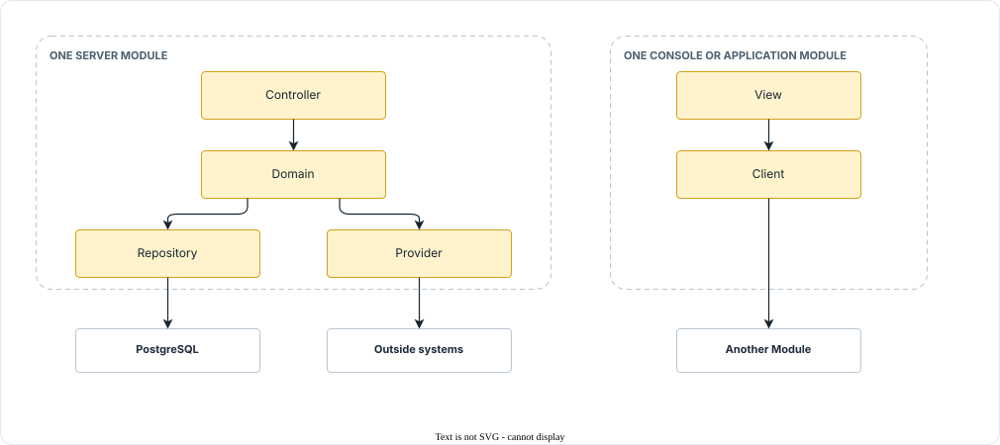

<!-- Sumber: Arsitektur Ekosistem Identitas Digital v0.2, §8 (pembuka), §8.1 (layer sebagai tanggung jawab Component), §8.2, §6.1 (penegakan aturan layer oleh compiler dan depguard; tata letak paket Go tidak dimuat, tracks/0154); Rincian Perangkat Lunak dan Deployment §2. Client dan View tidak didefinisikan di sumber; keduanya diturunkan dari pemakaiannya di tabel component §9 (debt/0054) -->

# Layers inside a Module {#layers-inside-a-module}

Every server Module divides into the same four layers, and one rule orders
them: a layer calls only the layer beneath it, never upward, and never
skipping one. A console or application Module swaps the top layer for two of
its own, and keeps the rule. A layer says what a Component is responsible
for, which is a way of dividing one Module's work. The rest of this page is
what that sentence means in practice.

## The six layers and the rule {#the-six-layers-and-the-rule}

[The layers][fig-layers-inside-a-module] shows the layout every server
Module shares, what the two lowest layers reach outside the Module, and the
pair a console or application Module uses at the top instead.

{ #fig-layers-inside-a-module }

<figure markdown="1">
  { loading=lazy }
  <figcaption> The layers of a server Module, and of a console or application Module.</figcaption>
</figure>

- **Controller** faces the network. It speaks HTTP and JSON, returns status
  codes, and knows the shape of each protocol message.
- **Domain** holds the business rules and the cryptography.
- **Repository** holds the SQL, the table schemas, and the indexes.
- **Provider** faces the systems outside the Module: the source system, the
  hardware security module (HSM), and Trust Infrastructure.
- **PostgreSQL** is what Repository reaches, and nothing else in the Module
  touches it.
- **Outside systems** are what Provider reaches, and nothing else in the
  Module touches them.
- **View** faces the person. It is a screen a citizen, an operator, or a
  merchant works in.
- **Client** faces another Module. It sends the protocol messages that a
  Controller on the other side receives.
- **Another Module** is what Client reaches: a Controller in Issuer Core,
  Verifier Core, Wallet Backend Service, or a system outside IDCTF.

The rule reads downward through that figure. Controller calls Domain. Domain
calls Repository and Provider, which sit side by side at the bottom. Nothing
calls upward, so Repository never calls Domain, and nothing skips a layer, so
Controller never reaches a database or an outside system on its own.

!!! info "A dependency ban can be tested by a machine"

    Because every call outward goes through Provider, a ban on calling some
    other party can be tested rather than promised in a document. The rule
    that Verifier Core never contacts Issuer Core during verification becomes
    a check for a Provider class in Verifier Core that points at an issuer's
    domain. The bans themselves are listed under
    [constraints binding implementations][constraints-binding-implementations].
    The layer rule itself is enforced in the build, not by review: a server
    Module keeps one package per layer, the Go compiler refuses an import of
    an `internal/` package from outside the tree it belongs to, and depguard,
    a linter in the pipeline, refuses the imports the compiler allows but the
    rule does not, such as a handler that imports a repository.

A console or application Module is not a server. Nothing calls into it over
the network, so it has no Controller. In its place it has View and Client:
View is what the person sees and touches, and Client is the mirror of a
Controller, sending outward the messages a Controller receives. View calls
Client, and Client calls the other Module. Domain, Provider, and Repository
keep their meaning wherever one applies: a console has none of the three, an
application on a phone has all three.
[Components inside a Module](components-inside-a-module.md) gives the layer of
every Component in every Module. The Trust SDK is a library and has no layers
of its own; inside the four Modules that embed it, it is one Provider
Component.

A View is a screen, and a Client is a Component that calls another Module;
the Component tables hold no other kind of either. On the citizen's phone the Views are Consent UI, Trust Display, Credential Renderer,
and App Lock, which [Architecture on the
device](../high-level-architecture/architecture-on-the-device.md) calls the
interface part.

## Who knows what {#who-knows-what}

The rule is about calls. What makes it hold is a division of knowledge, which
[the table of who knows what][tbl-who-knows-what] sets out layer by layer.

{ #tbl-who-knows-what }

<figure markdown="1" class="ekdn-table">

| Layer | Knows | Does not know |
|---|---|---|
| Controller | HTTP, JSON, status codes, the shape of each protocol message | The business rules |
| Domain | The business rules and the cryptography | That HTTP exists, that SQL exists |
| Repository | SQL, table schemas, indexes | The business rules |
| Provider | The outside systems: the source system, the HSM, Trust Infrastructure | The business rules |
| View | Screens: what the person sees, selects, and submits | The business rules, the protocol |
| Client | The protocol message to send, and which Module receives it | The business rules |

</figure>

Issuance Controller knows that OpenID for Verifiable Credential Issuance (OpenID4VCI) requires a `/credential` endpoint
that accepts a `proof`. It does not know what selective disclosure is.
Credential Builder knows that an SD-JWT-based Verifiable Credential (SD-JWT VC) needs a salt per disclosure and a
`cnf` claim. It does not know that HTTP exists.

!!! info "A change does not spread"

    What each layer does not know is what keeps a change from spreading.
    Moving to a new version of OpenID for Verifiable Presentations (OpenID4VP) changes the Controller, because only
    the Controller knows the shape of the messages. Changing a minimization
    rule changes the Domain, because only the Domain knows the rules. The two
    changes never meet.

## Examples {#layer-examples}

Three cases show the layers at work. The first two walk one request down
through a server Module. The third shows the pair a console uses instead.

### One credential request through Issuer Core {#one-credential-request-through-issuer-core}

A single `POST /credential`
walks down through all four layers. Issuance Controller parses the proof.
Credential Builder, in Domain, assembles the credential. To do that it calls
three Components beneath it: Claims Provider for the claims, Signing Provider
for the signature, and Issuance Repository for the record. The request never
touches the source system, the HSM, or the database except through those
three.

### One presentation through Verifier Core {#one-presentation-through-verifier-core}

Presentation Controller accepts
the response the wallet posts back. Signing Provider decrypts it, through Key
Manager. Credential Verifier, in Domain, checks the credential's signature,
its Key Binding JSON Web Token (KB-JWT), and its disclosures, and Trust Evaluator, also in Domain,
walks the entity chain and the transaction chain. Both read the trusted list
and the status list through the Trust SDK, from cache, so no call leaves for
Trust Registry while the citizen waits. Verification Repository writes the
`verification_record`, and RP Controller hands the attributes to the Relying
Party's business system without storing them.

### A console that never reaches the database {#a-console-that-never-reaches-the-database}

Issuer Console has three Views
and one Client, and no Repository at all. Configuration View, Operations View,
and Reporting View call Core API Client, and Core API Client calls Admin
Controller in Issuer Core. Whatever an operator does in the console reaches
the data only through that Controller, which is why a console session cannot
reach around the API to the tables underneath.

!!! info "A Provider can be replaced without touching anything else"

    One institution reads its source system over REST, another replicates it
    overnight. What differs between the two installations of Issuer Core is
    one class in the Provider layer, Claims Provider, and nothing above it.
    Replacing the protocol is the same story one layer up: it changes the
    Controller and nothing else.
