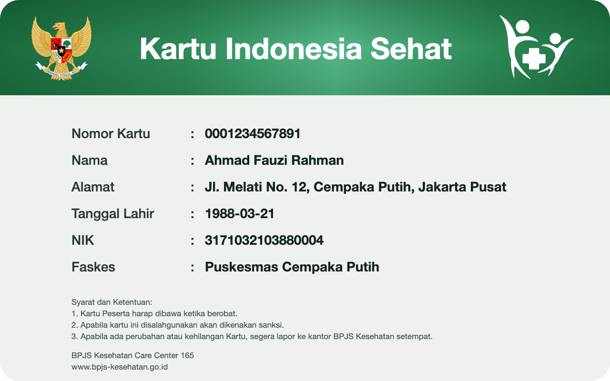
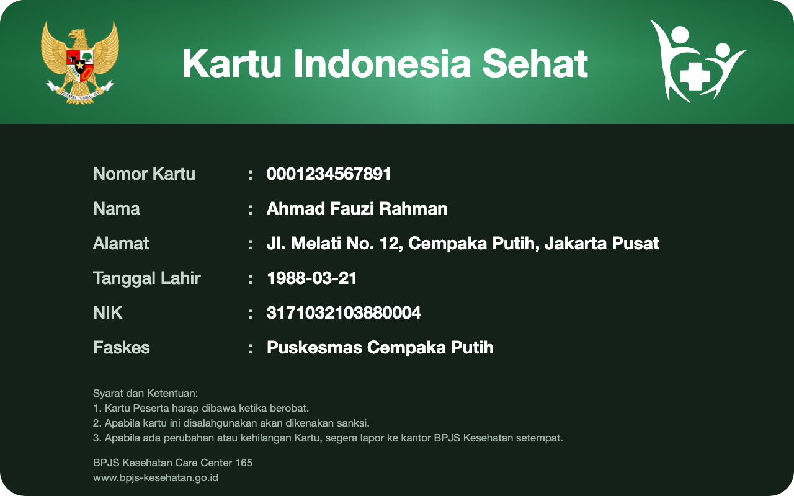

<!-- Sumber: card design supplied by the user, 17 October 2026; tracks/0199, tracks/0204, tracks/0226, tracks/0234 -->

# Kartu Indonesia Sehat {#kartu-indonesia-sehat}

<p class="ekdn-lead" markdown="span">
One credential type worked through from its Rulebook to the card a wallet
draws: the Kartu Indonesia Sehat, the membership card of the national health
insurance that Badan Penyelenggara Jaminan Sosial (BPJS) Kesehatan runs,
issued as an [SD-JWT-based Verifiable Credential (SD-JWT VC) draft -13][ref-i-d-ietf-oauth-sd-jwt-vc].
</p>

!!! note "Informative page"

    This Rulebook is an illustration and is not registered. Its values were
    chosen to show how the fields of [Rulebook structure](../rulebook-structure.md)
    fit together, and none of them has been approved by the Root Authority.
    The addresses under `catalog.trust.go.id` do not exist yet; the files they
    name are shown on this page instead.

## The Rulebook {#kartu-indonesia-sehat-rulebook}

The Rulebook for `id.idctf.kartu-indonesia-sehat.1`, carrying every field
[Rulebook structure](../rulebook-structure.md) lists. It lists `sd-jwt-vc`
alone. It lists no `expiry_date`, because the card it mirrors prints no
validity period.

``` { .json title="rulebook.json" data-format="JSON" }
--8<-- "docs/credential-rulebook/example/kartu-indonesia-sehat/rulebook.json"
```

## Schema {#kartu-indonesia-sehat-schema}

The [JSON Schema 2020-12][ref-json-schema] that [the schema field][rulebook-schema-field] points at.
Issuer Core checks the six type claims against it before it signs.

``` { .json title="schema.json" data-format="JSON" }
--8<-- "docs/credential-rulebook/example/kartu-indonesia-sehat/schema.json"
```

## Display {#kartu-indonesia-sehat-display}

The card a wallet draws, light and dark, and the SD-JWT VC Type Metadata that
[the display field][rulebook-display-field] points at. The Type Metadata
carries both templates and the logo.

[](){ #fig-kartu-indonesia-sehat-light }
[](){ #fig-kartu-indonesia-sehat-dark }

<div class="ekdn-fig-pair" markdown="1">
<figure markdown="1">
  { loading=lazy }
  <figcaption><span class="ekdn-fignum"></span> The Kartu Indonesia Sehat, light template.</figcaption>
</figure>
<figure markdown="1">
  { loading=lazy }
  <figcaption><span class="ekdn-fignum"></span> The Kartu Indonesia Sehat, dark template.</figcaption>
</figure>
</div>

Templates: [`card-light.svg`](kartu-indonesia-sehat/card-light.svg) and
[`card-dark.svg`](kartu-indonesia-sehat/card-dark.svg).

``` { .json title="type-metadata.json" data-format="JSON" }
--8<-- "docs/credential-rulebook/example/kartu-indonesia-sehat/type-metadata.json"
```

## Issued credential {#kartu-indonesia-sehat-issued-credential}

One credential as Issuer Core signs it, and where each of its claims comes
from.

``` { .json title="SD-JWT VC header, payload and disclosure" data-format="SD-JWT VC" }
// header
{ "typ": "dc+sd-jwt", "alg": "ES256", "kid": "did:webvh:QmScid...:bpjs-kesehatan.go.id#issuance-jose-1" }

// payload
{
  "iss": "did:webvh:QmScid...:bpjs-kesehatan.go.id",
  "vct": "id.idctf.kartu-indonesia-sehat.1",
  "cnf": { "jwk": { "kty": "EC", "crv": "P-256",
                    "x": "4Rd7Qm...Ka2", "y": "Vn3Tx8...Ye5" } },
  "_sd": [ "Hq3Lm8...", "Zt6Rb2...", "Wd9Kc4...",
           "Fs1Np7...", "Yg5Ue3...", "Bm8Jx6..." ],
  "_sd_alg": "sha-256",
  "status": { "status_list": { "idx": 481920,
                 "uri": "https://bpjs-kesehatan.go.id/status/kartu-indonesia-sehat-1" } },
  "iat": 1789901520, "exp": 1852973520
}

// disclosure for nama, sent beside the credential
~WyJzYWx0Nzg5IiwibmFtYSIsIkFobWFkIEZhdXppIFJhaG1hbiJd
// decodes to ["salt789","nama","Ahmad Fauzi Rahman"]
```

<figure markdown="1" class="ekdn-table">

| Claim | Comes from |
|---|---|
| `iss` | The issuer the Root Authority authorized for the type in an [Authority Statement][authority-statement], not the Rulebook |
| `vct` | The Rulebook's `id`, the only claim taken from the Rulebook |
| `cnf` | The credential key reported in `attested_keys` of the [Key Attestation][key-attestation] |
| `_sd`, `_sd_alg` | Issuer Core, which hides each of the six type claims behind a digest |
| `status` | The credential's entry in the issuer's [status list][status-list], allocated by Issuer Core, using its Status Manager Component |
| `iat` | The moment Issuer Core signs |
| `exp` | The issuer, within the ceiling the Governance Profile sets, because [a Rulebook carries no technical validity period][what-a-rulebook-does-not-carry] |
| `nomor_kartu` to `faskes` | Disclosures, read from the issuer's source system by Issuer Core, using its Claims Provider Component, and checked against `schema.json`; `tanggal_lahir` is a `full-date` |

</figure>
