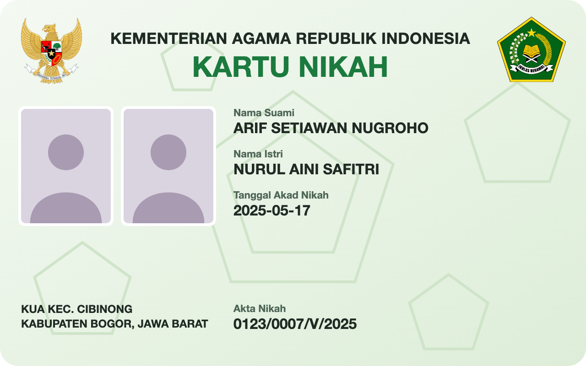
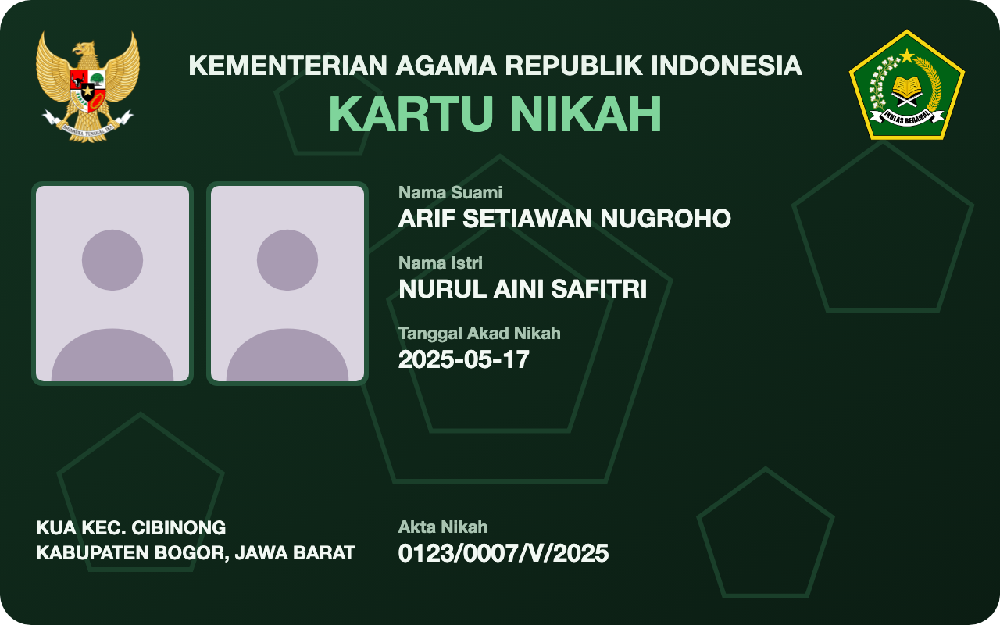

<!-- Sumber: card design supplied by the user, 16 October 2026; tracks/0199, tracks/0204, tracks/0206, tracks/0207, tracks/0208, tracks/0210, tracks/0211, tracks/0215, tracks/0223, tracks/0226, tracks/0320 -->

# Kartu Nikah {#kartu-nikah}

<p class="ekdn-lead" markdown="span">
One credential type worked through from its Rulebook to the card a wallet
draws: the Kartu Nikah, the marriage card of the Ministry of Religious
Affairs, issued as a [W3C Verifiable Credentials Data Model (VCDM) 2.0][ref-vc-data-2-0]
credential.
</p>

!!! note "Informative page"

    This Rulebook is an illustration and is not registered. Its values show
    how the fields of [Rulebook structure](../rulebook-structure.md) fit
    together, and the Root Authority has approved none of them. The addresses
    under `catalog.trust.go.id` do not exist yet, so this page shows the files
    they name.

## The Rulebook {#kartu-nikah-rulebook}

The Rulebook for `id.idctf.kartu-nikah.1` carries every field
[Rulebook structure](../rulebook-structure.md) lists, and its `ldp_vc` entry
names the [JSON-LD 1.1][ref-json-ld] context. It lists `ldp_vc` alone, as
[REQ-CR-055][req-cr-055] requires of a Rulebook that lists that format. It
lists no `expiry_date`, because the card it mirrors carries no validity
period. It carries no photograph either, because
[REQ-CR-082][req-cr-082] fixes a facial image at `restricted` and
[REQ-CR-017][req-cr-017] keeps a `restricted` attribute out of `ldp_vc`. Every
term in the context expands to an Internationalized Resource Identifier (IRI)
under `https://catalog.trust.go.id/vocab/id.idctf.kartu-nikah`; the schema
gives each term's type, and the Type Metadata its labels.

``` { .json title="rulebook.json" data-format="JSON" }
--8<-- "docs/credential-rulebook/example/kartu-nikah/rulebook.json"
```

``` { .json title="context.jsonld" data-format="JSON-LD" }
--8<-- "docs/credential-rulebook/example/kartu-nikah/context.jsonld"
```

## Schema {#kartu-nikah-schema}

These are the [JSON Schema 2020-12][ref-json-schema] that
[the schema field][rulebook-schema-field] points at and the schema over the whole
credential that `credential_schema` points at, as
[the schema in each format][schema-in-each-format] sets out for `ldp_vc`.

``` { .json title="schema.json" data-format="JSON" }
--8<-- "docs/credential-rulebook/example/kartu-nikah/schema.json"
```

``` { .json title="credential-schema.json" data-format="JSON" }
--8<-- "docs/credential-rulebook/example/kartu-nikah/credential-schema.json"
```

## Display {#kartu-nikah-display}

A wallet draws the card, light and dark, from the
[SD-JWT-based Verifiable Credential (SD-JWT VC) draft -13 Type Metadata][ref-i-d-ietf-oauth-sd-jwt-vc]
that [the display field][rulebook-display-field] points at. The Type Metadata
carries both templates and the logo.

[](){ #fig-kartu-nikah-light }
[](){ #fig-kartu-nikah-dark }

<div class="ekdn-fig-pair" markdown="1">
<figure markdown="1">
  { loading=lazy }
  <figcaption><span class="ekdn-fignum"></span> The Kartu Nikah, light template.</figcaption>
</figure>
<figure markdown="1">
  { loading=lazy }
  <figcaption><span class="ekdn-fignum"></span> The Kartu Nikah, dark template.</figcaption>
</figure>
</div>

The templates are [`card-light.svg`](kartu-nikah/card-light.svg) and
[`card-dark.svg`](kartu-nikah/card-dark.svg).

``` { .json title="type-metadata.json" data-format="JSON" }
--8<-- "docs/credential-rulebook/example/kartu-nikah/type-metadata.json"
```

## Issued credential {#kartu-nikah-issued-credential}

This section shows one credential as Issuer Core signs it, and where each of
its parts comes from.

``` { .json title="W3C VCDM 2.0 credential with its Data Integrity proof" data-format="JSON-LD" }
{
  "@context": [
    "https://www.w3.org/ns/credentials/v2",
    "https://catalog.trust.go.id/type-metadata/kartu-nikah-v1/context.jsonld"
  ],
  "type": [ "VerifiableCredential", "KartuNikah" ],
  "issuer": "did:webvh:QmScid...:kemenag.go.id",
  "validFrom": "2026-10-16T09:12:00Z",
  "validUntil": "2027-10-16T09:12:00Z",
  "credentialSubject": {
    "id": "did:key:zDnaeT7k...Qm4",
    "nama_suami": "Arif Setiawan Nugroho",
    "nama_istri": "Nurul Aini Safitri",
    "tanggal_akad": "2025-05-17",
    "nomor_akta_nikah": "0123/0007/V/2025",
    "kua": "KUA Kec. Cibinong",
    "kabupaten_kota": "Kabupaten Bogor",
    "provinsi": "Jawa Barat"
  },
  "credentialStatus": [
    {
      "id": "https://kemenag.go.id/status/kartu-nikah-1-revocation#481920",
      "type": "BitstringStatusListEntry",
      "statusPurpose": "revocation",
      "statusListIndex": "481920",
      "statusListCredential": "https://kemenag.go.id/status/kartu-nikah-1-revocation"
    },
    {
      "id": "https://kemenag.go.id/status/kartu-nikah-1-suspension#481920",
      "type": "BitstringStatusListEntry",
      "statusPurpose": "suspension",
      "statusListIndex": "481920",
      "statusListCredential": "https://kemenag.go.id/status/kartu-nikah-1-suspension"
    }
  ],
  "credentialSchema": {
    "id": "https://catalog.trust.go.id/type-metadata/kartu-nikah-v1/credential-schema.json",
    "type": "JsonSchema",
    "digestSRI": "sha384-ZgGlm2JwrvKbb05pUITOcjghTRr1ImjyhgXstLXKDA/j2LzIwpgUSZwbk7ABXxpn"
  },
  "proof": {
    "type": "DataIntegrityProof",
    "cryptosuite": "ecdsa-rdfc-2019",
    "created": "2026-10-16T09:12:00Z",
    "verificationMethod": "did:webvh:QmScid...:kemenag.go.id#issuance-jose-1",
    "proofPurpose": "assertionMethod",
    "proofValue": "z3FXQjecWufY46...Ve6p"
  }
}
```

<figure markdown="1" class="ekdn-table">

| Part | Comes from |
|---|---|
| `@context` | The VCDM 2.0 context, then the Rulebook's `formats.ldp_vc.context`; a verifier reads both from cache |
| `type` | `VerifiableCredential`, then `KartuNikah`, the Rulebook's `formats.ldp_vc.type` and the type term `context.jsonld` defines. It expands to `https://catalog.trust.go.id/vocab/id.idctf.kartu-nikah#KartuNikah`, an IRI that resolves to this type's catalog page, as [the formats field][rulebook-formats-field] requires of every term |
| `issuer` | The issuer the Root Authority authorized for the type in an [Authority Statement][authority-statement], not the Rulebook |
| `validFrom` | The moment Issuer Core signs |
| `validUntil` | The issuer, within the ceiling the Governance Profile sets, because [a Rulebook carries no technical validity period][what-a-rulebook-does-not-carry] |
| `credentialSubject.id` | The holder's [did:key][holder-one-didkey-per-wallet-installation] |
| `nama_suami` to `provinsi` | The issuer's source system, read by Issuer Core, using its Claims Provider Component, and checked against `schema.json` |
| `credentialStatus` | The credential's two entries in the issuer's [status list][status-list], one for revocation and one for suspension at the same index, allocated by Issuer Core, using its Status Manager Component |
| `credentialSchema` | The Rulebook's `formats.ldp_vc.credential_schema`, with the `digestSRI` of that file |
| `proof` | Issuer Core, signing the [RDFC-1.0][ref-rdfc-1-0] canonical form of the whole document with the issuer's signing key under `ecdsa-rdfc-2019`; `verificationMethod` names that key's [`Multikey`][ref-cid] entry in the issuer's DID Document |

</figure>
