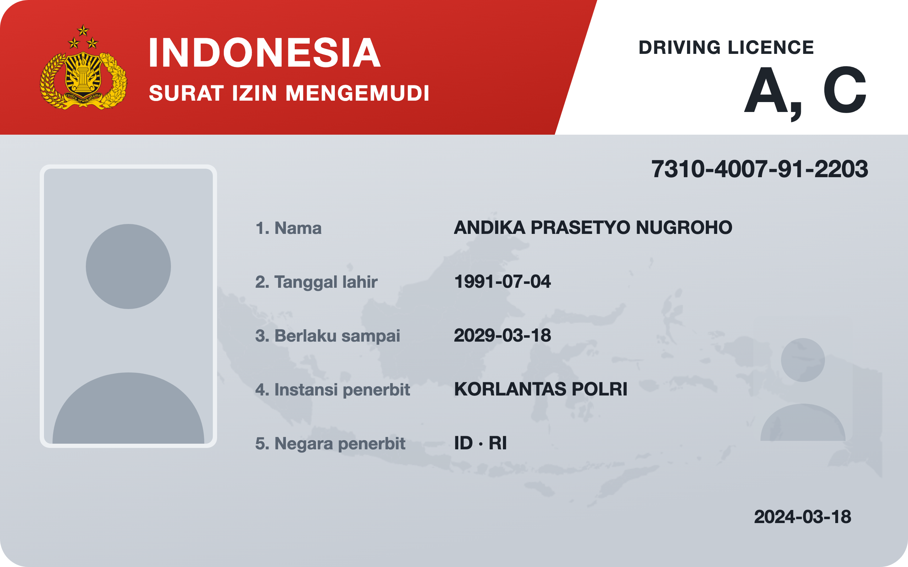
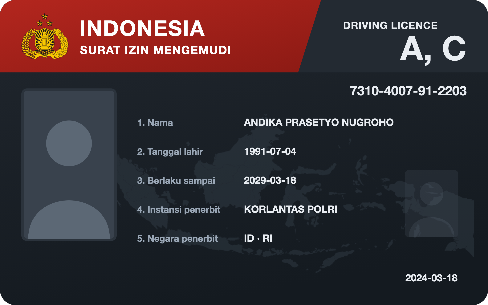

<!-- Sumber: Panduan mdoc, bagian 2 dan Lampiran A; ISO/IEC 18013-5:2021 §7.2; tracks/0199, tracks/0225, tracks/0289, tracks/0292, tracks/0293, tracks/0294, tracks/0295, tracks/0317, tracks/0318, tracks/0341 -->

# SIM {#sim}

<p class="ekdn-lead" markdown="span">
One credential type worked through from its Rulebook to the credential
Issuer Core signs: the Surat Izin Mengemudi (SIM), the driving license of Korps Lalu
Lintas Polri, issued as the mobile driving license (mDL) that
[ISO/IEC 18013-5:2021][ref-iso-18013-5] defines, and the one type here whose
name another body owns.
</p>

!!! note "Informative page"

    This Rulebook is an illustration and is not registered. Its values were
    chosen to show how the fields of [Rulebook structure](../rulebook-structure.md)
    fit together, and none of them has been approved by the Root Authority.
    The addresses under `catalog.trust.go.id` do not exist yet; the files they
    name are shown on this page instead.

## The Rulebook {#sim-rulebook}

The Rulebook for `org.iso.18013.5.1.mDL.1`, carrying every field
[Rulebook structure](../rulebook-structure.md) lists. Three of them follow
from the name belonging to ISO rather than to the ecosystem: the `id` is the
document type ISO defines followed by the version number, as
[REQ-CR-069][req-cr-069] requires; the `docType` keeps ISO's name rather than
repeating the `id`, as [REQ-CR-005][req-cr-005] requires; and the `mdoc`
entry carries `namespace`, because the data elements sit in ISO's namespace
and not in one named after the type, as [REQ-CR-061][req-cr-061] requires.
SIM is the name the credential carries in the wallet and in this catalog;
`org.iso.18013.5.1.mDL` is what a reader asks for on the wire.

It lists `mdoc` alone, because a license is read at the roadside with no
network reaching the reader, as [REQ-CR-018][req-cr-018] requires.
`age_over_18` is derived from `birth_date`, so a merchant checking the age
of a buyer never receives the date itself. `portrait` is `restricted`, which
is what keeps it out of a merchant's reach: a merchant device never carries
a `restricted` attribute, whatever its intermediary was accredited for, as
[RP Intermediary and merchant](../../architecture-framework/roles/rp-intermediary-and-merchant.md)
sets out.

``` { .json title="rulebook.json" data-format="JSON" }
--8<-- "docs/credential-rulebook/example/sim/rulebook.json"
```

## Schema {#sim-schema}

The [JSON Schema 2020-12][ref-json-schema] that [the schema field][rulebook-schema-field]
points at. Issuer Core checks the twelve type claims against it before it
signs. The schema requires every claim, as [REQ-CR-077][req-cr-077] requires
of a type issued in mdoc, and no claim may be absent from the source record:
a SIM with no entry in `driving_privileges` is not a SIM.

``` { .json title="schema.json" data-format="JSON" }
--8<-- "docs/credential-rulebook/example/sim/schema.json"
```

## Display {#sim-display}

The card a wallet draws, light and dark, and the
[SD-JWT VC draft -13 Type Metadata][ref-i-d-ietf-oauth-sd-jwt-vc] that
[the display field][rulebook-display-field] points at. Each claim `path`
names ISO's namespace and then the data element, as
[REQ-CR-074][req-cr-074] requires of a Rulebook that lists `mdoc` alone.

[](){ #fig-sim-light }
[](){ #fig-sim-dark }

<div class="ekdn-fig-pair" markdown="1">
<figure markdown="1">
  { loading=lazy }
  <figcaption><span class="ekdn-fignum"></span> The SIM, light template.</figcaption>
</figure>
<figure markdown="1">
  { loading=lazy }
  <figcaption><span class="ekdn-fignum"></span> The SIM, dark template.</figcaption>
</figure>
</div>

Templates: [`card-light.svg`](sim/card-light.svg) and
[`card-dark.svg`](sim/card-dark.svg).

The design follows the physical SIM: the Polri emblem and the title in a red
band, the driving privileges and the document number beside it, and the
holder's details numbered below. The emblem, the map and the two figures are
drawn into the template, so they are the same on every card; everything in the
numbered list comes from the credential.

Ten of the twelve claims carry an `svg_id`. `portrait` carries none, because
[REQ-CR-071][req-cr-071] allows no placeholder for an image attribute, and
the templates draw a fixed figure where the photo would sit; the wallet shows
the photo from the claim, beside the card. `age_over_18` carries none either:
it is derived from `birth_date`, which the card already shows.
`driving_privileges` is an array of objects in ISO's namespace, and
[REQ-CR-074][req-cr-074] fixes every claim `path` at the namespace and the
attribute, so no path reaches one vehicle category. The template places the
whole claim under *Golongan*, and what appears there is what the wallet
renders for an array.

``` { .json title="type-metadata.json" data-format="JSON" }
--8<-- "docs/credential-rulebook/example/sim/type-metadata.json"
```

## Issued credential {#sim-issued-credential}

One credential as Issuer Core signs it, and where each of its parts comes
from.

``` { .text title="mdoc IssuerSigned and its Mobile Security Object" data-format="CBOR diag" }
// IssuerSigned
{
  "nameSpaces": {
    "org.iso.18013.5.1": [
      24(<< { "digestID": 1203948576, "random": h'3c7e19a4...',
              "elementIdentifier": "family_name",
              "elementValue": "Nugroho" } >>),
      24(<< { "digestID": 418827301, "random": h'a06d52f1...',
              "elementIdentifier": "given_name",
              "elementValue": "Andika Prasetyo" } >>),
      24(<< { "digestID": 1977342610, "random": h'5be840c7...',
              "elementIdentifier": "birth_date",
              "elementValue": 1004("1991-07-04") } >>),
      24(<< { "digestID": 702115948, "random": h'e91f3a6d...',
              "elementIdentifier": "age_over_18",
              "elementValue": true } >>),
      24(<< { "digestID": 1560288417, "random": h'0d4ac2b8...',
              "elementIdentifier": "issue_date",
              "elementValue": 1004("2024-03-18") } >>),
      24(<< { "digestID": 893710264, "random": h'7f2b6e05...',
              "elementIdentifier": "expiry_date",
              "elementValue": 1004("2029-03-18") } >>),
      ...
      24(<< { "digestID": 1325590837, "random": h'b48c0e9a...',
              "elementIdentifier": "driving_privileges",
              "elementValue": [
                { "vehicle_category_code": "A",
                  "issue_date": 1004("2024-03-18"),
                  "expiry_date": 1004("2029-03-18") },
                { "vehicle_category_code": "C",
                  "issue_date": 1004("2024-03-18"),
                  "expiry_date": 1004("2029-03-18") }
              ] } >>),
      24(<< { "digestID": 264019583, "random": h'c3a95d72...',
              "elementIdentifier": "portrait",
              "elementValue": h'ffd8ffe000104a464946...' } >>)
    ]
  },
  "issuerAuth": [
    h'a10126',                          // protected: {1: -7}, ES256
    { 33: h'308202ac308202...' },       // unprotected: x5chain, the Document Signer Certificate
    24(<< MobileSecurityObject >>),     // payload
    h'5e0a93c1d77f2b48...'              // signature
  ]
}

// MobileSecurityObject
{
  "version": "1.0",
  "digestAlgorithm": "SHA-256",
  "valueDigests": {
    "org.iso.18013.5.1": {
      1203948576: h'9a41c07e...', 418827301: h'27d3b6f0...',
      1977342610: h'e5087a1c...',
      ...
      264019583: h'6cf2915d...'
    }
  },
  "deviceKeyInfo": {
    "deviceKey": { 1: 2, -1: 1, -2: h'4d9e27b1...', -3: h'a83f60c4...' }
  },
  "docType": "org.iso.18013.5.1.mDL",
  "validityInfo": {
    "signed": 0("2026-10-18T03:12:00Z"),
    "validFrom": 0("2026-10-18T03:12:00Z"),
    "validUntil": 0("2027-10-18T03:12:00Z")
  },
  "status": {
    "status_list": { "idx": 207415,
                     "uri": "https://korlantas.polri.go.id/status/sim-1" }
  }
}
```

<figure markdown="1" class="ekdn-table">

| Part | Comes from |
|---|---|
| `nameSpaces` | One `IssuerSignedItem` per type claim, in ISO's namespace `org.iso.18013.5.1`, which the Rulebook's `mdoc` entry names. Each value is read from the issuer's source system by Issuer Core, using its Claims Provider Component, and checked against `schema.json`; `birth_date`, `issue_date` and `expiry_date` are `full-date`, and `portrait` is the decoded JPEG bytes, as [the table of mdoc encodings][tbl-mdoc-encodings] sets out. `driving_privileges` is an array of maps, one per vehicle category, with its dates as `full-date` too |
| `random` | Issuer Core, sixteen fresh bytes per item, so a verifier cannot guess a value from its digest |
| `age_over_18` | Issuer Core, computed from `birth_date` at signing, as the Rulebook's `derived_from` names |
| `issue_date`, `expiry_date` | The physical license, whose administrative validity the Rulebook's `legal_basis` sets |
| `x5chain` | The issuer's Document Signer Certificate, chained to the Issuer Root CA, as [Document Signer Certificate][ts-5-04-document-signer-certificate] sets out; TS-5-04 shows [the one Korps Lalu Lintas Polri holds][ts-5-04-document-signer-certificate-of-the-sim-issuer]. The issuer is the one the Root Authority authorized for the type in an [Authority Statement][authority-statement], not the Rulebook |
| `valueDigests` | Issuer Core, the SHA-256 of each tagged item, so the holder can disclose one data element and withhold the rest |
| `deviceKeyInfo` | The credential key reported in `attested_keys` of the [Key Attestation][key-attestation], as a COSE key |
| `docType` | The Rulebook's `formats.mdoc.docType`, ISO's name rather than the `id` |
| `validityInfo` | `signed` and `validFrom` are the moment Issuer Core signs. `validUntil` is set by the issuer, within the ceiling the Governance Profile sets, because [a Rulebook carries no technical validity period][what-a-rulebook-does-not-carry], and never past `expiry_date` |
| `status` | The credential's entry in the issuer's [status list][status-list], allocated by Issuer Core, using its Status Manager Component |
| `issuerAuth` signature | Issuer Core, signing the Mobile Security Object with the key of its Document Signer Certificate |

</figure>

## Reading a license from another country {#sim-reading-one-from-another-country}

A reader in the ecosystem meets two mDLs under this one document type: the
SIM, whose Document Signer Certificate chains to the Issuer Root CA, and a
license from a recognized authority abroad, whose root reaches the reader
through the Verified Issuer Certificate Authority List (VICAL) that
[Issuing and validating the X.509 certificates and the VICAL](../../technical-specifications/issuing-and-validating-the-x509-certificates-and-the-vical.md)
publishes. The Rulebook governs what may be asked for in both cases, because
a permission names a credential type and the type is the same.

What the foreign authority writes into its own license is its own affair.
This Rulebook binds the attributes an entity in this ecosystem may register
a use over, and the minimization class each of them takes.

The card is where the two part company. A wallet draws the templates above,
and the name SIM, only for a license whose signer chains to the Issuer Root
CA, as [REQ-TS-5-10-134][req-ts-5-10-134] requires. A license admitted through the
VICAL is drawn plainly, named from its own `issuing_authority` and
`issuing_country`, as [REQ-TS-5-10-136][req-ts-5-10-136] and [REQ-TS-5-10-137][req-ts-5-10-137] require: the design belongs
to Korps Lalu Lintas Polri, and a German license wearing it would say
something untrue about who issued it.
